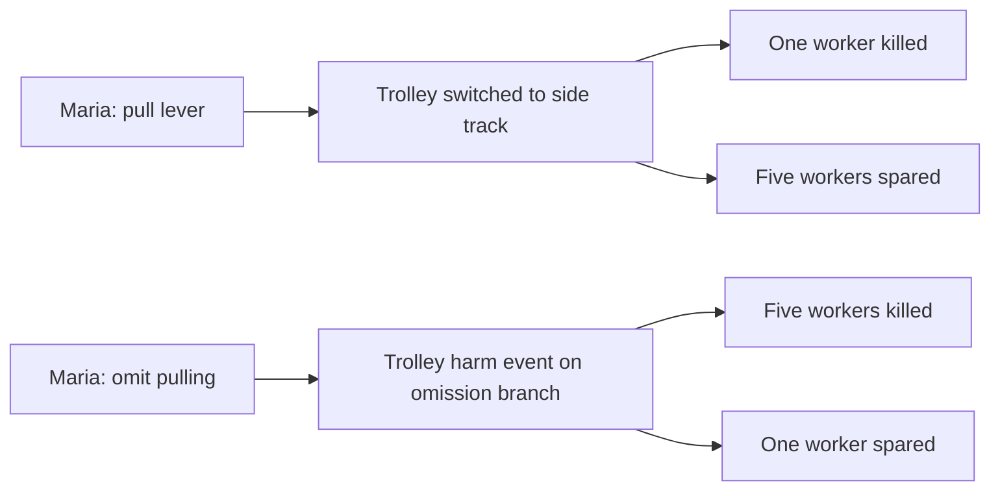

# Lean branch representation: trolley and medicine comparison

Review of the current saved viewer exports, 2026-10-14. This is a design proposal;
no accepted world, agent input, or validator has been changed.

## Observed cost

| Current artifact | Medicine allocation | Explicit trolley |
| --- | ---: | ---: |
| Cloze slots in the applicable macro | 19 (5 required) | 10 (5 required) |
| Party records | 4 | 7 |
| Action records | 2 | 2 |
| Effect records | 8 | 8 |
| Condition records | 0 | 2 |
| Scene proposition records | 0 | 3 |
| Rendered nodes before source-ledger additions | 14 | 22 |
| Recorded causal links | 6 | 6 |

Sources: `frontend/dist/data/medicine.json`, `frontend/dist/data/trolley.json`,
and the macro definitions in `blueprint_cloze_chooser.py`. Counts describe these
saved graphs, not every candidate or later code version.

The trolley's extra nodes partly preserve real information: a trolley, instrument,
two locations, and source scene assertions. Its Cloze is not larger than allocation.
The allocation macro has overlapping assignment, transfer, branch-sentence,
outcome, and hedge blanks; not every blank adds independent information.

Both graphs repeat each action as its direct effect. In trolley, A0/E1 both read
`pulls the lever`; A1/E5 both read `does not`. E5/E6 then repeat that same remnant
on the same party, with DIRECT/DOWNSTREAM bookkeeping as their main distinction.
E2 is useful: it says the trolley is switched to the side track. E6 supplies no
comparable physical transition. It is an unsatisfactory mechanism placeholder.

## Keep the distinctions, remove repeated event descriptions

The semantic unit should be a branch containing an intervention or omission,
an optional physical/resource transition, and separately scoped outcomes. Actors,
instruments, process bearers, and affected parties are roles referencing shared
entities. An event and its roles need not become separate events merely because
the native schema stores them in several record types.

- **Choice:** pull versus omit pulling. Expand the omission's display label from
  its recorded antecedent, retaining the remnant and reconstruction provenance.
- **Mechanism:** an explicit trolley-route transition; or a source-supported
  trolley event on the omission branch. Do not manufacture "continues on the
  main track" solely to satisfy a parent requirement.
- **Outcomes:** harm to one / survival of five, and harm to five / survival of one.
  Keep the two groups, cardinalities, branch ownership, and explicit benefits.
- **Scene:** worker locations, the trolley's initial heading, and inability to
  stop it remain in a compact context section with inspectable evidence.
- **Scope:** conditions and probabilities attach to branches/outcomes. Show
  them as labels or badges by default; expose operator nodes when scope itself
  is contested or independently important.

Illustrative reader view below is a design, not a graph claimed to have been
generated or admitted. Named process nodes summarize branch-specific source
events; they do not assert both branches occurred.

Initial heading, tracks, instrument, and group membership can remain visible as
context/roles without eight more event boxes. Keep role links available on demand.
Do not combine killing and sparing into a single effect with one polarity.

## Why the process remains

Physical causation and moral responsibility are separate questions. A trolley
process distinguishes the instrument and moving hazard from Maria and the harmed
workers. It must not insulate Maria from responsibility or decide that omission
is innocent. Frameworks should still receive intervention/omission, agency,
control, causal participation, and consequences.

A pushing variant adds an explicit person-intervention event and its relationship
to the trolley process when supported. It must preserve whether a person is used
as a means, rather than collapse every mechanism into "five versus one". Additional
events are justified by distinct participants, scope, intermediate state, timing,
or a source-supported causal role—not by a universal minimum chain length.

## Bounded implementation sequence

1. **Reader projection first.** Bundle action/direct-effect aliases into one
   displayed intervention, with every underlying ID inspectable. Move routine
   scope and scene copies into badges/context. Retain the full native graph.
   Keep E6 visibly marked as repeated/underspecified; do not silently re-label it
   as an established trolley-route state.
2. **Normalize the compiler's branch input.** Reuse parser evidence for actor,
   participants, quantity, and condition boundaries. Cloze proposes the branch's
   intervention, stated transition, and outcomes; it should not answer the same
   branch separately as assignment, sentence, hedge, and transfer. Accept old
   macro answers through an adapter while comparing outputs on saved fixtures.
3. **Separate semantic events from native expansion.** One source-backed event
   identity can have multiple actor/patient/process perspectives. Preserve those
   roles in a lean representation; expand into the existing Parliament schema
   at its boundary. No new dilemma-specific schema or invented intermediate
   event is necessary. Confirm native acceptance before changing live defaults.
4. **Measure preservation and burden.** Compare visible boxes, unique semantic
   events, repeated descriptions, model-filled slots, and admission separately.
   Require preservation of counts, omitted-patient death, explicit survival,
   probabilities, promise provenance, scope, and mechanism. Add a pushing probe
   so simplification cannot erase morally relevant mechanism differences.

The local native checkout referenced by the runner is currently absent, so native
schema simplification cannot be validated here yet. Existing saved admission is
evidence about those snapshots, not proof a lean new compiler passes admission.

## First implemented increment, 2026-10-14

Omission Cloze now has 15 slots: the prior ten plus separate branch patients,
branch counts, and the operated instrument. Actor/process/patient/instrument
answers are normalized to copied local noun phrases. Actions stop before attached
relative mechanisms; harm answers stop at the consequence rather than swallowing
the conditional. Raw model completions and supporting hypotheses remain available.
Parser recovery fills the new roles for older saved answers. Missing or ambiguous
counts remain missing rather than inferred from bare singular wording.

The downstream macro consumes the patient/count/instrument fields and exports
branch bindings with parser support IDs. Native world schema remains 1.4; this is
an input-normalization increment, not a replacement Parliament event schema.

The reader projection bundles only single neutral, certain direct effects whose
wording matches their action and which carry no independent scope qualifiers.
Different event text or qualified effects stay separate. Ungoverned scene
assertions move to clickable context; governed propositions remain graph nodes.
All original records and IDs stay available. Browser verification showed trolley
17 compact boxes / 22 full boxes, and the bundled A0/E1 inspector exposed both
records. No rendering errors were logged.
