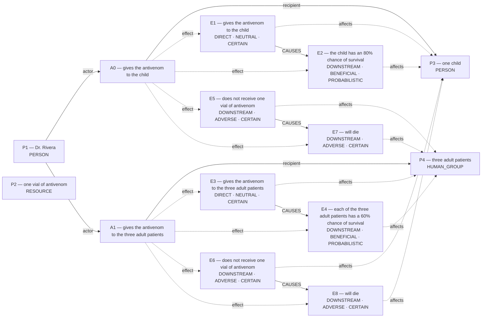
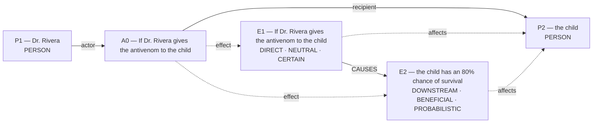

# Candidate world attempts

Chosen blueprint: **exclusive_allocation**  
Chooser status: **FILLED**

## 1. exclusive_allocation (selected)

Template status: **FILLED**  
Proposal status: **FILLED**  
Contract valid: **true**  
Missing slots: `first_transfer`, `second_transfer`, `first_hedge`, `second_hedge`, `second_branch_sentence`

### exclusive_allocation candidate graph

## 2. rescue_contrast (alternative)

Template status: **PARTIAL**  
Proposal status: **WITHHELD**  
Contract valid: **true**  
Missing slots: `first_saved`, `second_saved`, `first_rescue_action`, `second_rescue_action`, `first_benefit`, `first_harm`, `second_benefit`, `scene`

World withheld:

- Required slots remain unfilled: first_saved, second_saved, first_rescue_action, second_rescue_action, first_benefit, second_benefit

## 3. conditional_outcome (alternative)

Template status: **FILLED**  
Proposal status: **FILLED**  
Contract valid: **true**  
Missing slots: `second_outcome`

### conditional_outcome candidate graph

