# Logic_Puzzles claim/conflict projection

Read-only projection. Native records remain attributed; evidence links do not establish whole-record correctness.

```mermaid
flowchart LR
    n0["WORLD_EFFECT: Ada gives the medicine to Ben"]
    n1["WORLD_EFFECT: Ben has a 95% chance of survival"]
    n2["WORLD_EFFECT: Ada gives the medicine to Cara"]
    n3["WORLD_EFFECT: Cara has a 5% chance of survival"]
    n4["WORLD_EFFECT: does not receive one dose of medicine"]
    n5["WORLD_EFFECT: does not receive one dose of medicine"]
    n6["WORLD_EFFECT: will die"]
    n7["WORLD_EFFECT: will die"]
    n8["PROPOSITION: Ada gives the medicine to Ben; affected subject: Ben"]
    n9["PROPOSITION: Ben has a 95% chance of survival; affected subject: Ben; modality: PROBABILISTIC"]
    n10["PROPOSITION: 95% chance — Ben has a 95% chance of survival"]
    n11["PROPOSITION: Ada gives the medicine to Cara; affected subject: Cara"]
    n12["PROPOSITION: Cara has a 5% chance of survival; affected subject: Cara; modality: PROBABILISTIC"]
    n13["PROPOSITION: 5% chance — Cara has a 5% chance of survival"]
    n14["PROPOSITION: does not receive one dose of medicine; affected subject: Cara; magnitude or qualifier: one"]
    n15["PROPOSITION: does not receive one dose of medicine; affected subject: Ben; magnitude or qualifier: one"]
    n16["PROPOSITION: will die; affected subject: Cara"]
    n17["PROPOSITION: will die; affected subject: Ben"]
    n18["PROPOSITION: A clinic has one dose of medicine."]
    n19["PROPOSITION: Ada can give the medicine to Ben or Cara, but not both."]
    n20["PROPOSITION: The patient who does not get the medicine will die."]
    n21["PROPOSITION: If Ada gives the medicine to Ben, Ben has a 95% chance of survival."]
    n22["PROPOSITION: If Ada gives the medicine to Cara, Cara has a 5% chance of survival."]
    n23["PROPOSITION: Ben has a 95% chance of survival; affected subject: Ben; modality: PROBABILISTIC"]
    n24["PROPOSITION: Cara has a 5% chance of survival; affected subject: Cara; modality: PROBABILISTIC"]
    n25["PROPOSITION: Ben has a 95% chance of survival; affected subject: Ben; modality: PROBABILISTIC"]
    n26["PROPOSITION: Cara has a 5% chance of survival; affected subject: Cara; modality: PROBABILISTIC"]
    n27["PROPOSITION: Ada can give the medicine to Ben or Cara, but not both."]
    n28["PROPOSITION: Ben has a 95% chance of survival; affected subject: Ben; modality: PROBABILISTIC"]
    n29["PROPOSITION: Cara has a 5% chance of survival; affected subject: Cara; modality: PROBABILISTIC"]
    n30["CLAIM: utilitarian: A0 assessment"]
    n31["CLAIM: utilitarian: A0 assessment"]
    n32["CLAIM: utilitarian: A0 assessment"]
    n33["CLAIM: utilitarian: A0 assessment"]
    n34["CLAIM: utilitarian: A1 assessment"]
    n35["CLAIM: utilitarian: A1 assessment"]
    n36["CLAIM: utilitarian: A1 assessment"]
    n37["CLAIM: utilitarian: A1 assessment"]
    n38["CLAIM: deontological: A0 PERMISSIBLE"]
    n39["FRAMEWORK_COMMITMENT: imperfect duty of beneficence"]
    n40["FRAMEWORK_COMMITMENT: aid others effectively when possible"]
    n41["CLAIM: deontological: A1 PROHIBITED"]
    n42["FRAMEWORK_COMMITMENT: choosing far weaker aid neglects duty"]
    n43["UNRESOLVED_CONFLICT: A0 competing protected party lacks current-run action grounding"]
    n44["CLAIM: care: A0 RESPONSIVE"]
    n45["FRAMEWORK_COMMITMENT: professional duty of competent care"]
    n46["FRAMEWORK_COMMITMENT: ACUTE_DEPENDENCY"]
    n47["CLAIM: care: A1 MIXED"]
    n48["UNRESOLVED_CONFLICT: A0 competing Care claim remains contested"]
    n49["UNRESOLVED_CONFLICT: A1 competing Care claim remains contested"]
    n38 -->|"DEPENDENCY"| n25
    n38 -->|"DEPENDENCY"| n26
    n39 -->|"SUPPORT"| n38
    n40 -->|"SUPPORT"| n38
    n41 -->|"DEPENDENCY"| n25
    n41 -->|"DEPENDENCY"| n26
    n39 -->|"SUPPORT"| n41
    n42 -->|"SUPPORT"| n41
    n0 -->|"SUPPORT"| n44
    n1 -->|"SUPPORT"| n44
    n44 -->|"DEPENDENCY"| n28
    n44 -->|"DEPENDENCY"| n29
    n45 -->|"SUPPORT"| n44
    n46 -->|"SUPPORT"| n44
    n2 -->|"SUPPORT"| n47
    n3 -->|"SUPPORT"| n47
    n47 -->|"DEPENDENCY"| n28
    n47 -->|"DEPENDENCY"| n29
    n45 -->|"SUPPORT"| n47
    n46 -->|"SUPPORT"| n47
```

Proposed review queue (at most two issues):

- A0 competing protected party lacks current-run action grounding
- A0 competing Care claim remains contested
