# Logic_Puzzles claim/conflict projection

Read-only projection. Native records remain attributed; evidence links do not establish whole-record correctness.

```mermaid
flowchart LR
    n0["WORLD_EFFECT: Ada gives the medicine to Ben"]
    n1["WORLD_EFFECT: Ben has a 95% chance of survival"]
    n2["WORLD_EFFECT: Ada gives the medicine to Cara"]
    n3["WORLD_EFFECT: Cara has a 5% chance of survival"]
    n4["WORLD_EFFECT: does not receive one dose of medicine"]
    n5["WORLD_EFFECT: does not receive one dose of medicine"]
    n6["WORLD_EFFECT: will die"]
    n7["WORLD_EFFECT: will die"]
    n8["PROPOSITION: Ada gives the medicine to Ben; affected subject: Ben"]
    n9["PROPOSITION: Ben has a 95% chance of survival; affected subject: Ben; modality: PROBABILISTIC"]
    n10["PROPOSITION: 95% chance — Ben has a 95% chance of survival"]
    n11["PROPOSITION: Ada gives the medicine to Cara; affected subject: Cara"]
    n12["PROPOSITION: Cara has a 5% chance of survival; affected subject: Cara; modality: PROBABILISTIC"]
    n13["PROPOSITION: 5% chance — Cara has a 5% chance of survival"]
    n14["PROPOSITION: does not receive one dose of medicine; affected subject: Cara; magnitude or qualifier: one"]
    n15["PROPOSITION: does not receive one dose of medicine; affected subject: Ben; magnitude or qualifier: one"]
    n16["PROPOSITION: will die; affected subject: Cara"]
    n17["PROPOSITION: will die; affected subject: Ben"]
    n18["PROPOSITION: A clinic has one dose of medicine."]
    n19["PROPOSITION: Ada can give the medicine to Ben or Cara, but not both."]
    n20["PROPOSITION: The patient who does not get the medicine will die."]
    n21["PROPOSITION: If Ada gives the medicine to Ben, Ben has a 95% chance of survival."]
    n22["PROPOSITION: If Ada gives the medicine to Cara, Cara has a 5% chance of survival."]
    n23["PROPOSITION: Ben has a 95% chance of survival; affected subject: Ben; modality: PROBABILISTIC"]
    n24["PROPOSITION: Cara has a 5% chance of survival; affected subject: Cara; modality: PROBABILISTIC"]
    n25["PROPOSITION: Ben has a 95% chance of survival; affected subject: Ben; modality: PROBABILISTIC"]
    n26["PROPOSITION: Cara has a 5% chance of survival; affected subject: Cara; modality: PROBABILISTIC"]
    n27["PROPOSITION: Ada can give the medicine to Ben or Cara, but not both."]
    n28["PROPOSITION: Cara are entrusted to the decision maker"]
    n29["PROPOSITION: Ben are entrusted to the decision maker"]
    n30["PROPOSITION: Ben has a 95% chance of survival; affected subject: Ben; modality: PROBABILISTIC"]
    n31["PROPOSITION: Cara has a 5% chance of survival; affected subject: Cara; modality: PROBABILISTIC"]
    n32["CLAIM: utilitarian: A0 assessment"]
    n33["CLAIM: utilitarian: A0 assessment"]
    n34["CLAIM: utilitarian: A0 assessment"]
    n35["CLAIM: utilitarian: A0 assessment"]
    n36["CLAIM: utilitarian: A1 assessment"]
    n37["CLAIM: utilitarian: A1 assessment"]
    n38["CLAIM: utilitarian: A1 assessment"]
    n39["CLAIM: utilitarian: A1 assessment"]
    n40["CLAIM: care: A0 RESPONSIVE"]
    n41["FRAMEWORK_COMMITMENT: controller must respond competently"]
    n42["FRAMEWORK_COMMITMENT: ACUTE_DEPENDENCY"]
    n43["CLAIM: care: A1 NEGLECTFUL"]
    n44["UNRESOLVED_CONFLICT: A0 competing Care claim remains contested"]
    n45["UNRESOLVED_CONFLICT: A1 competing Care claim remains contested"]
    n32 -->|"DEPENDENCY"| n23
    n32 -->|"DEPENDENCY"| n24
    n33 -->|"DEPENDENCY"| n23
    n33 -->|"DEPENDENCY"| n24
    n34 -->|"DEPENDENCY"| n23
    n34 -->|"DEPENDENCY"| n24
    n35 -->|"DEPENDENCY"| n23
    n35 -->|"DEPENDENCY"| n24
    n36 -->|"DEPENDENCY"| n23
    n36 -->|"DEPENDENCY"| n24
    n37 -->|"DEPENDENCY"| n23
    n37 -->|"DEPENDENCY"| n24
    n38 -->|"DEPENDENCY"| n23
    n38 -->|"DEPENDENCY"| n24
    n39 -->|"DEPENDENCY"| n23
    n39 -->|"DEPENDENCY"| n24
    n0 -->|"SUPPORT"| n40
    n1 -->|"SUPPORT"| n40
    n41 -->|"SUPPORT"| n40
    n42 -->|"SUPPORT"| n40
    n2 -->|"SUPPORT"| n43
    n3 -->|"SUPPORT"| n43
    n41 -->|"SUPPORT"| n43
    n42 -->|"SUPPORT"| n43
```

Proposed review queue (at most two issues):

- A0 competing Care claim remains contested
- A1 competing Care claim remains contested
