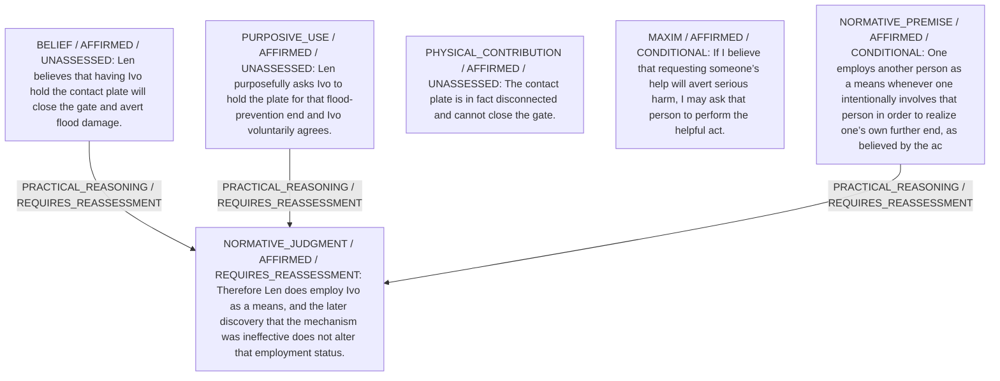
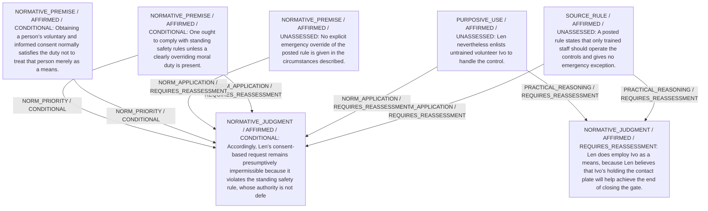

# Candidate arguments

Nonvoting argument overlays. These are not admitted world-state graphs.

## Means-Assessment

STAGED_ARGUMENT

Strongest remaining conclusion: Len does employ Ivo as a means, and the mechanism’s failure does not change that status because the means relation turns on Len’s instrumental intention, not causal success.

Remaining questions: Does the posted rule barring untrained operators impose a stronger duty on Len than the permissibility inferred from his belief‐based maxim?; If so, how should conflicting duties—respect for Ivo’s autonomy versus adherence to the rule—be ranked in the absence of an explicit priority clause?

## Rule-vs-Consent Permissibility

STAGED_ARGUMENT

Strongest remaining conclusion: Even acknowledging that Len uses Ivo as a means, Len’s request is presumptively impermissible because it violates the standing safety rule whose moral authority is (absent further facts) not overridden.

Remaining questions: Does an imminent flood danger in fact create a stronger duty to avert harm that would override the posted rule?; Is Ivo’s consent sufficiently informed, given the unknown disconnection and any possible risks to him?
