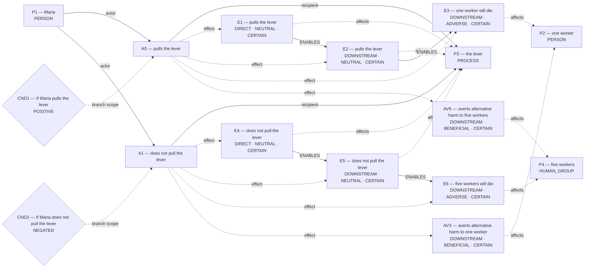
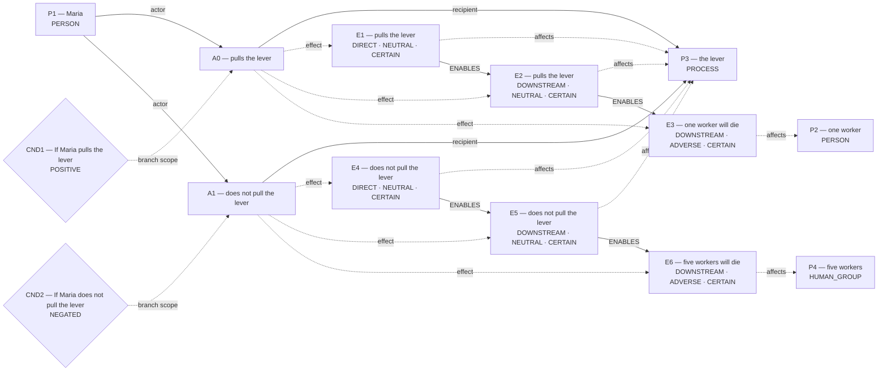
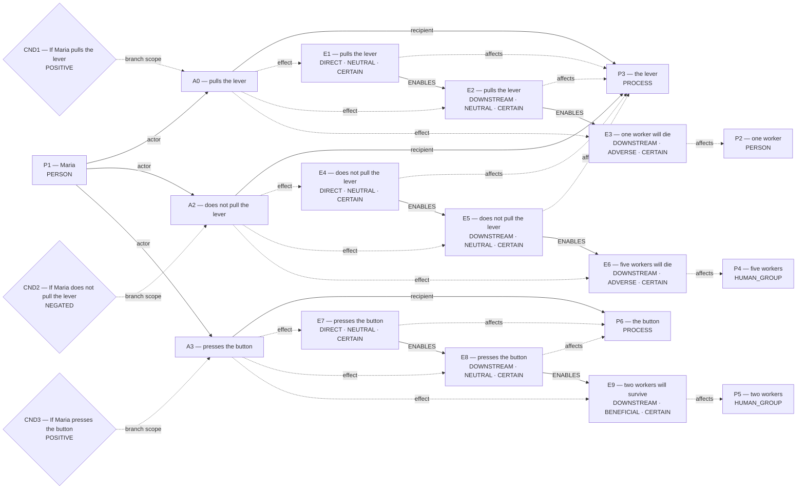

# Candidate world attempts

Chosen blueprint: **conditional_outcome**  
Chooser status: **FILLED**

## 1. conditional_outcome (selected)

Template status: **FILLED**  
Proposal status: **FILLED**  
Contract valid: **true**  
Missing slots: none

### conditional_outcome candidate graph



Hypothesis overlay (not submitted as world effects):

- `AV3`: averts alternative harm to one worker; unresolved_derivation_assumptions, unsupported_outcome_transformation, hypothesized_averted_harm
- `AV6`: averts alternative harm to five workers; unresolved_derivation_assumptions, unsupported_outcome_transformation, hypothesized_averted_harm

### Supported core for admission



Native admission:

```json
{
  "blueprint_id": "conditional_outcome",
  "rank": 0,
  "candidate_path": "diagnostics/blueprint_amendment_three_branches/admission_attempts/01_conditional_outcome/candidate.json",
  "overlay_path": "diagnostics/blueprint_amendment_three_branches/admission_attempts/01_conditional_outcome/hypothesis_overlay.json",
  "status": "REJECTED",
  "returncode": 1,
  "error": "Traceback (most recent call last):\n  File \"/var/folders/n8/ljhm3wm554j1rvxbx9vdvw600000gn/T/tmpwr5f_wuh/admit_blueprint.py\", line 27, in <module>\n    parse_world_model(\n  File \"/private/tmp/parliament-smoke-614af0c/global_workspace/world_state.py\", line 3120, in parse_world_model\n    raise WorldModelValidationError(\nglobal_workspace.world_validation.WorldModelValidationError: A0 omits quantity-bearing consequence 'two workers will survive'; admit a matching effect that records source quantities ['two']\n"
}
```

## 0.9. conditional_outcome (alternative)

Template status: **FILLED**  
Proposal status: **FILLED**  
Contract valid: **true**  
Missing slots: none

### conditional_outcome candidate graph


Native admission:

```json
{
  "blueprint_id": "conditional_outcome",
  "rank": -0.1,
  "candidate_path": "diagnostics/blueprint_amendment_three_branches/admission_attempts/00_conditional_outcome/candidate.json",
  "overlay_path": "diagnostics/blueprint_amendment_three_branches/admission_attempts/00_conditional_outcome/hypothesis_overlay.json",
  "status": "REJECTED",
  "returncode": 1,
  "error": "Traceback (most recent call last):\n  File \"/var/folders/n8/ljhm3wm554j1rvxbx9vdvw600000gn/T/tmpwr5f_wuh/admit_blueprint.py\", line 27, in <module>\n    parse_world_model(\n  File \"/private/tmp/parliament-smoke-614af0c/global_workspace/world_state.py\", line 3120, in parse_world_model\n    raise WorldModelValidationError(\nglobal_workspace.world_validation.WorldModelValidationError: typed world actions must cover every canonical action exactly once; E7 cites unknown action A3; E8 cites unknown action A3; E9 cites unknown action A3; causal_link[4] lacks a valid owning action_id; causal_link[5] lacks a valid owning action_id\n"
}
```

## 2. flexible_graph (alternative)

Template status: **FILLED**  
Proposal status: **FILLED**  
Contract valid: **true**  
Missing slots: none

### flexible_graph candidate graph



Native admission:

```json
{
  "blueprint_id": "flexible_graph",
  "rank": 1,
  "candidate_path": "diagnostics/blueprint_amendment_three_branches/admission_attempts/02_flexible_graph/candidate.json",
  "overlay_path": "diagnostics/blueprint_amendment_three_branches/admission_attempts/02_flexible_graph/hypothesis_overlay.json",
  "status": "REJECTED",
  "returncode": 1,
  "error": "Traceback (most recent call last):\n  File \"/var/folders/n8/ljhm3wm554j1rvxbx9vdvw600000gn/T/tmpwr5f_wuh/admit_blueprint.py\", line 27, in <module>\n    parse_world_model(\n  File \"/private/tmp/parliament-smoke-614af0c/global_workspace/world_state.py\", line 3120, in parse_world_model\n    raise WorldModelValidationError(\nglobal_workspace.world_validation.WorldModelValidationError: typed world actions must cover every canonical action exactly once; E7 cites unknown action A3; E8 cites unknown action A3; E9 cites unknown action A3; causal_link[4] lacks a valid owning action_id; causal_link[5] lacks a valid owning action_id\n"
}
```
