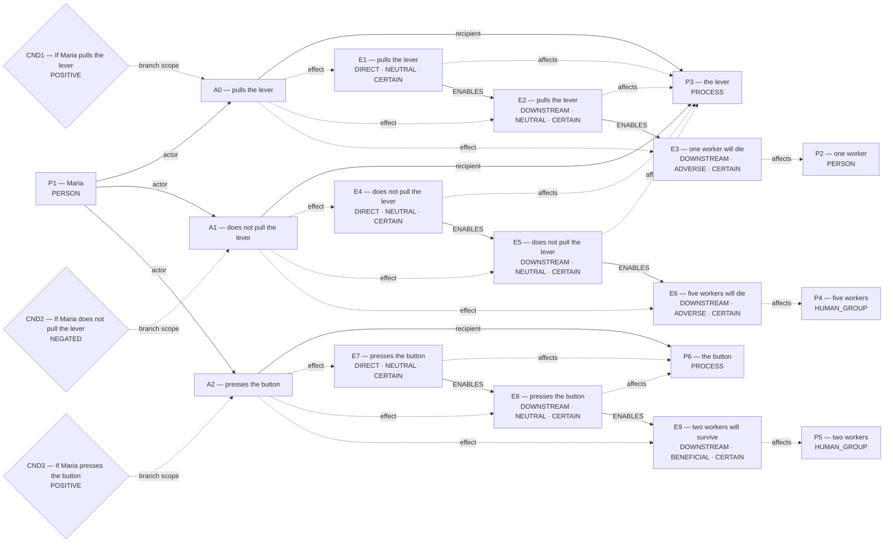
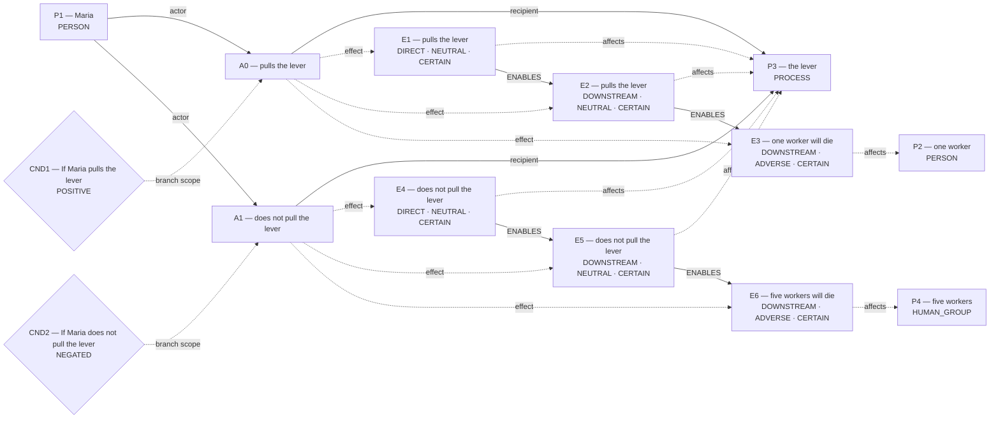

# Candidate world attempts

Chosen blueprint: **conditional_outcome**  
Chooser status: **FILLED**

## 1. conditional_outcome (selected; amended)

Template status: **FILLED**  
Proposal status: **FILLED**  
Contract valid: **true**  
Missing slots: none

### conditional_outcome candidate graph



Native admission:

```json
{
  "blueprint_id": "conditional_outcome",
  "rank": -0.1,
  "candidate_path": "diagnostics/blueprint_amendment_three_branches_final/admission_attempts/00_conditional_outcome/candidate.json",
  "overlay_path": "diagnostics/blueprint_amendment_three_branches_final/admission_attempts/00_conditional_outcome/hypothesis_overlay.json",
  "status": "ADMITTED",
  "admission": {
    "status": "COMMITTED",
    "world_model_status": "COMMITTED",
    "effects": 9,
    "causal_links": 6,
    "frozen_trace_valid": true,
    "fingerprint_sha256": "b3461c2d5330c6e966dc1487eb775451c976874090506ee6750d87273393ea2c"
  },
  "trace_path": "diagnostics/blueprint_amendment_three_branches_final/admission_attempts/00_conditional_outcome/frozen_world_trace.json",
  "variant": "amended"
}
```

## 2. conditional_outcome (alternative; baseline)

Template status: **FILLED**  
Proposal status: **FILLED**  
Contract valid: **true**  
Missing slots: none

### conditional_outcome candidate graph



Native admission:

```json
{
  "blueprint_id": "conditional_outcome",
  "rank": 0,
  "candidate_path": "diagnostics/blueprint_amendment_three_branches_final/admission_attempts/01_conditional_outcome/candidate.json",
  "overlay_path": "diagnostics/blueprint_amendment_three_branches_final/admission_attempts/01_conditional_outcome/hypothesis_overlay.json",
  "status": "REJECTED",
  "returncode": 1,
  "error": "Traceback (most recent call last):\n  File \"/var/folders/n8/ljhm3wm554j1rvxbx9vdvw600000gn/T/tmp_i3bpzmw/admit_blueprint.py\", line 27, in <module>\n    parse_world_model(\n  File \"/private/tmp/parliament-smoke-614af0c/global_workspace/world_state.py\", line 3120, in parse_world_model\n    raise WorldModelValidationError(\nglobal_workspace.world_validation.WorldModelValidationError: A0 omits quantity-bearing consequence 'two workers will survive'; admit a matching effect that records source quantities ['two']\n",
  "variant": "baseline"
}
```

## 3. flexible_graph (alternative; flexible)

Template status: **FILLED**  
Proposal status: **FILLED**  
Contract valid: **true**  
Missing slots: none

### flexible_graph candidate graph


Native admission:

```json
{
  "blueprint_id": "flexible_graph",
  "rank": 1,
  "candidate_path": "diagnostics/blueprint_amendment_three_branches_final/admission_attempts/02_flexible_graph/candidate.json",
  "overlay_path": "diagnostics/blueprint_amendment_three_branches_final/admission_attempts/02_flexible_graph/hypothesis_overlay.json",
  "status": "ADMITTED",
  "admission": {
    "status": "COMMITTED",
    "world_model_status": "COMMITTED",
    "effects": 9,
    "causal_links": 6,
    "frozen_trace_valid": true,
    "fingerprint_sha256": "22ab5c2e95282722c0cbe121c1075751e3954cb6410480c4ab9606a78cdbea18"
  },
  "trace_path": "diagnostics/blueprint_amendment_three_branches_final/admission_attempts/02_flexible_graph/frozen_world_trace.json",
  "variant": "flexible"
}
```
