# Logic_Puzzles claim/conflict projection

Read-only projection. Native records remain attributed; evidence links do not establish whole-record correctness.

```mermaid
flowchart LR
    n0["WORLD_EFFECT: pulls the lever"]
    n1["WORLD_EFFECT: redirects the tram onto a side track"]
    n2["WORLD_EFFECT: the tram will kill one worker"]
    n3["WORLD_EFFECT: spare ten workers"]
    n4["WORLD_EFFECT: does not"]
    n5["WORLD_EFFECT: heading toward ten workers on the main track"]
    n6["WORLD_EFFECT: it will kill ten workers"]
    n7["WORLD_EFFECT: spare one worker"]
    n8["PROPOSITION: If she pulls the lever"]
    n9["PROPOSITION: If she does not"]
    n10["PROPOSITION: pulls the lever; affected subject: a lever"]
    n11["PROPOSITION: redirects the tram onto a side track; affected subject: the tram"]
    n12["PROPOSITION: the tram will kill one worker; affected subject: one worker"]
    n13["PROPOSITION: spare ten workers; affected subject: ten workers"]
    n14["PROPOSITION: does not; affected subject: a lever"]
    n15["PROPOSITION: heading toward ten workers on the main track; affected subject: the tram; magnitude or qualifier: ten"]
    n16["PROPOSITION: it will kill ten workers; affected subject: ten workers"]
    n17["PROPOSITION: spare one worker; affected subject: one worker"]
    n18["PROPOSITION: ten workers"]
    n19["PROPOSITION: Dana cannot stop the tram."]
    n20["PROPOSITION: If she pulls the lever, the tram will kill that worker and spare the ten."]
    n21["PROPOSITION: If she does not, it will kill the ten and spare the one."]
    n22["PROPOSITION: Dana can pull a lever that redirects the tram onto a side track, where one worker stands."]
    n23["PROPOSITION: A runaway tram is heading toward ten workers on the main track."]
    n24["PROPOSITION: the tram will kill one worker; affected subject: one worker"]
    n25["PROPOSITION: it will kill ten workers; affected subject: ten workers"]
    n26["CLAIM: deontological: A0 CONFLICTED"]
    n27["FRAMEWORK_COMMITMENT: do not intentionally kill the innocent"]
    n28["FRAMEWORK_COMMITMENT: Perfect negative duties have lexical priority over imperfect duties."]
    n29["UNRESOLVED_CONFLICT: intended-as-means classification lacks an in-action causal path"]
    n30["UNRESOLVED_CONFLICT: candidate maxim chosen means has no admitted path to its stated end"]
    n31["UNRESOLVED_CONFLICT: resolved adjudication rests on unsupported decisive premises"]
    n32["CLAIM: deontological: A1 PERMISSIBLE"]
    n33["FRAMEWORK_COMMITMENT: refrain from killing innocent person"]
    n34["FRAMEWORK_COMMITMENT: When only violating a perfect duty could help, omission is permissible."]
    n35["UNRESOLVED_CONFLICT: dana&#x27;s duty &#x27;refrain from killing innocent person&#x27; protecting one worker ↔ dana&#x27;s competing duty &#x27;Imperfect duty to aid&#x27; protecting ten workers"]
    n36["UNRESOLVED_CONFLICT: A0 prohibited by do not intentionally kill the innocent ↔ whether an in-action causal path makes the burden instrumental to the chosen end"]
    n37["UNRESOLVED_CONFLICT: A0 prohibited by do not intentionally kill the innocent ↔ whether the candidate maxim&#x27;s means, person-role, and action assessment justify the claimed priority"]
    n38["UNRESOLVED_CONFLICT: A0 ADJUDICATION_CALIBRATION: intended-as-means classification lacks an in-action causal path"]
    n39["UNRESOLVED_CONFLICT: A0 ADJUDICATION_CALIBRATION: candidate maxim chosen means has no admitted path to its stated end"]
    n40["UNRESOLVED_CONFLICT: A0 ADJUDICATION_CALIBRATION: resolved adjudication rests on unsupported decisive premises"]
    n27 -->|"SUPPORT"| n26
    n28 -->|"SUPPORT"| n26
    n29 -->|"OBJECTION"| n26
    n30 -->|"OBJECTION"| n26
    n31 -->|"OBJECTION"| n26
    n33 -->|"SUPPORT"| n32
    n34 -->|"SUPPORT"| n32
```

Proposed review queue (at most two issues):

- intended-as-means classification lacks an in-action causal path
- candidate maxim chosen means has no admitted path to its stated end
