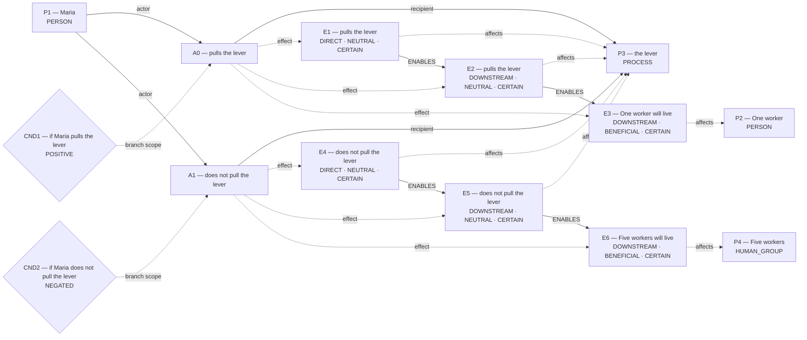

# Candidate world attempts

Chosen blueprint: **conditional_outcome**  
Chooser status: **FILLED**

## 1. rescue_contrast (alternative)

Template status: **PARTIAL**  
Proposal status: **WITHHELD**  
Contract valid: **true**  
Missing slots: `first_saved`, `second_saved`, `rescue_exclusivity`, `first_rescue_action`, `second_rescue_action`, `first_harm`, `second_harm`, `scene`

World withheld:

- Required slots remain unfilled: first_saved, second_saved, rescue_exclusivity, first_rescue_action, second_rescue_action

## 2. omission_harm (alternative)

Template status: **PARTIAL**  
Proposal status: **WITHHELD**  
Contract valid: **true**  
Missing slots: `done`, `harm_done`, `harm_omitted`, `done_hedge`, `omitted_hedge`, `instrument`

World withheld:

- Required slots remain unfilled: done, harm_done, harm_omitted

## 3. conditional_outcome (selected)

Template status: **FILLED**  
Proposal status: **FILLED**  
Contract valid: **true**  
Missing slots: `chance`

### conditional_outcome candidate graph

