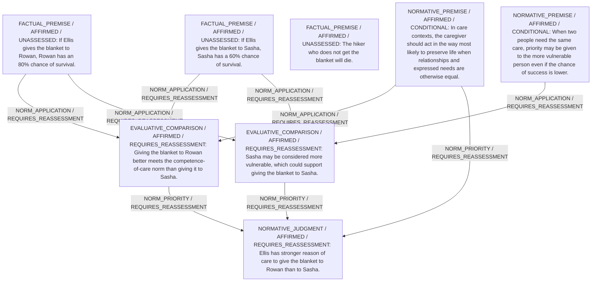

# Candidate arguments

Nonvoting argument overlays. These are not admitted world-state graphs.

## care

STAGED_PARTIAL_ARGUMENT

Critic's proposed remaining conclusion (check accepted graph below): Care ethics provisionally recommends giving the blanket to Rowan because this is the more competent, life-preserving response when relational factors are equal, although a reasonable objection appealing to Sasha’s greater vulnerability remains.

Remaining questions: Whether vulnerability should outweigh competence when the gap in success probability is significant

## Binding issues (not moral verdicts)

[
  {
    "kind": "PRINCIPLE_KIND_MISMATCH",
    "record_id": "PR_Maximize_Care_Effectiveness"
  },
  {
    "kind": "PRINCIPLE_KIND_MISMATCH",
    "record_id": "PR_Prioritize_Higher_Vulnerability"
  },
  {
    "kind": "MISSING_STATEMENT_REFERENCE",
    "record_id": "O1"
  },
  {
    "kind": "VERDICT_USED_AS_PREMISE",
    "record_id": "STATEMENT:433c8de52f63f5f4f5d3fa79"
  }
]

## Comparison bookkeeping (not semantic validation)

{
  "version": "complaint-comparison/0.1",
  "findings": [
    {
      "code": "BURDEN_TRANSITION_MISMATCH",
      "record_id": "COMP_A_vs_B",
      "burden_id": "B_Rowan_Death",
      "claim": "relieved_burden_ids",
      "observed": [
        "PRESENT",
        "PRESENT"
      ],
      "expected": [
        "PRESENT",
        "ABSENT"
      ]
    },
    {
      "code": "RETAINED_BURDEN_OMITTED",
      "record_id": "COMP_A_vs_B",
      "burden_id": "B_Rowan_Death"
    }
  ],
  "status": "REVIEW_REQUIRED",
  "matrix_authority": "MODEL_PROPOSED_NOT_SOURCE_VERIFIED",
  "semantic_support": "NOT_INDEPENDENTLY_ASSESSED",
  "moral_ranking_computed": false,
  "operative": false,
  "recommendation_status": "PROVISIONAL_PREFERENCE",
  "remaining_complaint_ids": [
    "R2"
  ]
}

## Burdens by option

| Burden / person | Option | Status |
| --- | --- | --- |
| Risk of dying from exposure / P_Rowan | A | PRESENT |
| Risk of dying from exposure / P_Rowan | B | PRESENT |
| Risk of dying from exposure / P_Sasha | A | PRESENT |
| Risk of dying from exposure / P_Sasha | B | PRESENT |

Full principles, reasons, comparisons and proposed attacks: [response.json](response.json).
