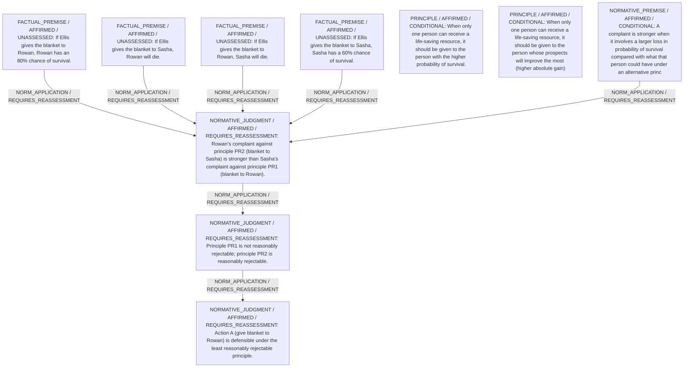

# Candidate arguments

Nonvoting argument overlays. These are not admitted world-state graphs.

## contractualist

STAGED_PARTIAL_ARGUMENT

Critic's proposed remaining conclusion (check accepted graph below): Giving the blanket to Rowan (Action A) is uniquely defensible because the strongest reasonable rejection falls on the alternative principle that would give the blanket to Sasha.

Remaining questions: Whether a 20 % difference in lost survival chance is enough to make one complaint decisively stronger remains open to reasonable dispute.

## Binding issues (not moral verdicts)

[
  {
    "kind": "DETACHED_COMPARISON",
    "record_id": "C1"
  },
  {
    "kind": "VERDICT_USED_AS_PREMISE",
    "record_id": "STATEMENT:ce7ec42951b0143b54186925"
  }
]

## Comparison bookkeeping (not semantic validation)

{
  "version": "complaint-comparison/0.1",
  "findings": [],
  "status": "NO_STRUCTURAL_MISMATCH_FOUND",
  "matrix_authority": "MODEL_PROPOSED_NOT_SOURCE_VERIFIED",
  "semantic_support": "NOT_INDEPENDENTLY_ASSESSED",
  "moral_ranking_computed": false,
  "operative": false,
  "recommendation_status": "UNIQUE_DEFENSIBLE",
  "remaining_complaint_ids": [
    "R_Sasha_against_A"
  ]
}

## Burdens by option

| Burden / person | Option | Status |
| --- | --- | --- |
| Risk of death from hypothermia / Rowan | A | PRESENT |
| Risk of death from hypothermia / Rowan | B | PRESENT |
| Risk of death from hypothermia / Sasha | A | PRESENT |
| Risk of death from hypothermia / Sasha | B | PRESENT |

Full principles, reasons, comparisons and proposed attacks: [response.json](response.json).
