# Candidate arguments

Nonvoting argument overlays. These are not admitted world-state graphs.

## deontological

STAGED_PARTIAL_ARGUMENT

Critic's proposed remaining conclusion (check accepted graph below): Under the duty of beneficence and with no competing perfect duty (such as a promise), Ellis should give the blanket to Rowan, because that course offers the greater chance that a person survives. The fairness-based objection is considered but judged weaker given the sizeable 20 % probability gap.

```mermaid
flowchart TB
n0["FACTUAL_PREMISE / AFFIRMED / UNASSESSED: If Ellis gives the blanket to Rowan, Rowan has an 80% chance of survival."]
n1["FACTUAL_PREMISE / AFFIRMED / UNASSESSED: If Ellis gives the blanket to Sasha, Sasha has a 60% chance of survival."]
n2["FACTUAL_PREMISE / AFFIRMED / UNASSESSED: The hiker who does not get the blanket will die."]
n3["FACTUAL_PREMISE / AFFIRMED / UNASSESSED: Ellis can give the blanket to only one hiker."]
n4["INTERPRETIVE_PREMISE / AFFIRMED / UNASSESSED: Ellis has no prior special duty or promise to either hiker."]
n5["NORMATIVE_PREMISE / AFFIRMED / CONDITIONAL: A rescuer who must choose whom to aid, absent special duties, ought to maximize the chance that someone survives (duty of beneficence)."]
n6["NORMATIVE_PREMISE / AFFIRMED / CONDITIONAL: Equal respect forbids arbitrary discrimination; when individuals have roughly equal moral claims, a fair randomization is permissible."]
n7["NORMATIVE_JUDGMENT / AFFIRMED / REQUIRES_REASSESSMENT: Ellis ought to give the blanket to Rowan."]
n8["NORMATIVE_JUDGMENT / AFFIRMED / UNASSESSED: Ellis ought to give the blanket to Sasha."]
n9["NORMATIVE_JUDGMENT / AFFIRMED / REQUIRES_REASSESSMENT: Ellis could toss a fair coin between Rowan and Sasha."]
n0 -->|NORM_APPLICATION / REQUIRES_REASSESSMENT| n7
n1 -->|NORM_APPLICATION / REQUIRES_REASSESSMENT| n7
n2 -->|NORM_APPLICATION / REQUIRES_REASSESSMENT| n7
n4 -->|NORM_APPLICATION / REQUIRES_REASSESSMENT| n7
n5 -->|NORM_APPLICATION / REQUIRES_REASSESSMENT| n7
n0 -->|NORM_APPLICATION / REQUIRES_REASSESSMENT| n9
n1 -->|NORM_APPLICATION / REQUIRES_REASSESSMENT| n9
n2 -->|NORM_APPLICATION / REQUIRES_REASSESSMENT| n9
n4 -->|NORM_APPLICATION / REQUIRES_REASSESSMENT| n9
n6 -->|NORM_APPLICATION / REQUIRES_REASSESSMENT| n9
```

Remaining questions: Weight of fairness when probability gap is modest but non-trivial; Exact threshold where duties switch priority

## Binding issues (not moral verdicts)

[
  {
    "kind": "PRINCIPLE_KIND_MISMATCH",
    "record_id": "PR1"
  },
  {
    "kind": "PRINCIPLE_KIND_MISMATCH",
    "record_id": "PR2"
  },
  {
    "kind": "DETACHED_COMPARISON",
    "record_id": "C1"
  },
  {
    "kind": "MISSING_STATEMENT_REFERENCE",
    "record_id": "CH1"
  },
  {
    "kind": "MISSING_STATEMENT_REFERENCE",
    "record_id": "CH1"
  }
]

## Comparison bookkeeping (not semantic validation)

{
  "version": "complaint-comparison/0.1",
  "findings": [
    {
      "code": "BURDEN_TRANSITION_MISMATCH",
      "record_id": "C1",
      "burden_id": "B1",
      "claim": "relieved_burden_ids",
      "observed": [
        "PRESENT",
        "PRESENT"
      ],
      "expected": [
        "PRESENT",
        "ABSENT"
      ]
    },
    {
      "code": "RETAINED_BURDEN_OMITTED",
      "record_id": "C1",
      "burden_id": "B1"
    },
    {
      "code": "UNKNOWN_REMAINING_COMPLAINT",
      "record_id": "CH1"
    }
  ],
  "status": "REVIEW_REQUIRED",
  "matrix_authority": "MODEL_PROPOSED_NOT_SOURCE_VERIFIED",
  "semantic_support": "NOT_INDEPENDENTLY_ASSESSED",
  "moral_ranking_computed": false,
  "operative": false,
  "recommendation_status": "PROVISIONAL_PREFERENCE",
  "remaining_complaint_ids": [
    "CH1"
  ]
}

## Burdens by option

| Burden / person | Option | Status |
| --- | --- | --- |
| Risk of death from hypothermia / P1 | A | PRESENT |
| Risk of death from hypothermia / P1 | B | PRESENT |
| Risk of death from hypothermia / P2 | A | PRESENT |
| Risk of death from hypothermia / P2 | B | PRESENT |

Full principles, reasons, comparisons and proposed attacks: [response.json](response.json).
