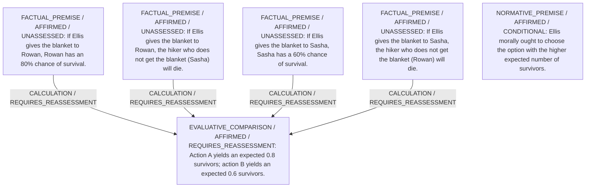

# Candidate arguments

Nonvoting argument overlays. These are not admitted world-state graphs.

## utilitarian

STAGED_PARTIAL_ARGUMENT

Critic's proposed remaining conclusion (check accepted graph below): Giving the blanket to Rowan uniquely maximizes expected survival and is therefore the utilitarian choice.

Remaining questions: 

Original construction problems retained: 1

## Binding issues (not moral verdicts)

[
  {
    "kind": "CONSTRUCTION",
    "path": "supports/7",
    "proposal": {
      "operation": "NORM_APPLICATION",
      "inputs": [
        "N1",
        "C1"
      ],
      "output": "J1",
      "explanation": "Higher expected survivors makes A preferable"
    },
    "error": "Dangling support reference"
  },
  {
    "kind": "PRINCIPLE_KIND_MISMATCH",
    "record_id": "PR1"
  },
  {
    "kind": "MISSING_STATEMENT_REFERENCE",
    "record_id": "R1"
  },
  {
    "kind": "DETACHED_REASON_SUPPORT",
    "record_id": "R1"
  },
  {
    "kind": "DETACHED_REASON_SUPPORT",
    "record_id": "R1"
  },
  {
    "kind": "MISSING_STATEMENT_REFERENCE",
    "record_id": "COMP1"
  },
  {
    "kind": "MISSING_STATEMENT_REFERENCE",
    "record_id": "O1"
  },
  {
    "kind": "MISSING_STATEMENT_REFERENCE",
    "record_id": "O1"
  },
  {
    "kind": "MISSING_STATEMENT_REFERENCE",
    "record_id": "A"
  },
  {
    "kind": "MISSING_STATEMENT_REFERENCE",
    "record_id": "B"
  }
]

## Comparison bookkeeping (not semantic validation)

{
  "version": "complaint-comparison/0.1",
  "findings": [],
  "status": "NO_STRUCTURAL_MISMATCH_FOUND",
  "matrix_authority": "MODEL_PROPOSED_NOT_SOURCE_VERIFIED",
  "semantic_support": "NOT_INDEPENDENTLY_ASSESSED",
  "moral_ranking_computed": false,
  "operative": false,
  "recommendation_status": "UNIQUE_DEFENSIBLE",
  "remaining_complaint_ids": []
}

## Burdens by option

| Burden / person | Option | Status |
| --- | --- | --- |
| Risk of death from hypothermia / P1 | A | PRESENT |
| Risk of death from hypothermia / P2 | A | PRESENT |
| Risk of death from hypothermia / P1 | B | PRESENT |
| Risk of death from hypothermia / P2 | B | PRESENT |

Full principles, reasons, comparisons and proposed attacks: [response.json](response.json).
