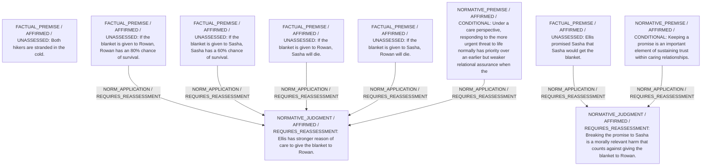

# Candidate arguments

Nonvoting argument overlays. These are not admitted world-state graphs.

## care

STAGED_PARTIAL_ARGUMENT

Critic's proposed remaining conclusion (check accepted graph below): Caring responsiveness to the most acute life-threatening need provisionally supports giving the blanket to Rowan, though the moral cost of breaking Ellis’s promise to Sasha remains a live concern.

Remaining questions: Whether Ellis could have competently avoided promising before full knowledge and whether the lingering harm to caring relationships outweighs the 20-percentage-point survival difference

## Binding issues (not moral verdicts)

[
  {
    "kind": "DETACHED_COMPARISON",
    "record_id": "C1"
  }
]

## Comparison bookkeeping (not semantic validation)

{
  "version": "complaint-comparison/0.1",
  "findings": [
    {
      "code": "BURDEN_TRANSITION_MISMATCH",
      "record_id": "C1",
      "burden_id": "B1R",
      "claim": "relieved_burden_ids",
      "observed": [
        "PRESENT",
        "PRESENT"
      ],
      "expected": [
        "PRESENT",
        "ABSENT"
      ]
    },
    {
      "code": "BURDEN_TRANSITION_MISMATCH",
      "record_id": "C1",
      "burden_id": "B2S",
      "claim": "introduced_burden_ids",
      "observed": [
        "PRESENT",
        "ABSENT"
      ],
      "expected": [
        "ABSENT",
        "PRESENT"
      ]
    },
    {
      "code": "BURDEN_TRANSITION_MISMATCH",
      "record_id": "C1",
      "burden_id": "B3E",
      "claim": "retained_burden_ids",
      "observed": [
        "UNKNOWN",
        "UNKNOWN"
      ],
      "expected": [
        "PRESENT",
        "PRESENT"
      ]
    }
  ],
  "status": "REVIEW_REQUIRED",
  "matrix_authority": "MODEL_PROPOSED_NOT_SOURCE_VERIFIED",
  "semantic_support": "NOT_INDEPENDENTLY_ASSESSED",
  "moral_ranking_computed": false,
  "operative": false,
  "recommendation_status": "PROVISIONAL_PREFERENCE",
  "remaining_complaint_ids": [
    "R2"
  ]
}

## Burdens by option

| Burden / person | Option | Status |
| --- | --- | --- |
| Risk of death from exposure for Rowan / P1 | A | PRESENT |
| Risk of death from exposure for Sasha / P2 | A | PRESENT |
| Harm of promise being broken / P2 | A | PRESENT |
| Moral distress for Ellis at failing someone in need or breaking a promise / P3 | A | UNKNOWN |
| Risk of death from exposure for Rowan / P1 | B | PRESENT |
| Risk of death from exposure for Sasha / P2 | B | PRESENT |
| Harm of promise being broken / P2 | B | ABSENT |
| Moral distress for Ellis at failing someone in need or breaking a promise / P3 | B | UNKNOWN |

Full principles, reasons, comparisons and proposed attacks: [response.json](response.json).
