# Candidate arguments

Nonvoting argument overlays. These are not admitted world-state graphs.

## contractualist

STAGED_PARTIAL_ARGUMENT

Critic's proposed remaining conclusion (check accepted graph below): Allocating the blanket to Rowan is provisionally preferable because the principle that permits it is harder for anyone to reasonably reject: it avoids an 80-point survival loss to Rowan at the cost of a 60-point loss and promise breach to Sasha. The promise adds moral weight but is not enough to overturn the larger life-and-death stake.

```mermaid
flowchart TB
n0["FACTUAL_PREMISE / AFFIRMED / UNASSESSED: If Ellis gives the blanket to Rowan, Rowan has an 80% chance of survival."]
n1["FACTUAL_PREMISE / AFFIRMED / UNASSESSED: If Ellis gives the blanket to Sasha, Sasha has a 60% chance of survival."]
n2["FACTUAL_PREMISE / AFFIRMED / UNASSESSED: Before learning about Rowan, Ellis promised Sasha that Sasha would get the blanket."]
n3["FACTUAL_PREMISE / AFFIRMED / UNASSESSED: The hiker who does not get the blanket will die."]
n4["PRINCIPLE / AFFIRMED / CONDITIONAL: It is permissible to allocate life‐saving aid to the person with the higher probability of survival."]
n5["PRINCIPLE / AFFIRMED / CONDITIONAL: One must keep a specific promise even if later information reveals a somewhat better life‐saving allocation."]
n6["NORMATIVE_PREMISE / AFFIRMED / CONDITIONAL: A principle is reasonably rejectable if some affected person bears a substantially greater expected loss of life under it than under an alternative th"]
n7["EVALUATIVE_COMPARISON / AFFIRMED / UNASSESSED: Rowan’s 80% additional survival prospect under action A is a weightier individual reason than Sasha’s 60% additional prospect under action B, other th"]
```

Remaining questions: Whether a 20-percentage-point survival gap is sufficient to override a specific promise remains contestable among reasonable parties.

Original construction problems retained: 3

## Binding issues (not moral verdicts)

[
  {
    "kind": "CONSTRUCTION",
    "path": "supports/5",
    "proposal": {
      "operation": "ASSUMPTION",
      "inputs": [],
      "output": "C1",
      "explanation": "Magnitude interpretation of survival differences"
    },
    "error": "Assumptions must be explicit interpretive/normative roots"
  },
  {
    "kind": "CONSTRUCTION",
    "path": "supports/6",
    "proposal": {
      "operation": "NORM_APPLICATION",
      "inputs": [
        "S1",
        "S2",
        "S4",
        "N1",
        "C1"
      ],
      "output": "J_ProbNotRejectable",
      "explanation": "Given larger expected life loss Rowan would face under promise\u2010keeping, keeping promise is more reasonably rejectable"
    },
    "error": "Dangling support reference"
  },
  {
    "kind": "CONSTRUCTION",
    "path": "supports/7",
    "proposal": {
      "operation": "NORM_APPLICATION",
      "inputs": [
        "S3",
        "N1"
      ],
      "output": "J_PromiseRelevant",
      "explanation": "Broken promise adds a moral burden to Sasha but does not outweigh larger survival loss to Rowan"
    },
    "error": "Dangling support reference"
  },
  {
    "kind": "MISSING_STATEMENT_REFERENCE",
    "record_id": "R_Rowan_vs_B"
  },
  {
    "kind": "CONTRACTUALIST_REASON_BINDING_INCOMPLETE",
    "record_id": "R_Rowan_vs_B"
  },
  {
    "kind": "DETACHED_REASON_SUPPORT",
    "record_id": "R_Rowan_vs_B"
  },
  {
    "kind": "DETACHED_REASON_SUPPORT",
    "record_id": "R_Rowan_vs_B"
  },
  {
    "kind": "DETACHED_REASON_SUPPORT",
    "record_id": "R_Rowan_vs_B"
  },
  {
    "kind": "MISSING_STATEMENT_REFERENCE",
    "record_id": "R_Sasha_vs_A"
  },
  {
    "kind": "CONTRACTUALIST_REASON_BINDING_INCOMPLETE",
    "record_id": "R_Sasha_vs_A"
  },
  {
    "kind": "DETACHED_REASON_SUPPORT",
    "record_id": "R_Sasha_vs_A"
  },
  {
    "kind": "DETACHED_REASON_SUPPORT",
    "record_id": "R_Sasha_vs_A"
  },
  {
    "kind": "DETACHED_REASON_SUPPORT",
    "record_id": "R_Sasha_vs_A"
  },
  {
    "kind": "DETACHED_REASON_SUPPORT",
    "record_id": "R_Sasha_vs_A"
  },
  {
    "kind": "MISSING_STATEMENT_REFERENCE",
    "record_id": "R_Ellis_vs_A"
  },
  {
    "kind": "CONTRACTUALIST_REASON_BINDING_INCOMPLETE",
    "record_id": "R_Ellis_vs_A"
  },
  {
    "kind": "DETACHED_REASON_SUPPORT",
    "record_id": "R_Ellis_vs_A"
  },
  {
    "kind": "DETACHED_REASON_SUPPORT",
    "record_id": "R_Ellis_vs_A"
  },
  {
    "kind": "MISSING_STATEMENT_REFERENCE",
    "record_id": "Comp_AB"
  },
  {
    "kind": "MISSING_STATEMENT_REFERENCE",
    "record_id": "Ch1"
  },
  {
    "kind": "MISSING_STATEMENT_REFERENCE",
    "record_id": "Ch1"
  },
  {
    "kind": "MISSING_STATEMENT_REFERENCE",
    "record_id": "A"
  },
  {
    "kind": "MISSING_STATEMENT_REFERENCE",
    "record_id": "B"
  }
]

## Comparison bookkeeping (not semantic validation)

{
  "version": "complaint-comparison/0.1",
  "findings": [
    {
      "code": "BURDEN_TRANSITION_MISMATCH",
      "record_id": "Comp_AB",
      "burden_id": "B_RowanDeath",
      "claim": "relieved_burden_ids",
      "observed": [
        "PRESENT",
        "PRESENT"
      ],
      "expected": [
        "PRESENT",
        "ABSENT"
      ]
    },
    {
      "code": "BURDEN_TRANSITION_MISMATCH",
      "record_id": "Comp_AB",
      "burden_id": "B_SashaBrokenPromise",
      "claim": "introduced_burden_ids",
      "observed": [
        "PRESENT",
        "ABSENT"
      ],
      "expected": [
        "ABSENT",
        "PRESENT"
      ]
    },
    {
      "code": "BURDEN_TRANSITION_MISMATCH",
      "record_id": "Comp_AB",
      "burden_id": "B_EllisBreach",
      "claim": "introduced_burden_ids",
      "observed": [
        "PRESENT",
        "ABSENT"
      ],
      "expected": [
        "ABSENT",
        "PRESENT"
      ]
    },
    {
      "code": "RETAINED_BURDEN_OMITTED",
      "record_id": "Comp_AB",
      "burden_id": "B_RowanDeath"
    }
  ],
  "status": "REVIEW_REQUIRED",
  "matrix_authority": "MODEL_PROPOSED_NOT_SOURCE_VERIFIED",
  "semantic_support": "NOT_INDEPENDENTLY_ASSESSED",
  "moral_ranking_computed": false,
  "operative": false,
  "recommendation_status": "PROVISIONAL_PREFERENCE",
  "remaining_complaint_ids": [
    "R_Sasha_vs_A"
  ]
}

## Burdens by option

| Burden / person | Option | Status |
| --- | --- | --- |
| Risk of death from cold exposure / P_Rowan | A | PRESENT |
| Risk of death from cold exposure / P_Rowan | B | PRESENT |
| Risk of death from cold exposure / P_Sasha | A | PRESENT |
| Risk of death from cold exposure / P_Sasha | B | PRESENT |
| Betrayal of Ellis’s prior assurance / P_Sasha | A | PRESENT |
| Betrayal of Ellis’s prior assurance / P_Sasha | B | ABSENT |
| Moral cost of breaking a promise / P_Ellis | A | PRESENT |
| Moral cost of breaking a promise / P_Ellis | B | ABSENT |

Full principles, reasons, comparisons and proposed attacks: [response.json](response.json).
