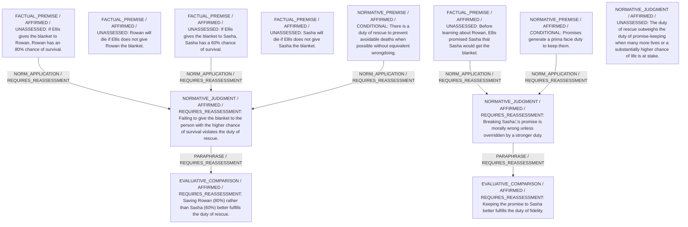

# Candidate arguments

Nonvoting argument overlays. These are not admitted world-state graphs.

## deontological

STAGED_PARTIAL_ARGUMENT

Critic's proposed remaining conclusion (check accepted graph below): Given the significantly higher chance of saving a life, Ellis should provisionally give the blanket to Rowan, although this breaks the earlier promise to Sasha.

Remaining questions: Some maintain that promises are categorical and cannot be overridden by probabilistic benefits, so they would still choose B.

Original construction problems retained: 2

## Binding issues (not moral verdicts)

[
  {
    "kind": "CONSTRUCTION",
    "path": "supports/6",
    "proposal": {
      "operation": "NORM_PRIORITY",
      "inputs": [
        "EC1",
        "EC2",
        "NPriority"
      ],
      "output": "PRIORITY1",
      "explanation": "Resolve conflict: rescue outweighs fidelity."
    },
    "error": "Dangling support reference"
  },
  {
    "kind": "CONSTRUCTION",
    "path": "supports/7",
    "proposal": {
      "operation": "ASSUMPTION",
      "inputs": [],
      "output": "NPriority",
      "explanation": "State priority principle."
    },
    "error": "Assumptions must be explicit interpretive/normative roots"
  },
  {
    "kind": "PRINCIPLE_KIND_MISMATCH",
    "record_id": "PR1"
  },
  {
    "kind": "PRINCIPLE_KIND_MISMATCH",
    "record_id": "PR2"
  },
  {
    "kind": "MISSING_STATEMENT_REFERENCE",
    "record_id": "C1"
  },
  {
    "kind": "MISSING_STATEMENT_REFERENCE",
    "record_id": "A"
  }
]

## Comparison bookkeeping (not semantic validation)

{
  "version": "complaint-comparison/0.1",
  "findings": [
    {
      "code": "BURDEN_TRANSITION_MISMATCH",
      "record_id": "C1",
      "burden_id": "B2",
      "claim": "relieved_burden_ids",
      "observed": [
        "PRESENT",
        "PRESENT"
      ],
      "expected": [
        "PRESENT",
        "ABSENT"
      ]
    },
    {
      "code": "BURDEN_TRANSITION_MISMATCH",
      "record_id": "C1",
      "burden_id": "B3",
      "claim": "introduced_burden_ids",
      "observed": [
        "PRESENT",
        "ABSENT"
      ],
      "expected": [
        "ABSENT",
        "PRESENT"
      ]
    },
    {
      "code": "BURDEN_TRANSITION_MISMATCH",
      "record_id": "C1",
      "burden_id": "B4",
      "claim": "introduced_burden_ids",
      "observed": [
        "PRESENT",
        "ABSENT"
      ],
      "expected": [
        "ABSENT",
        "PRESENT"
      ]
    },
    {
      "code": "RETAINED_BURDEN_OMITTED",
      "record_id": "C1",
      "burden_id": "B2"
    },
    {
      "code": "UNKNOWN_REMAINING_COMPLAINT",
      "record_id": "B3"
    },
    {
      "code": "UNKNOWN_REMAINING_COMPLAINT",
      "record_id": "B4"
    }
  ],
  "status": "REVIEW_REQUIRED",
  "matrix_authority": "MODEL_PROPOSED_NOT_SOURCE_VERIFIED",
  "semantic_support": "NOT_INDEPENDENTLY_ASSESSED",
  "moral_ranking_computed": false,
  "operative": false,
  "recommendation_status": "PROVISIONAL_PREFERENCE",
  "remaining_complaint_ids": [
    "B3",
    "B4"
  ]
}

## Burdens by option

| Burden / person | Option | Status |
| --- | --- | --- |
| Risk of death for Rowan / P1 | A | PRESENT |
| Risk of death for Rowan / P1 | B | PRESENT |
| Risk of death for Sasha / P2 | A | PRESENT |
| Risk of death for Sasha / P2 | B | PRESENT |
| Broken promise to Sasha / P2 | A | PRESENT |
| Broken promise to Sasha / P2 | B | ABSENT |
| Moral wrongdoing of breaking a promise / P3 | A | PRESENT |
| Moral wrongdoing of breaking a promise / P3 | B | ABSENT |

Full principles, reasons, comparisons and proposed attacks: [response.json](response.json).
