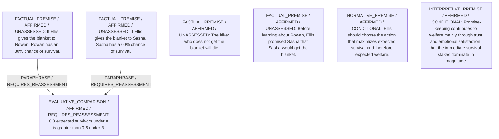

# Candidate arguments

Nonvoting argument overlays. These are not admitted world-state graphs.

## utilitarian

STAGED_PARTIAL_ARGUMENT

Critic's proposed remaining conclusion (check accepted graph below): Under utilitarian evaluation, giving the blanket to Rowan (A) maximizes expected survival (0.8 vs 0.6) and is provisionally preferred, despite violating Ellis’s prior promise.

Remaining questions: Weight of promise-keeping utility; Estimation of broader trust consequences

## Binding issues (not moral verdicts)

[
  {
    "kind": "PRINCIPLE_KIND_MISMATCH",
    "record_id": "PR1"
  },
  {
    "kind": "DETACHED_REASON_SUPPORT",
    "record_id": "R1"
  },
  {
    "kind": "MISSING_STATEMENT_REFERENCE",
    "record_id": "R2"
  },
  {
    "kind": "DETACHED_REASON_SUPPORT",
    "record_id": "R2"
  },
  {
    "kind": "DETACHED_REASON_SUPPORT",
    "record_id": "R2"
  },
  {
    "kind": "MISSING_STATEMENT_REFERENCE",
    "record_id": "R3"
  },
  {
    "kind": "DETACHED_REASON_SUPPORT",
    "record_id": "R3"
  },
  {
    "kind": "DETACHED_REASON_SUPPORT",
    "record_id": "R3"
  },
  {
    "kind": "MISSING_STATEMENT_REFERENCE",
    "record_id": "COMP1"
  },
  {
    "kind": "MISSING_STATEMENT_REFERENCE",
    "record_id": "CH1"
  },
  {
    "kind": "MISSING_STATEMENT_REFERENCE",
    "record_id": "CH1"
  },
  {
    "kind": "MISSING_STATEMENT_REFERENCE",
    "record_id": "A"
  },
  {
    "kind": "MISSING_STATEMENT_REFERENCE",
    "record_id": "B"
  }
]

## Comparison bookkeeping (not semantic validation)

{
  "version": "complaint-comparison/0.1",
  "findings": [
    {
      "code": "BURDEN_TRANSITION_MISMATCH",
      "record_id": "COMP1",
      "burden_id": "B1",
      "claim": "relieved_burden_ids",
      "observed": [
        "PRESENT",
        "PRESENT"
      ],
      "expected": [
        "PRESENT",
        "ABSENT"
      ]
    },
    {
      "code": "RETAINED_BURDEN_OMITTED",
      "record_id": "COMP1",
      "burden_id": "B1"
    },
    {
      "code": "UNKNOWN_REMAINING_COMPLAINT",
      "record_id": "OB1"
    }
  ],
  "status": "REVIEW_REQUIRED",
  "matrix_authority": "MODEL_PROPOSED_NOT_SOURCE_VERIFIED",
  "semantic_support": "NOT_INDEPENDENTLY_ASSESSED",
  "moral_ranking_computed": false,
  "operative": false,
  "recommendation_status": "PROVISIONAL_PREFERENCE",
  "remaining_complaint_ids": [
    "OB1"
  ]
}

## Burdens by option

| Burden / person | Option | Status |
| --- | --- | --- |
| Risk of death for Rowan / P1 | A | PRESENT |
| Risk of death for Rowan / P1 | B | PRESENT |
| Risk of death for Sasha / P2 | A | PRESENT |
| Risk of death for Sasha / P2 | B | PRESENT |
| Broken promise to Sasha (loss of trust / disappointment) / P2 | A | PRESENT |
| Broken promise to Sasha (loss of trust / disappointment) / P2 | B | ABSENT |
| Ellis’s moral distress from breaking a promise / P3 | A | PRESENT |
| Ellis’s moral distress from breaking a promise / P3 | B | ABSENT |

Full principles, reasons, comparisons and proposed attacks: [response.json](response.json).
