# Candidate arguments

Nonvoting argument overlays. These are not admitted world-state graphs.

## care

STAGED_PARTIAL_ARGUMENT

Critic's proposed remaining conclusion (check accepted graph below): Plan A is rejected under care ethics because it would impose homelessness on Mira against her refusal. Care considerations then leave Plans B and C both defensible: B protects twelve households with no new harms, C responds to Jo’s uniquely high vulnerability but adds an eight-week income loss for Sal and leaves twelve households uncooled. Because B meets many needs without creating new hardship, it is provisionally preferred, though a reasonable carer could still choose C by prioritising Jo’s exceptional risk.

```mermaid
flowchart TB
n0["FACTUAL_PREMISE / AFFIRMED / UNASSESSED: Plan A cools twenty households"]
n1["FACTUAL_PREMISE / AFFIRMED / UNASSESSED: Plan A requires demolishing Mira&#x27;s occupied home, leaving her without housing"]
n2["FACTUAL_PREMISE / AFFIRMED / UNASSESSED: Mira refuses the demolition of her home"]
n3["FACTUAL_PREMISE / AFFIRMED / UNASSESSED: Plan B cools twelve of those same households and displaces nobody"]
n4["FACTUAL_PREMISE / AFFIRMED / UNASSESSED: Plan C cools Jo&#x27;s home, which has the greatest heat exposure of any home in this case"]
n5["FACTUAL_PREMISE / AFFIRMED / UNASSESSED: Plan C requires closing Sal&#x27;s only shop for eight weeks without compensation, depriving Sal of income"]
n6["FACTUAL_PREMISE / AFFIRMED / UNASSESSED: Sal freely agrees to that closure after being informed, without pressure"]
n7["FACTUAL_PREMISE / AFFIRMED / UNASSESSED: Jo&#x27;s home is not cooled by A or B"]
n8["INTERPRETIVE_PREMISE / AFFIRMED / CONDITIONAL: Homelessness during a heat wave represents an extreme vulnerability"]
n9["INTERPRETIVE_PREMISE / AFFIRMED / CONDITIONAL: Having the greatest heat exposure signals a particularly urgent cooling need"]
n10["NORMATIVE_PREMISE / AFFIRMED / CONDITIONAL: In a care framework, preventing extreme vulnerability takes priority unless it neglects others with equal or greater vulnerability"]
n11["NORMATIVE_PREMISE / AFFIRMED / CONDITIONAL: Causing serious harm against a person&#x27;s refusal is worse than causing comparable harm with that person&#x27;s informed consent"]
n12["NORMATIVE_JUDGMENT / AFFIRMED / REQUIRES_REASSESSMENT: Plan A should be rejected because it creates extreme vulnerability for Mira against her refusal"]
n13["EVALUATIVE_COMPARISON / AFFIRMED / REQUIRES_REASSESSMENT: Between A and B, B is preferable within a care perspective"]
n14["EVALUATIVE_COMPARISON / AFFIRMED / REQUIRES_REASSESSMENT: Between B and C, care considerations do not establish a clear priority"]
n1 -->|NORM_APPLICATION / REQUIRES_REASSESSMENT| n12
n2 -->|NORM_APPLICATION / REQUIRES_REASSESSMENT| n12
n8 -->|NORM_APPLICATION / REQUIRES_REASSESSMENT| n12
n10 -->|NORM_APPLICATION / REQUIRES_REASSESSMENT| n12
n12 -->|NORM_PRIORITY / REQUIRES_REASSESSMENT| n13
n0 -->|NORM_PRIORITY / REQUIRES_REASSESSMENT| n13
n4 -->|NORM_PRIORITY / REQUIRES_REASSESSMENT| n14
n3 -->|NORM_PRIORITY / REQUIRES_REASSESSMENT| n14
n9 -->|NORM_PRIORITY / REQUIRES_REASSESSMENT| n14
n10 -->|NORM_PRIORITY / REQUIRES_REASSESSMENT| n14
n11 -->|NORM_PRIORITY / REQUIRES_REASSESSMENT| n14
```

Remaining questions: Extent of Jo’s unique danger relative to the 12 households; Whether Sal’s consent fully offsets the significance of his income loss; Weight to assign to the eight additional households aided only by A

## Binding issues (not moral verdicts)

[
  {
    "kind": "PRINCIPLE_KIND_MISMATCH",
    "record_id": "care_priority_extreme"
  },
  {
    "kind": "PRINCIPLE_KIND_MISMATCH",
    "record_id": "consent_warrant"
  },
  {
    "kind": "DETACHED_REASON_SUPPORT",
    "record_id": "r_Sal"
  },
  {
    "kind": "DETACHED_REASON_SUPPORT",
    "record_id": "r_Sal"
  },
  {
    "kind": "DETACHED_COMPARISON",
    "record_id": "c_BC"
  },
  {
    "kind": "VERDICT_USED_AS_PREMISE",
    "record_id": "STATEMENT:c5af8c6f2df2a89d0ac1efd5"
  }
]

## Comparison bookkeeping (not semantic validation)

{
  "version": "complaint-comparison/0.1",
  "findings": [
    {
      "code": "BURDEN_TRANSITION_MISMATCH",
      "record_id": "c_AB",
      "burden_id": "b1",
      "claim": "retained_burden_ids",
      "observed": [
        "ABSENT",
        "ABSENT"
      ],
      "expected": [
        "PRESENT",
        "PRESENT"
      ]
    }
  ],
  "status": "REVIEW_REQUIRED",
  "matrix_authority": "MODEL_PROPOSED_NOT_SOURCE_VERIFIED",
  "semantic_support": "NOT_INDEPENDENTLY_ASSESSED",
  "moral_ranking_computed": false,
  "operative": false,
  "recommendation_status": "PROVISIONAL_PREFERENCE",
  "remaining_complaint_ids": [
    "r_Jo",
    "r_H12",
    "r_Sal"
  ]
}

## Burdens by option

| Burden / person | Option | Status |
| --- | --- | --- |
| Continued heat exposure for the 12 households / H12 | A | ABSENT |
| Continued heat exposure for the 12 households / H12 | B | ABSENT |
| Continued heat exposure for the 12 households / H12 | C | PRESENT |
| Continued heat exposure for the 8 additional households / H8 | A | ABSENT |
| Continued heat exposure for the 8 additional households / H8 | B | PRESENT |
| Continued heat exposure for the 8 additional households / H8 | C | PRESENT |
| Continued extreme heat exposure for Jo / Jo | A | PRESENT |
| Continued extreme heat exposure for Jo / Jo | B | PRESENT |
| Continued extreme heat exposure for Jo / Jo | C | ABSENT |
| Loss of housing / homelessness for Mira / Mira | A | PRESENT |
| Loss of housing / homelessness for Mira / Mira | B | ABSENT |
| Loss of housing / homelessness for Mira / Mira | C | ABSENT |
| Eight-week loss of all shop income for Sal / Sal | A | ABSENT |
| Eight-week loss of all shop income for Sal / Sal | B | ABSENT |
| Eight-week loss of all shop income for Sal / Sal | C | PRESENT |

Full principles, reasons, comparisons and proposed attacks: [response.json](response.json).
