# Candidate arguments

Nonvoting argument overlays. These are not admitted world-state graphs.

## contractualist

STAGED_ARGUMENT

Critic's proposed remaining conclusion (check accepted graph below): Plan B is provisionally preferable because it avoids Mira’s decisive, non-consensual loss while imposing only moderate uncooled discomfort on eight households and leaves Jo uncooled. Whether Jo’s complaint can outweigh the many moderate complaints that arise under C remains unsettled, so B is presently the uniquely defensible option among the settled comparisons, with an open question relative to C.

```mermaid
flowchart TB
n0["FACTUAL_PREMISE / AFFIRMED / UNASSESSED: Plan A cools twenty households"]
n1["FACTUAL_PREMISE / AFFIRMED / UNASSESSED: Plan A requires demolishing Mira&#x27;s occupied home, leaving her without housing; she refuses"]
n2["FACTUAL_PREMISE / AFFIRMED / UNASSESSED: Plan C requires closing Sal&#x27;s only shop for eight weeks without compensation, depriving Sal of income during that period."]
n3["FACTUAL_PREMISE / AFFIRMED / UNASSESSED: Sal freely agrees to that closure after being informed of those consequences, without pressure."]
n4["FACTUAL_PREMISE / AFFIRMED / UNASSESSED: Jo&#x27;s home is not cooled by A or B"]
n5["FACTUAL_PREMISE / AFFIRMED / UNASSESSED: Plan C cools Jo&#x27;s home"]
n6["NORMATIVE_PREMISE / AFFIRMED / CONDITIONAL: It is harder to justify imposing an uncompensated severe harm like permanent loss of housing on a non-consenting individual than to fail to confer a b"]
n7["PRINCIPLE / AFFIRMED / CONDITIONAL: A public plan that imposes a severe, non-consensual basic-needs loss on one person to confer moderate benefits on others is reasonably rejectable."]
n8["PRINCIPLE / AFFIRMED / CONDITIONAL: A plan may impose a time-limited economic burden that the affected party voluntarily accepts in order to remedy the severest unmet need."]
n9["PRINCIPLE / AFFIRMED / CONDITIONAL: When no one faces a severe uncompensated loss, choosing the option that helps more people withstand heat is harder to reasonably reject."]
n10["NORMATIVE_JUDGMENT / AFFIRMED / REQUIRES_REASSESSMENT: Mira has a decisive complaint against Plan A."]
n11["NORMATIVE_JUDGMENT / AFFIRMED / REQUIRES_REASSESSMENT: Sal has a limited objection to Plan C because he consented."]
n12["NORMATIVE_JUDGMENT / AFFIRMED / REQUIRES_REASSESSMENT: The eight households have a reasonable complaint against Plan B for being left without cooling when an alternative (A) could cool them without harming"]
n13["EVALUATIVE_COMPARISON / AFFIRMED / REQUIRES_REASSESSMENT: Complaints against Plan A outweigh those against Plan B."]
n14["EVALUATIVE_COMPARISON / UNKNOWN / REQUIRES_REASSESSMENT: Between B and C, it is not yet settled whose complaints are stronger."]
n1 -->|NORM_APPLICATION / REQUIRES_REASSESSMENT| n10
n6 -->|NORM_APPLICATION / REQUIRES_REASSESSMENT| n10
n7 -->|NORM_APPLICATION / REQUIRES_REASSESSMENT| n10
n2 -->|NORM_APPLICATION / REQUIRES_REASSESSMENT| n11
n3 -->|NORM_APPLICATION / REQUIRES_REASSESSMENT| n11
n8 -->|NORM_APPLICATION / REQUIRES_REASSESSMENT| n11
n0 -->|NORM_APPLICATION / REQUIRES_REASSESSMENT| n12
n4 -->|NORM_APPLICATION / REQUIRES_REASSESSMENT| n12
n9 -->|NORM_APPLICATION / REQUIRES_REASSESSMENT| n12
n10 -->|NORM_PRIORITY / REQUIRES_REASSESSMENT| n13
n12 -->|NORM_PRIORITY / REQUIRES_REASSESSMENT| n13
n6 -->|NORM_PRIORITY / REQUIRES_REASSESSMENT| n13
n12 -->|NORM_PRIORITY / REQUIRES_REASSESSMENT| n14
n11 -->|NORM_PRIORITY / REQUIRES_REASSESSMENT| n14
n6 -->|NORM_PRIORITY / REQUIRES_REASSESSMENT| n14
```

Remaining questions: Severity of Jo’s exposure vs. cumulative burden on uncooled households; Whether Sal’s consent fully answers distributive concern for his income loss

## Binding issues (not moral verdicts)

[]

## Comparison bookkeeping (not semantic validation)

{
  "version": "complaint-comparison/0.1",
  "findings": [
    {
      "code": "POSITION_GROUND_MISSING",
      "record_id": "('B_M_displace', 'B')"
    },
    {
      "code": "POSITION_GROUND_MISSING",
      "record_id": "('B_M_displace', 'C')"
    },
    {
      "code": "POSITION_GROUND_MISSING",
      "record_id": "('B_S_income', 'A')"
    },
    {
      "code": "POSITION_GROUND_MISSING",
      "record_id": "('B_S_income', 'B')"
    },
    {
      "code": "POSITION_GROUND_MISSING",
      "record_id": "('B_J_heat', 'A')"
    },
    {
      "code": "POSITION_GROUND_MISSING",
      "record_id": "('B_J_heat', 'B')"
    },
    {
      "code": "POSITION_GROUND_MISSING",
      "record_id": "('B_J_heat', 'C')"
    },
    {
      "code": "POSITION_GROUND_MISSING",
      "record_id": "('B_H12_heat', 'A')"
    },
    {
      "code": "POSITION_GROUND_MISSING",
      "record_id": "('B_H12_heat', 'B')"
    },
    {
      "code": "POSITION_GROUND_MISSING",
      "record_id": "('B_H12_heat', 'C')"
    },
    {
      "code": "POSITION_GROUND_MISSING",
      "record_id": "('B_H8_heat', 'A')"
    },
    {
      "code": "POSITION_GROUND_MISSING",
      "record_id": "('B_H8_heat', 'B')"
    },
    {
      "code": "POSITION_GROUND_MISSING",
      "record_id": "('B_H8_heat', 'C')"
    }
  ],
  "status": "REVIEW_REQUIRED",
  "matrix_authority": "MODEL_PROPOSED_NOT_SOURCE_VERIFIED",
  "semantic_support": "NOT_INDEPENDENTLY_ASSESSED",
  "moral_ranking_computed": false,
  "operative": false,
  "recommendation_status": "PROVISIONAL_PREFERENCE",
  "remaining_complaint_ids": [
    "r_H8_B",
    "r_H12_C"
  ]
}

## Burdens by option

| Burden / person | Option | Status |
| --- | --- | --- |
| Home demolished and left without housing / M | A | PRESENT |
| Home demolished and left without housing / M | B | ABSENT |
| Home demolished and left without housing / M | C | ABSENT |
| Loss of shop income for eight weeks / S | A | ABSENT |
| Loss of shop income for eight weeks / S | B | ABSENT |
| Loss of shop income for eight weeks / S | C | PRESENT |
| Severest heat exposure remains unmitigated / J | A | PRESENT |
| Severest heat exposure remains unmitigated / J | B | PRESENT |
| Severest heat exposure remains unmitigated / J | C | ABSENT |
| Heat exposure not mitigated for 12 households / H12 | A | ABSENT |
| Heat exposure not mitigated for 12 households / H12 | B | ABSENT |
| Heat exposure not mitigated for 12 households / H12 | C | PRESENT |
| Heat exposure not mitigated for 8 households / H8 | A | ABSENT |
| Heat exposure not mitigated for 8 households / H8 | B | PRESENT |
| Heat exposure not mitigated for 8 households / H8 | C | PRESENT |

Full principles, reasons, comparisons and proposed attacks: [response.json](response.json).
