# Candidate arguments

Nonvoting argument overlays. These are not admitted world-state graphs.

## deontological

STAGED_PARTIAL_ARGUMENT

Critic's proposed remaining conclusion (check accepted graph below): Plan B uniquely avoids violating any non-consensual stringent duty and provides the greatest permissible benefit; therefore the council should adopt Plan B.

```mermaid
flowchart TB
n0["FACTUAL_PREMISE / AFFIRMED / UNASSESSED: requires demolishing Mira&#x27;s occupied home, leaving her without housing; she refuses"]
n1["FACTUAL_PREMISE / AFFIRMED / UNASSESSED: requires closing Sal&#x27;s only shop for eight weeks without compensation, depriving Sal of income during that period. Sal freely agrees to that closure a"]
n2["FACTUAL_PREMISE / AFFIRMED / UNASSESSED: Plan A cools twenty households"]
n3["FACTUAL_PREMISE / AFFIRMED / UNASSESSED: Plan B cools twelve of those same households"]
n4["FACTUAL_PREMISE / AFFIRMED / UNASSESSED: Jo&#x27;s home is not cooled by A or B"]
n5["FACTUAL_PREMISE / AFFIRMED / UNASSESSED: Plan C cools Jo&#x27;s home"]
n6["NORMATIVE_PREMISE / AFFIRMED / CONDITIONAL: Intentionally destroying a person&#x27;s home without consent violates a stringent duty of respect for autonomy and property."]
n7["NORMATIVE_PREMISE / AFFIRMED / CONDITIONAL: Interfering with a person in a way to which they voluntarily consent is normally permissible unless it violates another duty."]
n8["NORMATIVE_PREMISE / AFFIRMED / CONDITIONAL: Public authorities have a duty of beneficence to aid people in serious need when it does not require violating a stronger duty."]
n9["NORMATIVE_JUDGMENT / AFFIRMED / REQUIRES_REASSESSMENT: Plan A is impermissible because it violates Mira&#x27;s autonomy by demolishing her home without consent."]
n10["NORMATIVE_JUDGMENT / AFFIRMED / REQUIRES_REASSESSMENT: Between B and C, Plan B better fulfills the council&#x27;s beneficence duty without infringing any non-consensual rights."]
n0 -->|NORM_APPLICATION / REQUIRES_REASSESSMENT| n9
n6 -->|NORM_APPLICATION / REQUIRES_REASSESSMENT| n9
n1 -->|NORM_APPLICATION / REQUIRES_REASSESSMENT| n10
n7 -->|NORM_APPLICATION / REQUIRES_REASSESSMENT| n10
n8 -->|NORM_APPLICATION / REQUIRES_REASSESSMENT| n10
n3 -->|NORM_APPLICATION / REQUIRES_REASSESSMENT| n10
n2 -->|NORM_APPLICATION / REQUIRES_REASSESSMENT| n10
n4 -->|NORM_APPLICATION / REQUIRES_REASSESSMENT| n10
n5 -->|NORM_APPLICATION / REQUIRES_REASSESSMENT| n10
```

Remaining questions: 

## Binding issues (not moral verdicts)

[
  {
    "kind": "PERSON_SOURCE_BINDING_MISSING",
    "record_id": "p_jo"
  },
  {
    "kind": "PRINCIPLE_KIND_MISMATCH",
    "record_id": "pr_consented_use"
  },
  {
    "kind": "PRINCIPLE_KIND_MISMATCH",
    "record_id": "pr_no_nonconsent_harm"
  },
  {
    "kind": "PRINCIPLE_KIND_MISMATCH",
    "record_id": "pr_beneficence"
  },
  {
    "kind": "DETACHED_COMPARISON",
    "record_id": "cmp_A_B"
  },
  {
    "kind": "DETACHED_COMPARISON",
    "record_id": "cmp_B_C"
  },
  {
    "kind": "DETACHED_COMPARISON",
    "record_id": "cmp_A_C"
  }
]

## Comparison bookkeeping (not semantic validation)

{
  "version": "complaint-comparison/0.1",
  "findings": [
    {
      "code": "BURDEN_TRANSITION_MISMATCH",
      "record_id": "cmp_B_C",
      "burden_id": "b_20_heat",
      "claim": "relieved_burden_ids",
      "observed": [
        "PRESENT",
        "PRESENT"
      ],
      "expected": [
        "PRESENT",
        "ABSENT"
      ]
    },
    {
      "code": "BURDEN_TRANSITION_MISMATCH",
      "record_id": "cmp_B_C",
      "burden_id": "b_sal_income",
      "claim": "retained_burden_ids",
      "observed": [
        "PRESENT",
        "ABSENT"
      ],
      "expected": [
        "PRESENT",
        "PRESENT"
      ]
    },
    {
      "code": "BURDEN_TRANSITION_MISMATCH",
      "record_id": "cmp_B_C",
      "burden_id": "b_jo_heat",
      "claim": "retained_burden_ids",
      "observed": [
        "ABSENT",
        "PRESENT"
      ],
      "expected": [
        "PRESENT",
        "PRESENT"
      ]
    },
    {
      "code": "RETAINED_BURDEN_OMITTED",
      "record_id": "cmp_B_C",
      "burden_id": "b_20_heat"
    },
    {
      "code": "BURDEN_TRANSITION_MISMATCH",
      "record_id": "cmp_A_C",
      "burden_id": "b_jo_heat",
      "claim": "retained_burden_ids",
      "observed": [
        "PRESENT",
        "ABSENT"
      ],
      "expected": [
        "PRESENT",
        "PRESENT"
      ]
    }
  ],
  "status": "REVIEW_REQUIRED",
  "matrix_authority": "MODEL_PROPOSED_NOT_SOURCE_VERIFIED",
  "semantic_support": "NOT_INDEPENDENTLY_ASSESSED",
  "moral_ranking_computed": false,
  "operative": false,
  "recommendation_status": "UNIQUE_DEFENSIBLE",
  "remaining_complaint_ids": []
}

## Burdens by option

| Burden / person | Option | Status |
| --- | --- | --- |
| Loss of housing through demolition without consent / p_mira | A | PRESENT |
| Loss of housing through demolition without consent / p_mira | B | ABSENT |
| Loss of housing through demolition without consent / p_mira | C | ABSENT |
| Loss of shop income for eight weeks / p_sal | A | ABSENT |
| Loss of shop income for eight weeks / p_sal | B | ABSENT |
| Loss of shop income for eight weeks / p_sal | C | PRESENT |
| Continued dangerous heat exposure / g_20 | A | ABSENT |
| Continued dangerous heat exposure / g_20 | B | PRESENT |
| Continued dangerous heat exposure / g_20 | C | PRESENT |
| Continued dangerous heat exposure / p_jo | A | PRESENT |
| Continued dangerous heat exposure / p_jo | B | PRESENT |
| Continued dangerous heat exposure / p_jo | C | ABSENT |

Full principles, reasons, comparisons and proposed attacks: [response.json](response.json).
