# Candidate arguments

Nonvoting argument overlays. These are not admitted world-state graphs.

## utilitarian

STAGED_PARTIAL_ARGUMENT

Critic's proposed remaining conclusion (check accepted graph below): Plan B currently gives the highest defensible aggregate welfare: it substantially reduces dangerous heat exposure for twelve households without imposing Mira’s homelessness or Sal’s uncompensated income loss. That advantage is large enough, under the stated weighting assumption, to outweigh the extra eight households cooled by Plan A and Jo’s single-home benefit under Plan C.

```mermaid
flowchart TB
n0["FACTUAL_PREMISE / AFFIRMED / UNASSESSED: Plan A demolishes Mira’s occupied home, leaving her without housing."]
n1["FACTUAL_PREMISE / AFFIRMED / UNASSESSED: Plans B and C do not demolish Mira’s home."]
n2["FACTUAL_PREMISE / AFFIRMED / UNASSESSED: Plan A cools twenty households."]
n3["FACTUAL_PREMISE / AFFIRMED / UNASSESSED: Plan B cools twelve of those same households."]
n4["FACTUAL_PREMISE / AFFIRMED / UNASSESSED: Plan C does not cool any of the twenty households."]
n5["FACTUAL_PREMISE / AFFIRMED / UNASSESSED: Jo’s home is not cooled by Plans A or B."]
n6["FACTUAL_PREMISE / AFFIRMED / UNASSESSED: Plan C cools Jo’s home, which has the greatest heat exposure."]
n7["FACTUAL_PREMISE / AFFIRMED / UNASSESSED: Plans A and B do not close Sal’s shop."]
n8["FACTUAL_PREMISE / AFFIRMED / UNASSESSED: Plan C closes Sal’s only shop for eight weeks, depriving income."]
n9["NORMATIVE_PREMISE / AFFIRMED / CONDITIONAL: Severe basic-needs deprivations (homelessness, life-threatening heat) carry more negative utility than moderate comfort gains for several households."]
n10["NORMATIVE_PREMISE / AFFIRMED / CONDITIONAL: When comparing options, expected aggregate welfare should be maximised unless doing so would impose a very large harm on a single individual that outw"]
n11["NORMATIVE_JUDGMENT / AFFIRMED / REQUIRES_REASSESSMENT: Under utilitarian weights, Plan B yields higher net welfare than Plan A."]
n12["NORMATIVE_JUDGMENT / AFFIRMED / REQUIRES_REASSESSMENT: Under utilitarian weights, Plan B yields higher net welfare than Plan C."]
n0 -->|NORM_APPLICATION / REQUIRES_REASSESSMENT| n11
n2 -->|NORM_APPLICATION / REQUIRES_REASSESSMENT| n11
n3 -->|NORM_APPLICATION / REQUIRES_REASSESSMENT| n11
n9 -->|NORM_APPLICATION / REQUIRES_REASSESSMENT| n11
n10 -->|NORM_APPLICATION / REQUIRES_REASSESSMENT| n11
n3 -->|NORM_APPLICATION / REQUIRES_REASSESSMENT| n12
n4 -->|NORM_APPLICATION / REQUIRES_REASSESSMENT| n12
n6 -->|NORM_APPLICATION / REQUIRES_REASSESSMENT| n12
n8 -->|NORM_APPLICATION / REQUIRES_REASSESSMENT| n12
n9 -->|NORM_APPLICATION / REQUIRES_REASSESSMENT| n12
n10 -->|NORM_APPLICATION / REQUIRES_REASSESSMENT| n12
```

Remaining questions: Relative severity of Jo’s heat risk; Exact utility values for cooling versus homelessness and income loss

## Binding issues (not moral verdicts)

[
  {
    "kind": "PRINCIPLE_KIND_MISMATCH",
    "record_id": "NP1"
  },
  {
    "kind": "PRINCIPLE_KIND_MISMATCH",
    "record_id": "NP2"
  },
  {
    "kind": "DETACHED_COMPARISON",
    "record_id": "C1"
  },
  {
    "kind": "DETACHED_COMPARISON",
    "record_id": "C2"
  },
  {
    "kind": "MISSING_STATEMENT_REFERENCE",
    "record_id": "CH1"
  },
  {
    "kind": "MISSING_STATEMENT_REFERENCE",
    "record_id": "CH1"
  }
]

## Comparison bookkeeping (not semantic validation)

{
  "version": "complaint-comparison/0.1",
  "findings": [
    {
      "code": "BURDEN_TRANSITION_MISMATCH",
      "record_id": "C1",
      "burden_id": "B4",
      "claim": "retained_burden_ids",
      "observed": [
        "ABSENT",
        "ABSENT"
      ],
      "expected": [
        "PRESENT",
        "PRESENT"
      ]
    },
    {
      "code": "BURDEN_TRANSITION_MISMATCH",
      "record_id": "C1",
      "burden_id": "B2",
      "claim": "retained_burden_ids",
      "observed": [
        "ABSENT",
        "PRESENT"
      ],
      "expected": [
        "PRESENT",
        "PRESENT"
      ]
    },
    {
      "code": "BURDEN_TRANSITION_MISMATCH",
      "record_id": "C2",
      "burden_id": "B3",
      "claim": "retained_burden_ids",
      "observed": [
        "ABSENT",
        "PRESENT"
      ],
      "expected": [
        "PRESENT",
        "PRESENT"
      ]
    },
    {
      "code": "UNKNOWN_REMAINING_COMPLAINT",
      "record_id": "O1"
    }
  ],
  "status": "REVIEW_REQUIRED",
  "matrix_authority": "MODEL_PROPOSED_NOT_SOURCE_VERIFIED",
  "semantic_support": "NOT_INDEPENDENTLY_ASSESSED",
  "moral_ranking_computed": false,
  "operative": false,
  "recommendation_status": "PROVISIONAL_PREFERENCE",
  "remaining_complaint_ids": [
    "O1"
  ]
}

## Burdens by option

| Burden / person | Option | Status |
| --- | --- | --- |
| Loss of housing (homelessness) for Mira / P1 | A | PRESENT |
| Loss of housing (homelessness) for Mira / P1 | B | ABSENT |
| Loss of housing (homelessness) for Mira / P1 | C | ABSENT |
| Heat exposure for the twenty households / P2 | A | ABSENT |
| Heat exposure for the twenty households / P2 | B | PRESENT |
| Heat exposure for the twenty households / P2 | C | PRESENT |
| Heat exposure for Jo / P3 | A | PRESENT |
| Heat exposure for Jo / P3 | B | PRESENT |
| Heat exposure for Jo / P3 | C | ABSENT |
| Eight-week loss of shop income for Sal / P4 | A | ABSENT |
| Eight-week loss of shop income for Sal / P4 | B | ABSENT |
| Eight-week loss of shop income for Sal / P4 | C | PRESENT |

Full principles, reasons, comparisons and proposed attacks: [response.json](response.json).
