# Candidate arguments

Nonvoting argument overlays. These are not admitted world-state graphs.

## care

STAGED_PARTIAL_ARGUMENT

Critic's proposed remaining conclusion (check accepted graph below): Under a care perspective that stresses preventing the gravest uncontrolled vulnerability, Plan B is the most defensible: it cools twelve households without rendering anyone homeless or stripping them of their entire income. Plan A is ruled out because it would leave Mira without housing, an extreme ongoing vulnerability. Plan C, while helping Jo, would strip Sal of all income for eight weeks and still leave twenty households without cooling, so it is less responsive overall than Plan B.

```mermaid
flowchart TB
n0["FACTUAL_PREMISE / AFFIRMED / UNASSESSED: Plan A cools twenty households."]
n1["FACTUAL_PREMISE / AFFIRMED / UNASSESSED: Plan B cools twelve of those same households."]
n2["FACTUAL_PREMISE / AFFIRMED / UNASSESSED: Plan C cools Jo&#x27;s home, which has the greatest heat exposure of any home in this case."]
n3["FACTUAL_PREMISE / AFFIRMED / UNASSESSED: Plan C requires closing Sal&#x27;s only shop for eight weeks without compensation, depriving Sal of income during that period."]
n4["FACTUAL_PREMISE / AFFIRMED / UNASSESSED: Jo&#x27;s home is not cooled by A or B."]
n5["NORMATIVE_PREMISE / AFFIRMED / CONDITIONAL: Under a care perspective, rendering a person homeless is an extreme harm that normally outweighs the benefit of additional comfort to others when a le"]
n6["NORMATIVE_PREMISE / AFFIRMED / CONDITIONAL: Eight-week uncompensated income loss is a serious but lesser harm than homelessness."]
n7["NORMATIVE_PREMISE / AFFIRMED / CONDITIONAL: Providing cooling to heat-vulnerable households is an important caregiving good when it can be achieved without comparable or greater harms to others."]
n8["NORMATIVE_JUDGMENT / AFFIRMED / UNASSESSED: Plan A should be rejected because it imposes extreme harm (homelessness) on Mira."]
n9["NORMATIVE_JUDGMENT / AFFIRMED / UNASSESSED: Plan B is provisionally preferable among the three options under a care perspective."]
n10["NORMATIVE_JUDGMENT / AFFIRMED / REQUIRES_REASSESSMENT: Plan C should be rejected because it imposes serious economic harm on Sal while helping only one household and leaving others uncooled."]
n11["EVALUATIVE_COMPARISON / AFFIRMED / REQUIRES_REASSESSMENT: Compared with A, B avoids Mira&#x27;s homelessness while still cooling many households."]
n12["EVALUATIVE_COMPARISON / AFFIRMED / REQUIRES_REASSESSMENT: Compared with C, B avoids Sal&#x27;s income loss and cools more households, though it leaves Jo uncooled."]
n2 -->|NORM_APPLICATION / REQUIRES_REASSESSMENT| n10
n3 -->|NORM_APPLICATION / REQUIRES_REASSESSMENT| n10
n6 -->|NORM_APPLICATION / REQUIRES_REASSESSMENT| n10
n7 -->|NORM_APPLICATION / REQUIRES_REASSESSMENT| n10
n8 -->|NORM_PRIORITY / REQUIRES_REASSESSMENT| n11
n9 -->|NORM_PRIORITY / REQUIRES_REASSESSMENT| n11
n10 -->|NORM_PRIORITY / REQUIRES_REASSESSMENT| n12
n9 -->|NORM_PRIORITY / REQUIRES_REASSESSMENT| n12
```

Remaining questions: 

Original construction problems retained: 4

## Binding issues (not moral verdicts)

[
  {
    "kind": "CONSTRUCTION",
    "path": "statements/1",
    "proposal": {
      "kind": "FACTUAL_PREMISE",
      "text": "Plan A requires demolishing Mira's occupied home, leaving her without housing.",
      "polarity": "AFFIRMED",
      "modality": "ASSERTED",
      "hypothesis_ids": [],
      "citations": [
        {
          "evidence_id": "SCENE",
          "value_path": "",
          "quote": "Plan A ... requires demolishing Mira's occupied home, leaving her without housing"
        }
      ],
      "handle": "fp2"
    },
    "error": "Citation quote does not match exact location"
  },
  {
    "kind": "CONSTRUCTION",
    "path": "statements/3",
    "proposal": {
      "kind": "FACTUAL_PREMISE",
      "text": "Plan B displaces nobody.",
      "polarity": "AFFIRMED",
      "modality": "ASSERTED",
      "hypothesis_ids": [],
      "citations": [
        {
          "evidence_id": "SCENE",
          "value_path": "",
          "quote": "Plan B ... displaces nobody"
        }
      ],
      "handle": "fp4"
    },
    "error": "Citation quote does not match exact location"
  },
  {
    "kind": "CONSTRUCTION",
    "path": "supports/0",
    "proposal": {
      "operation": "NORM_APPLICATION",
      "inputs": [
        "fp2",
        "np1"
      ],
      "output": "nj1",
      "explanation": "Homelessness is an extreme harm to be avoided if possible."
    },
    "error": "Dangling support reference"
  },
  {
    "kind": "CONSTRUCTION",
    "path": "supports/1",
    "proposal": {
      "operation": "NORM_APPLICATION",
      "inputs": [
        "fp3",
        "fp4",
        "np3",
        "np2"
      ],
      "output": "nj2",
      "explanation": "B delivers care to 12 households without severe displacement or income loss."
    },
    "error": "Dangling support reference"
  },
  {
    "kind": "PERSON_SOURCE_BINDING_MISSING",
    "record_id": "M"
  },
  {
    "kind": "PERSON_SOURCE_BINDING_MISSING",
    "record_id": "J"
  },
  {
    "kind": "PERSON_SOURCE_BINDING_MISSING",
    "record_id": "S"
  },
  {
    "kind": "MISSING_STATEMENT_REFERENCE",
    "record_id": "r1"
  },
  {
    "kind": "DETACHED_REASON_SUPPORT",
    "record_id": "r1"
  },
  {
    "kind": "DETACHED_REASON_SUPPORT",
    "record_id": "r2"
  },
  {
    "kind": "MISSING_STATEMENT_REFERENCE",
    "record_id": "r2"
  },
  {
    "kind": "DETACHED_REASON_SUPPORT",
    "record_id": "r2"
  },
  {
    "kind": "VERDICT_USED_AS_PREMISE",
    "record_id": "STATEMENT:63613ab27d9a31ccfe8f06db"
  },
  {
    "kind": "VERDICT_USED_AS_PREMISE",
    "record_id": "STATEMENT:b0458b12f65246ff6042f8ca"
  }
]

## Comparison bookkeeping (not semantic validation)

{
  "version": "complaint-comparison/0.1",
  "findings": [
    {
      "code": "POSITION_GROUND_MISSING",
      "record_id": "('b_mira_home', 'A')"
    },
    {
      "code": "POSITION_GROUND_MISSING",
      "record_id": "('b_mira_home', 'B')"
    },
    {
      "code": "POSITION_GROUND_MISSING",
      "record_id": "('b_sal_income', 'B')"
    },
    {
      "code": "BURDEN_TRANSITION_MISMATCH",
      "record_id": "c_AB",
      "burden_id": "b_sal_income",
      "claim": "retained_burden_ids",
      "observed": [
        "ABSENT",
        "ABSENT"
      ],
      "expected": [
        "PRESENT",
        "PRESENT"
      ]
    },
    {
      "code": "BURDEN_TRANSITION_MISMATCH",
      "record_id": "c_AB",
      "burden_id": "b_h12_heat",
      "claim": "retained_burden_ids",
      "observed": [
        "ABSENT",
        "ABSENT"
      ],
      "expected": [
        "PRESENT",
        "PRESENT"
      ]
    },
    {
      "code": "BURDEN_TRANSITION_MISMATCH",
      "record_id": "c_BC",
      "burden_id": "b_sal_income",
      "claim": "relieved_burden_ids",
      "observed": [
        "ABSENT",
        "PRESENT"
      ],
      "expected": [
        "PRESENT",
        "ABSENT"
      ]
    },
    {
      "code": "BURDEN_TRANSITION_MISMATCH",
      "record_id": "c_BC",
      "burden_id": "b_h12_heat",
      "claim": "relieved_burden_ids",
      "observed": [
        "ABSENT",
        "PRESENT"
      ],
      "expected": [
        "PRESENT",
        "ABSENT"
      ]
    },
    {
      "code": "BURDEN_TRANSITION_MISMATCH",
      "record_id": "c_BC",
      "burden_id": "b_jo_heat",
      "claim": "introduced_burden_ids",
      "observed": [
        "PRESENT",
        "ABSENT"
      ],
      "expected": [
        "ABSENT",
        "PRESENT"
      ]
    },
    {
      "code": "BURDEN_TRANSITION_MISMATCH",
      "record_id": "c_BC",
      "burden_id": "b_mira_home",
      "claim": "retained_burden_ids",
      "observed": [
        "ABSENT",
        "ABSENT"
      ],
      "expected": [
        "PRESENT",
        "PRESENT"
      ]
    }
  ],
  "status": "REVIEW_REQUIRED",
  "matrix_authority": "MODEL_PROPOSED_NOT_SOURCE_VERIFIED",
  "semantic_support": "NOT_INDEPENDENTLY_ASSESSED",
  "moral_ranking_computed": false,
  "operative": false,
  "recommendation_status": "PROVISIONAL_PREFERENCE",
  "remaining_complaint_ids": []
}

## Burdens by option

| Burden / person | Option | Status |
| --- | --- | --- |
| Loss of housing (homelessness) during heat-wave / M | A | PRESENT |
| Loss of housing (homelessness) during heat-wave / M | B | ABSENT |
| Loss of housing (homelessness) during heat-wave / M | C | ABSENT |
| Greatest heat exposure at home remains unmitigated / J | A | PRESENT |
| Greatest heat exposure at home remains unmitigated / J | B | PRESENT |
| Greatest heat exposure at home remains unmitigated / J | C | ABSENT |
| Eight-week loss of all shop income / S | A | ABSENT |
| Eight-week loss of all shop income / S | B | ABSENT |
| Eight-week loss of all shop income / S | C | PRESENT |
| Heat exposure if their homes are not cooled / H12 | A | ABSENT |
| Heat exposure if their homes are not cooled / H12 | B | ABSENT |
| Heat exposure if their homes are not cooled / H12 | C | PRESENT |
| Heat exposure for the 8 not reached by plan B / H8 | A | ABSENT |
| Heat exposure for the 8 not reached by plan B / H8 | B | PRESENT |
| Heat exposure for the 8 not reached by plan B / H8 | C | PRESENT |

Full principles, reasons, comparisons and proposed attacks: [response.json](response.json).
