# Candidate arguments

Nonvoting argument overlays. These are not admitted world-state graphs.

## contractualist

STAGED_PARTIAL_ARGUMENT

Critic's proposed remaining conclusion (check accepted graph below): Plan B is provisionally preferred: it avoids the most severe unconsented burden (Mira’s homelessness) while providing substantial though not maximal cooling, and it does not newly impose severe burdens on others. Reasonable rejection of Plan B has not been demonstrated, whereas Plan A is reasonably rejectable and Plan C remains contested.

```mermaid
flowchart TB
n0["FACTUAL_PREMISE / AFFIRMED / UNASSESSED: Plan A requires demolishing Mira&#x27;s occupied home, leaving her without housing."]
n1["FACTUAL_PREMISE / AFFIRMED / UNASSESSED: Plans B and C do not demolish Mira&#x27;s home."]
n2["FACTUAL_PREMISE / AFFIRMED / UNASSESSED: Plans A and B leave Sal&#x27;s shop open."]
n3["FACTUAL_PREMISE / AFFIRMED / UNASSESSED: Plan C closes Sal&#x27;s only shop for eight weeks without compensation."]
n4["FACTUAL_PREMISE / AFFIRMED / UNASSESSED: Jo&#x27;s home is not cooled by Plans A or B."]
n5["FACTUAL_PREMISE / AFFIRMED / UNASSESSED: Plan C cools Jo&#x27;s home."]
n6["FACTUAL_PREMISE / AFFIRMED / UNASSESSED: Plan A cools twenty households."]
n7["FACTUAL_PREMISE / AFFIRMED / UNASSESSED: Plan B cools twelve of the same households cooled by A."]
n8["FACTUAL_PREMISE / AFFIRMED / UNASSESSED: Plan C does not cool the twenty households mentioned."]
n9["FACTUAL_PREMISE / AFFIRMED / UNASSESSED: Under Plan B eight of the twenty households remain without cooling."]
n10["NORMATIVE_PREMISE / AFFIRMED / CONDITIONAL: A principle is reasonably rejectable if it permits imposing a severe, non-consensual basic-needs loss on one person to provide moderate benefits to ot"]
n11["NORMATIVE_PREMISE / AFFIRMED / CONDITIONAL: A principle that avoids imposing any severe burden without consent, while providing some cooling benefit, is harder to reasonably reject when no bette"]
n12["NORMATIVE_PREMISE / AFFIRMED / CONDITIONAL: A principle that shifts a severe burden from one person onto another in order to help a third person and removes benefits from many others is reasonab"]
n13["NORMATIVE_JUDGMENT / AFFIRMED / REQUIRES_REASSESSMENT: Plan A is reasonably rejectable because it imposes homelessness on Mira for a lesser benefit that can partly be achieved by Plan B."]
n14["NORMATIVE_JUDGMENT / AFFIRMED / REQUIRES_REASSESSMENT: Plan B is not reasonably rejectable given the available alternatives."]
n15["NORMATIVE_JUDGMENT / UNKNOWN / REQUIRES_REASSESSMENT: Whether Plan C is reasonably rejectable is unresolved due to competing complaints from Sal, Jo, and the twelve households."]
n16["EVALUATIVE_COMPARISON / AFFIRMED / REQUIRES_REASSESSMENT: Compared with Plan A, Plan B better addresses the strongest reasonable complaints."]
n10 -->|NORM_APPLICATION / REQUIRES_REASSESSMENT| n13
n0 -->|NORM_APPLICATION / REQUIRES_REASSESSMENT| n13
n7 -->|NORM_APPLICATION / REQUIRES_REASSESSMENT| n13
n11 -->|NORM_APPLICATION / REQUIRES_REASSESSMENT| n14
n7 -->|NORM_APPLICATION / REQUIRES_REASSESSMENT| n14
n2 -->|NORM_APPLICATION / REQUIRES_REASSESSMENT| n14
n1 -->|NORM_APPLICATION / REQUIRES_REASSESSMENT| n14
n12 -->|NORM_APPLICATION / REQUIRES_REASSESSMENT| n15
n3 -->|NORM_APPLICATION / REQUIRES_REASSESSMENT| n15
n5 -->|NORM_APPLICATION / REQUIRES_REASSESSMENT| n15
n7 -->|NORM_APPLICATION / REQUIRES_REASSESSMENT| n15
n13 -->|NORM_PRIORITY / REQUIRES_REASSESSMENT| n16
n14 -->|NORM_PRIORITY / REQUIRES_REASSESSMENT| n16
```

Remaining questions: Whether Jo’s extreme heat exposure should outweigh the eight households’ cooling loss and Sal’s income loss remains unsettled, leaving Plan C’s status open

## Binding issues (not moral verdicts)

[
  {
    "kind": "PERSON_SOURCE_BINDING_MISSING",
    "record_id": "Sal"
  },
  {
    "kind": "PERSON_SOURCE_BINDING_MISSING",
    "record_id": "Jo"
  },
  {
    "kind": "PRINCIPLE_KIND_MISMATCH",
    "record_id": "P1"
  },
  {
    "kind": "PRINCIPLE_KIND_MISMATCH",
    "record_id": "P2"
  },
  {
    "kind": "PRINCIPLE_KIND_MISMATCH",
    "record_id": "P3"
  },
  {
    "kind": "DETACHED_REASON_SUPPORT",
    "record_id": "rHouse8B"
  },
  {
    "kind": "DETACHED_COMPARISON",
    "record_id": "comp_B_C"
  },
  {
    "kind": "DETACHED_COMPARISON",
    "record_id": "comp_A_C"
  },
  {
    "kind": "VERDICT_USED_AS_PREMISE",
    "record_id": "STATEMENT:326f6463913a388869aa25ae"
  }
]

## Comparison bookkeeping (not semantic validation)

{
  "version": "complaint-comparison/0.1",
  "findings": [
    {
      "code": "BURDEN_TRANSITION_MISMATCH",
      "record_id": "comp_A_B",
      "burden_id": "B_H12_Heat",
      "claim": "retained_burden_ids",
      "observed": [
        "ABSENT",
        "ABSENT"
      ],
      "expected": [
        "PRESENT",
        "PRESENT"
      ]
    },
    {
      "code": "BURDEN_TRANSITION_MISMATCH",
      "record_id": "comp_A_C",
      "burden_id": "B_Jo_Heat",
      "claim": "introduced_burden_ids",
      "observed": [
        "PRESENT",
        "ABSENT"
      ],
      "expected": [
        "ABSENT",
        "PRESENT"
      ]
    },
    {
      "code": "BURDEN_TRANSITION_MISMATCH",
      "record_id": "comp_A_C",
      "burden_id": "B_H12_Heat",
      "claim": "retained_burden_ids",
      "observed": [
        "ABSENT",
        "PRESENT"
      ],
      "expected": [
        "PRESENT",
        "PRESENT"
      ]
    },
    {
      "code": "BURDEN_TRANSITION_MISMATCH",
      "record_id": "comp_A_C",
      "burden_id": "B_H8_Heat",
      "claim": "retained_burden_ids",
      "observed": [
        "ABSENT",
        "PRESENT"
      ],
      "expected": [
        "PRESENT",
        "PRESENT"
      ]
    }
  ],
  "status": "REVIEW_REQUIRED",
  "matrix_authority": "MODEL_PROPOSED_NOT_SOURCE_VERIFIED",
  "semantic_support": "NOT_INDEPENDENTLY_ASSESSED",
  "moral_ranking_computed": false,
  "operative": false,
  "recommendation_status": "PROVISIONAL_PREFERENCE",
  "remaining_complaint_ids": [
    "rSalC"
  ]
}

## Burdens by option

| Burden / person | Option | Status |
| --- | --- | --- |
| Loss of housing (home demolished, no relocation)  / Mira | A | PRESENT |
| Loss of housing (home demolished, no relocation)  / Mira | B | ABSENT |
| Loss of housing (home demolished, no relocation)  / Mira | C | ABSENT |
| Loss of shop income for eight weeks / Sal | A | ABSENT |
| Loss of shop income for eight weeks / Sal | B | ABSENT |
| Loss of shop income for eight weeks / Sal | C | PRESENT |
| Continued extreme heat exposure at home / Jo | A | PRESENT |
| Continued extreme heat exposure at home / Jo | B | PRESENT |
| Continued extreme heat exposure at home / Jo | C | ABSENT |
| Continued heat exposure if home not cooled / H12 | A | ABSENT |
| Continued heat exposure if home not cooled / H12 | B | ABSENT |
| Continued heat exposure if home not cooled / H12 | C | PRESENT |
| Continued heat exposure if home not cooled / H8 | A | ABSENT |
| Continued heat exposure if home not cooled / H8 | B | PRESENT |
| Continued heat exposure if home not cooled / H8 | C | PRESENT |

Full principles, reasons, comparisons and proposed attacks: [response.json](response.json).
