# Candidate arguments

Nonvoting argument overlays. These are not admitted world-state graphs.

## deontological

STAGED_PARTIAL_ARGUMENT

Critic's proposed remaining conclusion (check accepted graph below): Plan B is provisionally preferable because it secures a significant rescue (cooling twelve households) without violating any individual’s stronger negative rights. Plan A directly violates Mira’s foundational right to a home; Plan C violates Sal’s income right, which still outweighs the additional individual rescue to Jo when some rescue is already possible without that violation.

```mermaid
flowchart TB
n0["FACTUAL_PREMISE / AFFIRMED / UNASSESSED: Plan A demolishes Mira’s occupied home, leaving her without housing."]
n1["FACTUAL_PREMISE / AFFIRMED / UNASSESSED: Plans B and C do not demolish Mira’s home."]
n2["FACTUAL_PREMISE / AFFIRMED / UNASSESSED: Plans A and B do not close Sal’s shop."]
n3["FACTUAL_PREMISE / AFFIRMED / UNASSESSED: Plan C closes Sal’s only shop for eight weeks, depriving him of income."]
n4["FACTUAL_PREMISE / AFFIRMED / UNASSESSED: Plan A cools twenty households."]
n5["FACTUAL_PREMISE / AFFIRMED / UNASSESSED: Plan B cools twelve of those same households."]
n6["FACTUAL_PREMISE / AFFIRMED / UNASSESSED: Plan C does not cool the twenty households."]
n7["FACTUAL_PREMISE / AFFIRMED / UNASSESSED: Jo’s home is not cooled by Plans A or B."]
n8["FACTUAL_PREMISE / AFFIRMED / UNASSESSED: Plan C cools Jo’s home, the one with the greatest heat exposure."]
n9["NORMATIVE_PREMISE / AFFIRMED / CONDITIONAL: Destroying an unwilling person’s only home is a rights-violating use that is presumptively impermissible."]
n10["NORMATIVE_PREMISE / AFFIRMED / CONDITIONAL: Depriving someone of their sole livelihood without consent is presumptively impermissible, though less severe than rendering them homeless."]
n11["NORMATIVE_PREMISE / AFFIRMED / CONDITIONAL: Providing life-preserving aid to many people creates a duty of rescue when it can be done without violating stronger negative duties."]
n12["NORMATIVE_JUDGMENT / AFFIRMED / REQUIRES_REASSESSMENT: Plan A is impermissible because it violates Mira’s stronger right not to be rendered homeless."]
n13["NORMATIVE_JUDGMENT / AFFIRMED / REQUIRES_REASSESSMENT: Plan C is presumptively impermissible because it violates Sal’s right to livelihood, unless no other plan can substantially relieve comparable or grea"]
n14["NORMATIVE_JUDGMENT / AFFIRMED / REQUIRES_REASSESSMENT: Plan B avoids rights violations while providing some rescue benefit, so it is permissible."]
n15["EVALUATIVE_COMPARISON / AFFIRMED / UNASSESSED: Between Plans B and C, the duty not to wrongfully deprive Sal of livelihood outweighs the extra aid to Jo when another plan supplies significant rescu"]
n0 -->|NORM_APPLICATION / REQUIRES_REASSESSMENT| n12
n9 -->|NORM_APPLICATION / REQUIRES_REASSESSMENT| n12
n3 -->|NORM_APPLICATION / REQUIRES_REASSESSMENT| n13
n10 -->|NORM_APPLICATION / REQUIRES_REASSESSMENT| n13
n11 -->|NORM_APPLICATION / REQUIRES_REASSESSMENT| n13
n1 -->|NORM_APPLICATION / REQUIRES_REASSESSMENT| n14
n5 -->|NORM_APPLICATION / REQUIRES_REASSESSMENT| n14
n11 -->|NORM_APPLICATION / REQUIRES_REASSESSMENT| n14
n9 -->|NORM_PRIORITY / UNASSESSED| n15
n11 -->|NORM_PRIORITY / UNASSESSED| n15
```

Remaining questions: Whether uncompensated eight-week closure is less severe than homelessness; Whether positive rescue for extreme heat should override livelihood in emergencies

## Binding issues (not moral verdicts)

[
  {
    "kind": "PRINCIPLE_KIND_MISMATCH",
    "record_id": "PR1"
  },
  {
    "kind": "PRINCIPLE_KIND_MISMATCH",
    "record_id": "PR2"
  },
  {
    "kind": "PRINCIPLE_KIND_MISMATCH",
    "record_id": "PR3"
  },
  {
    "kind": "MISSING_STATEMENT_REFERENCE",
    "record_id": "COMP_AB"
  },
  {
    "kind": "MISSING_STATEMENT_REFERENCE",
    "record_id": "COMP_BC"
  },
  {
    "kind": "MISSING_STATEMENT_REFERENCE",
    "record_id": "COMP_AC"
  }
]

## Comparison bookkeeping (not semantic validation)

{
  "version": "complaint-comparison/0.1",
  "findings": [
    {
      "code": "RETAINED_BURDEN_OMITTED",
      "record_id": "COMP_AB",
      "burden_id": "B5_JO_UNCOOLED"
    },
    {
      "code": "BURDEN_TRANSITION_MISMATCH",
      "record_id": "COMP_BC",
      "burden_id": "B2_LOST_INCOME",
      "claim": "relieved_burden_ids",
      "observed": [
        "ABSENT",
        "PRESENT"
      ],
      "expected": [
        "PRESENT",
        "ABSENT"
      ]
    },
    {
      "code": "BURDEN_TRANSITION_MISMATCH",
      "record_id": "COMP_BC",
      "burden_id": "B4_UNCOOLED_8",
      "claim": "relieved_burden_ids",
      "observed": [
        "PRESENT",
        "UNKNOWN"
      ],
      "expected": [
        "PRESENT",
        "ABSENT"
      ]
    },
    {
      "code": "BURDEN_TRANSITION_MISMATCH",
      "record_id": "COMP_AC",
      "burden_id": "B6_JO_RISK_REDUCED",
      "claim": "relieved_burden_ids",
      "observed": [
        "ABSENT",
        "PRESENT"
      ],
      "expected": [
        "PRESENT",
        "ABSENT"
      ]
    },
    {
      "code": "BURDEN_TRANSITION_MISMATCH",
      "record_id": "COMP_AC",
      "burden_id": "B3_UNCOOLED_20",
      "claim": "retained_burden_ids",
      "observed": [
        "ABSENT",
        "PRESENT"
      ],
      "expected": [
        "PRESENT",
        "PRESENT"
      ]
    }
  ],
  "status": "REVIEW_REQUIRED",
  "matrix_authority": "MODEL_PROPOSED_NOT_SOURCE_VERIFIED",
  "semantic_support": "NOT_INDEPENDENTLY_ASSESSED",
  "moral_ranking_computed": false,
  "operative": false,
  "recommendation_status": "PROVISIONAL_PREFERENCE",
  "remaining_complaint_ids": [
    "R2"
  ]
}

## Burdens by option

| Burden / person | Option | Status |
| --- | --- | --- |
| Loss of housing from demolition of Mira’s occupied home / P_MIRA | A | PRESENT |
| Loss of housing from demolition of Mira’s occupied home / P_MIRA | B | ABSENT |
| Loss of housing from demolition of Mira’s occupied home / P_MIRA | C | ABSENT |
| Loss of all shop income for eight weeks / P_SAL | A | ABSENT |
| Loss of all shop income for eight weeks / P_SAL | B | ABSENT |
| Loss of all shop income for eight weeks / P_SAL | C | PRESENT |
| Heat exposure for twenty households when not cooled / P_HH20 | A | ABSENT |
| Heat exposure for twenty households when not cooled / P_HH20 | B | PRESENT |
| Heat exposure for twenty households when not cooled / P_HH20 | C | PRESENT |
| Eight of the twenty households remain overheated under Plan B / P_HH20 | A | ABSENT |
| Eight of the twenty households remain overheated under Plan B / P_HH20 | B | PRESENT |
| Eight of the twenty households remain overheated under Plan B / P_HH20 | C | UNKNOWN |
| Jo’s extreme heat exposure remains / P_JO | A | PRESENT |
| Jo’s extreme heat exposure remains / P_JO | B | PRESENT |
| Jo’s extreme heat exposure remains / P_JO | C | ABSENT |
| Jo’s extreme heat exposure relieved / P_JO | C | PRESENT |
| Jo’s extreme heat exposure relieved / P_JO | A | ABSENT |
| Jo’s extreme heat exposure relieved / P_JO | B | ABSENT |

Full principles, reasons, comparisons and proposed attacks: [response.json](response.json).
