# Candidate arguments

Nonvoting argument overlays. These are not admitted world-state graphs.

## utilitarian

STAGED_PARTIAL_ARGUMENT

Critic's proposed remaining conclusion (check accepted graph below): Given the utilitarian mandate to maximize total welfare and the stated severity assumptions, Plan B is provisionally preferred because it secures substantial cooling benefits without imposing homelessness or significant economic hardship.

```mermaid
flowchart TB
n0["FACTUAL_PREMISE / AFFIRMED / UNASSESSED: Plan A cools twenty households"]
n1["FACTUAL_PREMISE / AFFIRMED / UNASSESSED: Plan A requires demolishing Mira&#x27;s occupied home, leaving her without housing"]
n2["FACTUAL_PREMISE / AFFIRMED / UNASSESSED: Plan B cools twelve of those same households and displaces nobody"]
n3["FACTUAL_PREMISE / AFFIRMED / UNASSESSED: Plan C cools Jo&#x27;s home, which has the greatest heat exposure of any home in this case"]
n4["FACTUAL_PREMISE / AFFIRMED / UNASSESSED: Plan C requires closing Sal&#x27;s only shop for eight weeks without compensation, depriving Sal of income"]
n5["FACTUAL_PREMISE / AFFIRMED / UNASSESSED: Jo&#x27;s home is not cooled by A or B"]
n6["NORMATIVE_PREMISE / AFFIRMED / CONDITIONAL: The council ought to choose the plan that maximizes overall welfare (utilitarian principle)"]
n7["INTERPRETIVE_PREMISE / AFFIRMED / CONDITIONAL: Homelessness for Mira imposes a very large welfare loss that outweighs the incremental cooling benefit to the eight additional households cooled only "]
n8["INTERPRETIVE_PREMISE / AFFIRMED / CONDITIONAL: Eight weeks of lost income for Sal is a moderate welfare loss, smaller than homelessness but non-trivial"]
n9["INTERPRETIVE_PREMISE / AFFIRMED / CONDITIONAL: Cooling Jo’s especially exposed home benefits Jo but does not compensate for simultaneously leaving 12 households uncooled and depriving Sal of income"]
n10["NORMATIVE_JUDGMENT / AFFIRMED / REQUIRES_REASSESSMENT: Plan B yields higher net welfare than Plan A"]
n11["NORMATIVE_JUDGMENT / AFFIRMED / REQUIRES_REASSESSMENT: Plan B yields higher net welfare than Plan C"]
n12["NORMATIVE_JUDGMENT / AFFIRMED / REQUIRES_REASSESSMENT: Plan B maximizes overall welfare among the three options"]
n6 -->|NORM_APPLICATION / REQUIRES_REASSESSMENT| n10
n7 -->|NORM_APPLICATION / REQUIRES_REASSESSMENT| n10
n0 -->|NORM_APPLICATION / REQUIRES_REASSESSMENT| n10
n1 -->|NORM_APPLICATION / REQUIRES_REASSESSMENT| n10
n2 -->|NORM_APPLICATION / REQUIRES_REASSESSMENT| n10
n6 -->|NORM_APPLICATION / REQUIRES_REASSESSMENT| n11
n8 -->|NORM_APPLICATION / REQUIRES_REASSESSMENT| n11
n9 -->|NORM_APPLICATION / REQUIRES_REASSESSMENT| n11
n2 -->|NORM_APPLICATION / REQUIRES_REASSESSMENT| n11
n3 -->|NORM_APPLICATION / REQUIRES_REASSESSMENT| n11
n4 -->|NORM_APPLICATION / REQUIRES_REASSESSMENT| n11
n10 -->|NORM_PRIORITY / REQUIRES_REASSESSMENT| n12
n11 -->|NORM_PRIORITY / REQUIRES_REASSESSMENT| n12
```

Remaining questions: I1; I2; I3

## Binding issues (not moral verdicts)

[
  {
    "kind": "PERSON_SOURCE_BINDING_MISSING",
    "record_id": "SAL"
  },
  {
    "kind": "PRINCIPLE_KIND_MISMATCH",
    "record_id": "UTIL"
  },
  {
    "kind": "DETACHED_COMPARISON",
    "record_id": "COMP_AB"
  },
  {
    "kind": "DETACHED_COMPARISON",
    "record_id": "COMP_BC"
  },
  {
    "kind": "MISSING_STATEMENT_REFERENCE",
    "record_id": "C1"
  },
  {
    "kind": "MISSING_STATEMENT_REFERENCE",
    "record_id": "C1"
  },
  {
    "kind": "VERDICT_USED_AS_PREMISE",
    "record_id": "STATEMENT:946a9b8cb71422afd88ec603"
  }
]

## Comparison bookkeeping (not semantic validation)

{
  "version": "complaint-comparison/0.1",
  "findings": [
    {
      "code": "BURDEN_TRANSITION_MISMATCH",
      "record_id": "COMP_AB",
      "burden_id": "B_H12_HEAT",
      "claim": "retained_burden_ids",
      "observed": [
        "ABSENT",
        "ABSENT"
      ],
      "expected": [
        "PRESENT",
        "PRESENT"
      ]
    },
    {
      "code": "RETAINED_BURDEN_OMITTED",
      "record_id": "COMP_AB",
      "burden_id": "B_JO_HEAT"
    },
    {
      "code": "UNKNOWN_REMAINING_COMPLAINT",
      "record_id": "C1"
    }
  ],
  "status": "REVIEW_REQUIRED",
  "matrix_authority": "MODEL_PROPOSED_NOT_SOURCE_VERIFIED",
  "semantic_support": "NOT_INDEPENDENTLY_ASSESSED",
  "moral_ranking_computed": false,
  "operative": false,
  "recommendation_status": "PROVISIONAL_PREFERENCE",
  "remaining_complaint_ids": [
    "C1"
  ]
}

## Burdens by option

| Burden / person | Option | Status |
| --- | --- | --- |
| Loss of housing (homelessness) / MIRA | A | PRESENT |
| Loss of housing (homelessness) / MIRA | B | ABSENT |
| Loss of housing (homelessness) / MIRA | C | ABSENT |
| Loss of all shop income for eight weeks / SAL | C | PRESENT |
| Loss of all shop income for eight weeks / SAL | A | ABSENT |
| Loss of all shop income for eight weeks / SAL | B | ABSENT |
| Unmitigated extreme heat exposure at Jo's home / JO | A | PRESENT |
| Unmitigated extreme heat exposure at Jo's home / JO | B | PRESENT |
| Unmitigated extreme heat exposure at Jo's home / JO | C | ABSENT |
| Unmitigated heat exposure for 12 households / H12 | A | ABSENT |
| Unmitigated heat exposure for 12 households / H12 | B | ABSENT |
| Unmitigated heat exposure for 12 households / H12 | C | PRESENT |
| Unmitigated heat exposure for 8 households / H8 | A | ABSENT |
| Unmitigated heat exposure for 8 households / H8 | B | PRESENT |
| Unmitigated heat exposure for 8 households / H8 | C | PRESENT |

Full principles, reasons, comparisons and proposed attacks: [response.json](response.json).
