# Framework contribution

Decision status: PROVISIONAL_PREFERENCE

## Critical unanswered questions

**Q1 — INTERPRETIVE / DECISION_DEPENDENCY**

Did Sasha reasonably rely on Ellis’s promise in a way that amplifies the wrong of breach?

Affected people: Sasha.
Options: A0, A1.

Why it matters: If reliance is strong, the promissory claim might plausibly outweigh survival-probability gains.

What could help: Evidence of reliance costs or expectations set by the promise.

- If Strong reliance established: ST_WEIGHT would tilt, comparison C1 could become UNRESOLVED or favor A1.
- If No reliance beyond hope: Current weighting remains reasonable.

These are proposed questions and conditional arguments, not settled moral findings.

# Candidate arguments

Nonvoting argument overlays. These are not admitted world-state graphs.

## contractualist

STAGED_PARTIAL_ARGUMENT

Critic's proposed remaining conclusion (check accepted graph below): Saving the person with the markedly higher survival chance (Rowan) is provisionally preferable, because the certain loss of Rowan’s life is a stronger reasonable objection than Sasha’s complaint of broken promise, absent evidence of special reliance.

```mermaid
flowchart TB
n0["FACTUAL_PREMISE / AFFIRMED / UNASSESSED: The hiker who does not get the blanket will die."]
n1["FACTUAL_PREMISE / AFFIRMED / UNASSESSED: If Ellis gives the blanket to Rowan, Rowan has an 80% chance of survival."]
n2["FACTUAL_PREMISE / AFFIRMED / UNASSESSED: If Ellis gives the blanket to Sasha, Sasha has a 60% chance of survival."]
n3["FACTUAL_PREMISE / AFFIRMED / UNASSESSED: Before learning about Rowan, Ellis promised Sasha that Sasha would get the blanket."]
n4["INTERPRETIVE_PREMISE / AFFIRMED / CONDITIONAL: Breaking the promise would wrong Sasha by violating an undertaken assurance."]
n5["NORMATIVE_PREMISE / AFFIRMED / CONDITIONAL: A principle is unreasonable if any affected person could reasonably reject it."]
n6["PRINCIPLE / AFFIRMED / CONDITIONAL: When only one person can be saved, the rescuer should maximize the individual chance of survival (PRIORITISE_SURVIVAL)."]
n7["PRINCIPLE / AFFIRMED / CONDITIONAL: An explicit promise made to someone establishes a claim that should normally be honoured even when new information appears (KEEP_PROMISES)."]
n8["NORMATIVE_PREMISE / AFFIRMED / CONDITIONAL: In a life-and-death rescue, avoiding an avoidable death is normally a weightier reason than preventing a promissory wrong, unless the promisee relied "]
```

Remaining questions: Weight of promissory obligation versus survival advantage

Original construction problems retained: 3

## Binding issues (not moral verdicts)

[
  {
    "kind": "CONSTRUCTION",
    "path": "supports/9",
    "proposal": {
      "operation": "NORM_APPLICATION",
      "inputs": [
        "S_ROWAN_80",
        "S_DIE",
        "ST_P1"
      ],
      "output": "RJ_P2",
      "explanation": "Rowan could reasonably reject KEEP_PROMISES if it dooms him despite higher chance"
    },
    "error": "Dangling support reference"
  },
  {
    "kind": "CONSTRUCTION",
    "path": "supports/10",
    "proposal": {
      "operation": "NORM_APPLICATION",
      "inputs": [
        "S_PROMISE",
        "INT_WRONG",
        "ST_P2"
      ],
      "output": "RJ_P1",
      "explanation": "Sasha could reasonably reject PRIORITISE_SURVIVAL because it breaks promise made to her"
    },
    "error": "Dangling support reference"
  },
  {
    "kind": "CONSTRUCTION",
    "path": "supports/11",
    "proposal": {
      "operation": "NORM_PRIORITY",
      "inputs": [
        "RJ_P2",
        "RJ_P1",
        "ST_WEIGHT"
      ],
      "output": "COMP_WEIGHT",
      "explanation": "Lives at stake override promissory wrong absent reliance"
    },
    "error": "Dangling support reference"
  },
  {
    "kind": "PERSON_SOURCE_BINDING_MISSING",
    "record_id": "Rowan"
  },
  {
    "kind": "PERSON_SOURCE_BINDING_MISSING",
    "record_id": "Sasha"
  },
  {
    "kind": "PERSON_SOURCE_BINDING_MISSING",
    "record_id": "Ellis"
  },
  {
    "kind": "MISSING_STATEMENT_REFERENCE",
    "record_id": "R1"
  },
  {
    "kind": "DETACHED_REASON_SUPPORT",
    "record_id": "R1"
  },
  {
    "kind": "DETACHED_REASON_SUPPORT",
    "record_id": "R1"
  },
  {
    "kind": "MISSING_STATEMENT_REFERENCE",
    "record_id": "R2"
  },
  {
    "kind": "DETACHED_REASON_SUPPORT",
    "record_id": "R2"
  },
  {
    "kind": "DETACHED_REASON_SUPPORT",
    "record_id": "R2"
  },
  {
    "kind": "MISSING_STATEMENT_REFERENCE",
    "record_id": "R3"
  },
  {
    "kind": "CONTRACTUALIST_REASON_BINDING_INCOMPLETE",
    "record_id": "R3"
  },
  {
    "kind": "DETACHED_REASON_SUPPORT",
    "record_id": "R3"
  },
  {
    "kind": "DETACHED_REASON_SUPPORT",
    "record_id": "R3"
  },
  {
    "kind": "MISSING_STATEMENT_REFERENCE",
    "record_id": "R4"
  },
  {
    "kind": "CONTRACTUALIST_REASON_BINDING_INCOMPLETE",
    "record_id": "R4"
  },
  {
    "kind": "DETACHED_REASON_SUPPORT",
    "record_id": "R4"
  },
  {
    "kind": "DETACHED_REASON_SUPPORT",
    "record_id": "R4"
  },
  {
    "kind": "DETACHED_REASON_SUPPORT",
    "record_id": "R4"
  },
  {
    "kind": "MISSING_STATEMENT_REFERENCE",
    "record_id": "C1"
  },
  {
    "kind": "MISSING_STATEMENT_REFERENCE",
    "record_id": "CH1"
  },
  {
    "kind": "MISSING_STATEMENT_REFERENCE",
    "record_id": "A0"
  },
  {
    "kind": "MISSING_STATEMENT_REFERENCE",
    "record_id": "A1"
  }
]

## Comparison bookkeeping (not semantic validation)

{
  "version": "complaint-comparison/0.2",
  "findings": [
    {
      "code": "POSITION_GROUND_MISSING",
      "record_id": "('B1', 'A1')"
    },
    {
      "code": "POSITION_GROUND_MISSING",
      "record_id": "('B1', 'A0')"
    },
    {
      "code": "POSITION_GROUND_MISSING",
      "record_id": "('B2', 'A1')"
    },
    {
      "code": "POSITION_GROUND_MISSING",
      "record_id": "('B3', 'A0')"
    },
    {
      "code": "POSITION_GROUND_MISSING",
      "record_id": "('B3', 'A1')"
    },
    {
      "code": "POSITION_GROUND_MISSING",
      "record_id": "('B4', 'A0')"
    },
    {
      "code": "BURDEN_TRANSITION_MISMATCH",
      "record_id": "C1",
      "burden_id": "B3",
      "claim": "relieved_burden_ids",
      "observed": [
        "ABSENT",
        "PRESENT"
      ],
      "expected": [
        "PRESENT",
        "ABSENT"
      ]
    },
    {
      "code": "BURDEN_TRANSITION_MISMATCH",
      "record_id": "C1",
      "burden_id": "B5",
      "claim": "relieved_burden_ids",
      "observed": [
        "ABSENT",
        "PRESENT"
      ],
      "expected": [
        "PRESENT",
        "ABSENT"
      ]
    },
    {
      "code": "BURDEN_TRANSITION_MISMATCH",
      "record_id": "C1",
      "burden_id": "B6",
      "claim": "relieved_burden_ids",
      "observed": [
        "ABSENT",
        "PRESENT"
      ],
      "expected": [
        "PRESENT",
        "ABSENT"
      ]
    },
    {
      "code": "BURDEN_TRANSITION_MISMATCH",
      "record_id": "C1",
      "burden_id": "B1",
      "claim": "retained_burden_ids",
      "observed": [
        "PRESENT",
        "ABSENT"
      ],
      "expected": [
        "PRESENT",
        "PRESENT"
      ]
    },
    {
      "code": "UNKNOWN_REMAINING_COMPLAINT",
      "record_id": "B5"
    }
  ],
  "status": "REVIEW_REQUIRED",
  "matrix_authority": "MODEL_PROPOSED_NOT_SOURCE_VERIFIED",
  "semantic_support": "NOT_INDEPENDENTLY_ASSESSED",
  "moral_ranking_computed": false,
  "operative": false,
  "derived_position_changes": [
    {
      "comparison_id": "C1",
      "from_action_id": "A1",
      "to_action_id": "A0",
      "positions": [
        {
          "burden_id": "B1",
          "person_id": "Rowan",
          "description": "Certain death if blanket withheld",
          "from": {
            "status": "PRESENT",
            "raw_position_indices": [
              0
            ],
            "descriptions": [
              "Rowan will die without blanket"
            ]
          },
          "to": {
            "status": "ABSENT",
            "raw_position_indices": [
              1
            ],
            "descriptions": [
              "Rowan receives blanket"
            ]
          },
          "change": "RELIEVED"
        },
        {
          "burden_id": "B2",
          "person_id": "Rowan",
          "description": "Residual 20% risk of death even if given blanket",
          "from": {
            "status": "ABSENT",
            "raw_position_indices": [
              3
            ],
            "descriptions": [
              "No residual risk because Rowan certainly dies"
            ]
          },
          "to": {
            "status": "PRESENT",
            "raw_position_indices": [
              2
            ],
            "descriptions": [
              "20% death risk for Rowan"
            ]
          },
          "change": "INTRODUCED"
        },
        {
          "burden_id": "B3",
          "person_id": "Sasha",
          "description": "Certain death if blanket withheld",
          "from": {
            "status": "ABSENT",
            "raw_position_indices": [
              5
            ],
            "descriptions": [
              "Sasha receives blanket"
            ]
          },
          "to": {
            "status": "PRESENT",
            "raw_position_indices": [
              4
            ],
            "descriptions": [
              "Sasha will die without blanket"
            ]
          },
          "change": "INTRODUCED"
        },
        {
          "burden_id": "B4",
          "person_id": "Sasha",
          "description": "Residual 40% risk of death even if given blanket",
          "from": {
            "status": "PRESENT",
            "raw_position_indices": [
              6
            ],
            "descriptions": [
              "40% death risk for Sasha"
            ]
          },
          "to": {
            "status": "ABSENT",
            "raw_position_indices": [
              7
            ],
            "descriptions": [
              "No residual risk because Sasha certainly dies"
            ]
          },
          "change": "RELIEVED"
        },
        {
          "burden_id": "B5",
          "person_id": "Sasha",
          "description": "Broken promise by Ellis",
          "from": {
            "status": "ABSENT",
            "raw_position_indices": [
              9
            ],
            "descriptions": [
              "Promise kept"
            ]
          },
          "to": {
            "status": "PRESENT",
            "raw_position_indices": [
              8
            ],
            "descriptions": [
              "Promise to Sasha broken"
            ]
          },
          "change": "INTRODUCED"
        },
        {
          "burden_id": "B6",
          "person_id": "Ellis",
          "description": "Breach-of-promise moral cost",
          "from": {
            "status": "ABSENT",
            "raw_position_indices": [
              11
            ],
            "descriptions": [
              "No breach"
            ]
          },
          "to": {
            "status": "PRESENT",
            "raw_position_indices": [
              10
            ],
            "descriptions": [
              "Ellis breaches own promise"
            ]
          },
          "change": "INTRODUCED"
        }
      ],
      "authority": "DERIVED_FROM_MODEL_MATRIX_NOT_SOURCE_VERIFIED",
      "proposed_comparison_status": "FAVORS_TO",
      "moral_ranking_computed": false
    }
  ],
  "recommendation_status": "PROVISIONAL_PREFERENCE",
  "remaining_complaint_ids": [
    "B5"
  ]
}

## Burdens by option

| Burden / person | Option | Status |
| --- | --- | --- |
| Certain death if blanket withheld / Rowan | A1 | PRESENT |
| Certain death if blanket withheld / Rowan | A0 | ABSENT |
| Residual 20% risk of death even if given blanket / Rowan | A0 | PRESENT |
| Residual 20% risk of death even if given blanket / Rowan | A1 | ABSENT |
| Certain death if blanket withheld / Sasha | A0 | PRESENT |
| Certain death if blanket withheld / Sasha | A1 | ABSENT |
| Residual 40% risk of death even if given blanket / Sasha | A1 | PRESENT |
| Residual 40% risk of death even if given blanket / Sasha | A0 | ABSENT |
| Broken promise by Ellis / Sasha | A0 | PRESENT |
| Broken promise by Ellis / Sasha | A1 | ABSENT |
| Breach-of-promise moral cost / Ellis | A0 | PRESENT |
| Breach-of-promise moral cost / Ellis | A1 | ABSENT |

Full principles, reasons, comparisons and proposed attacks: [response.json](response.json).
