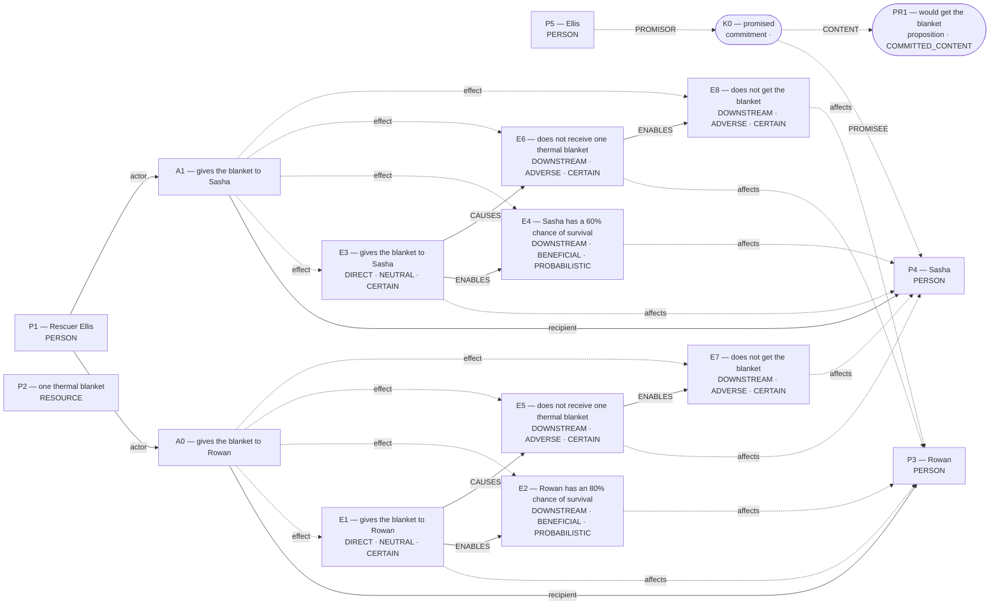

# Parliament demo

Status: **FRAMEWORK_PARTIAL** (recorded_pipeline_outcome).

Native judgment status: NOT_ADJUDICATED.

## Scenario

A mountain rescue shelter has one thermal blanket. Rescuer Ellis can give the blanket to Rowan or Sasha, but not both. Both hikers are stranded in the cold, and no other rescue or warming equipment will arrive in time. If Ellis gives the blanket to Rowan, Rowan has an 80% chance of survival. If Ellis gives the blanket to Sasha, Sasha has a 60% chance of survival. The hiker who does not get the blanket will die. Before learning about Rowan, Ellis promised Sasha that Sasha would get the blanket. Whom should Ellis give the blanket to?

## What Parliament thinks is happening

Actions: gives the blanket to Rowan; gives the blanket to Sasha

Parties: Rescuer Ellis, one thermal blanket, Rowan, Sasha, Ellis

These are alternative action branches and their stipulated outcomes, not claims that both actions occurred.

- Under A0, Rowan: gives the blanket to Rowan (CERTAIN)
- Under A0, Rowan: Rowan has an 80% chance of survival (PROBABILISTIC)
- Under A1, Sasha: gives the blanket to Sasha (CERTAIN)
- Under A1, Sasha: Sasha has a 60% chance of survival (PROBABILISTIC)
- Under A0, Sasha: does not receive one thermal blanket (CERTAIN)
- Under A1, Rowan: does not receive one thermal blanket (CERTAIN)
- Under A0, Sasha: does not get the blanket (CERTAIN)
- Under A1, Rowan: does not get the blanket (CERTAIN)
- gives the blanket to Rowan → ENABLES → Rowan has an 80% chance of survival
- gives the blanket to Sasha → ENABLES → Sasha has a 60% chance of survival
- does not receive one thermal blanket → ENABLES → does not get the blanket
- does not receive one thermal blanket → ENABLES → does not get the blanket
- gives the blanket to Rowan → CAUSES → does not receive one thermal blanket
- gives the blanket to Sasha → CAUSES → does not receive one thermal blanket

## World-state diagram

### Frozen world supplied to framework assessment

## What is grounded

Admitted source copies and structurally derived records follow. Exact excerpts establish traceability; they do not independently prove every interpretation.

- gives the blanket to Rowan — DIRECT_COPY; source: “If Ellis gives the blanket to Rowan, Rowan has an 80% chance of survival.”
- Rowan has an 80% chance of survival — SOURCE_STIPULATED_CAUSAL; source: “If Ellis gives the blanket to Rowan, Rowan has an 80% chance of survival.”
- gives the blanket to Sasha — DIRECT_COPY; source: “If Ellis gives the blanket to Sasha, Sasha has a 60% chance of survival.”
- Sasha has a 60% chance of survival — SOURCE_STIPULATED_CAUSAL; source: “If Ellis gives the blanket to Sasha, Sasha has a 60% chance of survival.”
- does not receive one thermal blanket — EXCLUSIVE_ALLOCATION_COMPLEMENT; source: “A mountain rescue shelter has one thermal blanket.; Rescuer Ellis can give the blanket to Rowan or Sasha, but not both.; If Ellis gives the blanket to Rowan, Rowan has an 80% chance of survival.”
- does not receive one thermal blanket — EXCLUSIVE_ALLOCATION_COMPLEMENT; source: “A mountain rescue shelter has one thermal blanket.; Rescuer Ellis can give the blanket to Rowan or Sasha, but not both.; If Ellis gives the blanket to Sasha, Sasha has a 60% chance of survival.”
- does not get the blanket — SOURCE_STIPULATED_CAUSAL; source: “The hiker who does not get the blanket will die.”
- does not get the blanket — SOURCE_STIPULATED_CAUSAL; source: “The hiker who does not get the blanket will die.”
- Stipulated source claim: Rowan has an 80% chance of survival; affected subject: Rowan; modality: PROBABILISTIC
- Stipulated source claim: 80% chance — Rowan has an 80% chance of survival
- Stipulated source claim: Sasha has a 60% chance of survival; affected subject: Sasha; modality: PROBABILISTIC
- Stipulated source claim: 60% chance — Sasha has a 60% chance of survival
- Stipulated source claim: Rescuer Ellis can give the blanket to Rowan or Sasha, but not both.
- Stipulated source claim: A mountain rescue shelter has one thermal blanket.
- Stipulated source claim: If Ellis gives the blanket to Rowan, Rowan has an 80% chance of survival.
- Stipulated source claim: If Ellis gives the blanket to Sasha, Sasha has a 60% chance of survival.
- Stipulated source claim: The hiker who does not get the blanket will die.

## What remains uncertain

- A0: numeric EV cannot be recomputed from its cited effects
- The utilitarian ledger contains unknown welfare magnitude or duration; survivor arithmetic does not settle total welfare.
- A0 ADJUDICATION_CALIBRATION: omission was classified as a perfect negative-duty violation without a separate basis
- A0 ADJUDICATION_CALIBRATION: candidate maxim person-role conflicts with means classification
- A0 ADJUDICATION_CALIBRATION: resolved adjudication rests on unsupported decisive premises
- A1 ADJUDICATION_CALIBRATION: perfect positive duty lacks a right-correlative, undertaking, or grounded emergency basis
- A1 ADJUDICATION_CALIBRATION: merely-as-means conclusion lacks intended-as-means classification
- A1 ADJUDICATION_CALIBRATION: resolved adjudication rests on unsupported decisive premises
- whether the burden is intended as a means or only foreseen as a side effect
- whether the proposed physical contribution is supported, separately from instrumental belief and purposive use
- what makes the positive duty perfect rather than imperfect
- ellis's duty 'keep promises (fidelity)' protecting sasha ↔ ellis's competing duty 'beneficence (rescue duty)' protecting rowan
- unresolved Care ranking must remain provisional
- A1: numeric EV cannot be recomputed from its cited effects
- Contractualist interpretive question: Did Sasha reasonably rely on Ellis’s promise in a way that amplifies the wrong of breach?

## Framework views

### utilitarian

Position: **ABSTAIN**. Recorded preference: withheld (not necessarily operative).

Framework did not select a live action. UNRESOLVED FRAMEWORK CONFLICT: live competing derivations. No comparative leaning is yet grounded. Interim working action recorded without becoming a ranking: gives the blanket to Rowan. Higher expected lives saved. Unresolved contestation: Prefer “gives the blanket to Rowan” when its expected survivor count exceeds that of “gives the blanket to Sasha”. Recorded comparison — “gives the blanket to Rowan”: Giving Rowan the blanket yields an 80 % survival chance, producing an expected 0.8 lives saved while Sasha certainly dies; this is the highest attainable expected welfare in the scenario.; “gives the blanket to Sasha”: Giving Sasha the blanket fulfils Ellis’s promise and gives Sasha a 60 % chance of survival (0.6 expected lives) but leaves Rowan certain to die, so total expected welfare is lower. Unadmitted magnitude cannot decide the ranking; the claim remains a reversal boundary.

[Full recorded explanation (Markdown)](arguments/utilitarian.md).

Assumptions / interpretive commitments: Recorded interpretive commitment: Prefer “gives the blanket to Rowan” when its expected survivor count exceeds that of “gives the blanket to Sasha”.; Run assumption: The stated scenario facts are accepted as givens for this analysis; their accuracy outside this scenario has not been verified.

The scenario’s stated facts are treated as givens for this run. No separate record says whether they were observed, reported by someone, or supplied as simulation facts. This is a provenance limitation, not a claim that the stated counts are missing.

Dependencies: Rowan has an 80% chance of survival; affected subject: Rowan; modality: PROBABILISTIC; Sasha has a 60% chance of survival; affected subject: Sasha; modality: PROBABILISTIC

Live objection: A0: numeric EV cannot be recomputed from its cited effects

Open comparison (no ranking to reverse): A moral rule making promise‐keeping override a 0.2 life difference would reverse the ranking.; Sasha’s survival probability rising to ≥ 80 % would reverse the ranking.

### deontological

Position: **ABSTAIN**. Recorded preference: gives the blanket to Sasha (not necessarily operative).

The agent assesses Ellis’s duty “keep promises (fidelity)” toward sasha. Ellis is the duty-bearer; sasha is the protected party. The competing obligation being assessed is Ellis’s “beneficence (rescue duty)” toward rowan. For “gives the blanket to Rowan”, the agent proposes the maxim “give blanket to Rowan instead”. This is an interpretation of possible practical reasoning, not an established intention. Its purpose is maximize survival probability; its chosen means are allocate blanket to higher-chance hiker. The proposed justification is: Would defeat reliability of promising. The agent assesses the maxim as indefensible, and the action as impermissible. Its proposed means–ends reasoning is: Believes reallocating blanket increases overall survival chances. Physical means references: E1; end references: E2. For Ellis’s option “gives the blanket to Rowan”, the ledger records conflicted. The agent’s stated reason is: Breaks a promise that could not be universalized without contradiction in conception.. For “gives the blanket to Sasha”, the agent proposes the maxim “give blanket to Sasha”. This is an interpretation of possible practical reasoning, not an established intention. Its purpose is keep promise; its chosen means are allocate promised blanket. The proposed justification is: Consistent; promise-based allocations remain reliable. The agent assesses the maxim as defensible, and the action as permissible. Its proposed means–ends reasoning is: Believes honoring promise is required regardless of utility. Physical means references: E3; end references: none. For Ellis’s option “gives the blanket to Sasha”, the ledger records conflicted. The agent’s stated reason is: Fulfills promise without instrumentalizing anyone.. The ledger retains unresolved issues; this does not establish that one duty overrides the other.

[Full recorded explanation (Markdown)](arguments/deontological.md).

Assumptions / interpretive commitments: Recorded interpretive commitment: Prefer the action that fulfills the agent’s perfect duty of fidelity when the rival action only advances an imperfect duty of beneficence.; Recorded interpretive commitment: Probabilities affect beneficence but do not override promise-keeping perfect duty; Run assumption: The stated scenario facts are accepted as givens for this analysis; their accuracy outside this scenario has not been verified.

The scenario’s stated facts are treated as givens for this run. No separate record says whether they were observed, reported by someone, or supplied as simulation facts. This is a provenance limitation, not a claim that the stated counts are missing.

Dependencies: Not separately recorded.

Live objection: A0 ADJUDICATION_CALIBRATION: omission was classified as a perfect negative-duty violation without a separate basis; A0 ADJUDICATION_CALIBRATION: candidate maxim person-role conflicts with means classification; A0 ADJUDICATION_CALIBRATION: resolved adjudication rests on unsupported decisive premises; A1 ADJUDICATION_CALIBRATION: perfect positive duty lacks a right-correlative, undertaking, or grounded emergency basis; A1 ADJUDICATION_CALIBRATION: merely-as-means conclusion lacks intended-as-means classification; A1 ADJUDICATION_CALIBRATION: resolved adjudication rests on unsupported decisive premises; whether the burden is intended as a means or only foreseen as a side effect; whether the proposed physical contribution is supported, separately from instrumental belief and purposive use; what makes the positive duty perfect rather than imperfect; ellis's duty 'keep promises (fidelity)' protecting sasha ↔ ellis's competing duty 'beneficence (rescue duty)' protecting rowan

Would reverse the recorded preference: The agent reports a switch from “gives the blanket to Sasha” to “gives the blanket to Rowan”. Condition: If promise-keeping were not a perfect duty (e.g., promise judged void), saving the person with higher survival chance would take priority. This is an agent-reported condition, not an independently established threshold.

### care

Position: **ABSTAIN**. Recorded preference: gives the blanket to Rowan (not necessarily operative).

Expected CARE_RELATIONSHIP_LEDGER, but no matching committed ledger is operative. competent care outweighs promise. Prefer “gives the blanket to Rowan” when it yields clearly higher survival probability without creating a new dependency. Recorded comparison — “gives the blanket to Rowan”: Ellis uses the only blanket to aid Rowan, meeting an immediate life-threatening need with the higher chance of success. Although this breaks a prior promise to Sasha, competence in preserving life is a core phase of good care when needs and vulnerability are equal.; “gives the blanket to Sasha”: Ellis keeps the promise to Sasha, honoring trust and relational continuity, but offers a less competent response to the equal life-threatening need because Sasha’s chance of survival is lower, thereby neglecting Rowan.

[Full recorded explanation (Markdown)](arguments/care.md).

Assumptions / interpretive commitments: Recorded interpretive commitment: Prefer “gives the blanket to Rowan” when it yields clearly higher survival probability without creating a new dependency.; Recorded interpretive commitment: Probabilities inform competence but do not override relational duties unless gap is large.; Run assumption: The stated scenario facts are accepted as givens for this analysis; their accuracy outside this scenario has not been verified.

The scenario’s stated facts are treated as givens for this run. No separate record says whether they were observed, reported by someone, or supplied as simulation facts. This is a provenance limitation, not a claim that the stated counts are missing.

Dependencies: Not separately recorded.

Live objection: unresolved Care ranking must remain provisional

Would reverse the recorded preference: The agent reports a switch from “gives the blanket to Rowan” to “gives the blanket to Sasha”. Condition: If honoring promises is given strict priority over competent care, prefer “gives the blanket to Sasha”. This is an agent-reported condition, not an independently established threshold.; The agent reports a switch from “gives the blanket to Rowan” to “gives the blanket to Sasha”. Condition: If Sasha’s survival probability exceeded Rowan’s (e.g. >80%), switch to “gives the blanket to Sasha”. This is an agent-reported condition, not an independently established threshold.

### virtue

Position: **ATTENUATED**. Recorded preference: gives the blanket to Rowan (not necessarily operative).

Wiser life-saving choice. Prefer “gives the blanket to Rowan” when greater expected survival outweighs non-absolute duty to keep a rash promise. Recorded comparison — “gives the blanket to Rowan”: EXEMPLIFIES: As rescuer, Ellis shows practical wisdom and benevolence by maximizing the chance a hiker survives, even at the cost of retracting a rash promise.; “gives the blanket to Sasha”: MIXED: Keeps the promise and shows reliability, but sacrifices prudence and justice by allowing the greater chance of life to be lost.

[Full recorded explanation (Markdown)](arguments/virtue.md).

Assumptions / interpretive commitments: Recorded interpretive commitment: Prefer “gives the blanket to Rowan” when greater expected survival outweighs non-absolute duty to keep a rash promise.; Recorded interpretive commitment: Numbers inform but do not override character; they guide prudent allocation of scarce aid.; Run assumption: The stated scenario facts are accepted as givens for this analysis; their accuracy outside this scenario has not been verified.

The scenario’s stated facts are treated as givens for this run. No separate record says whether they were observed, reported by someone, or supplied as simulation facts. This is a provenance limitation, not a claim that the stated counts are missing.

Dependencies: promised would get the blanket

Live objection: A0: numeric EV cannot be recomputed from its cited effects; A1: numeric EV cannot be recomputed from its cited effects

Would reverse the recorded preference: The agent reports a switch from “gives the blanket to Rowan” to “gives the blanket to Sasha”. Condition: If promise-keeping were an absolute virtue overriding prudence. This is an agent-reported condition, not an independently established threshold.; The agent reports a switch from “gives the blanket to Rowan” to “gives the blanket to Sasha”. Condition: If Sasha’s survival chance meets or exceeds Rowan’s. This is an agent-reported condition, not an independently established threshold.

### contractualist

Position: **ATTENUATED**. Recorded preference: gives the blanket to Rowan (not necessarily operative).

Saving the person with the markedly higher survival chance (Rowan) is provisionally preferable, because the certain loss of Rowan’s life is a stronger reasonable objection than Sasha’s complaint of broken promise, absent evidence of special reliance.

[Full recorded explanation (Markdown)](arguments/contractualist.md).

Assumptions / interpretive commitments: Model proposed interpretive premise: Breaking the promise would wrong Sasha by violating an undertaken assurance.; Model proposed normative premise: A principle is unreasonable if any affected person could reasonably reject it.; Model proposed principle: When only one person can be saved, the rescuer should maximize the individual chance of survival (PRIORITISE_SURVIVAL).; Model proposed principle: An explicit promise made to someone establishes a claim that should normally be honoured even when new information appears (KEEP_PROMISES).; Model proposed normative premise: In a life-and-death rescue, avoiding an avoidable death is normally a weightier reason than preventing a promissory wrong, unless the promisee relied on the assurance.

The exact scenario and the same validated frozen world supplied to the other four specialists.

Dependencies: Did Sasha reasonably rely on Ellis’s promise in a way that amplifies the wrong of breach?

Live objection: Weight of promissory obligation versus survival advantage; The argument graph has 25 binding findings; the original argument and questions remain inspectable.

Would reverse the recorded preference: If Sasha had materially relied on the promise or if the survival probabilities were roughly equal, KEEP_PROMISES could no longer be reasonably rejected, and giving the blanket to Sasha might become defensible.

## Critical unanswered questions

**Q1 — INTERPRETIVE / DECISION_DEPENDENCY**

Did Sasha reasonably rely on Ellis’s promise in a way that amplifies the wrong of breach?

Affected people: Sasha.
Options: A0, A1.

Why it matters: If reliance is strong, the promissory claim might plausibly outweigh survival-probability gains.

What could help: Evidence of reliance costs or expectations set by the promise.

- If Strong reliance established: ST_WEIGHT would tilt, comparison C1 could become UNRESOLVED or favor A1.
- If No reliance beyond hope: Current weighting remains reasonable.

These are proposed questions and conditional arguments, not settled moral findings.

## Agreement and disagreement

Recorded preferences differ. A Contractualist question-focused contribution is not counted as agreement or a contrary vote.

Framework-local normative arguments and empirical dependencies are shown above; no automatic causal classification is claimed.

- deontological: normative dependency — If promise-keeping were not a perfect duty (e.g., promise judged void), saving the person with higher survival chance would take priority.
- care: normative dependency — If honoring promises is given strict priority over competent care, prefer A1.
- contractualist: interpretive dependency — Did Sasha reasonably rely on Ellis’s promise in a way that amplifies the wrong of breach?

## Decision hinges

- utilitarian: A moral rule making promise‐keeping override a 0.2 life difference would reverse the ranking. (abstention boundary, no ranking to reverse; `cycles/0/candidates/0/normative_reversal_threshold`).
- deontological: If promise-keeping were not a perfect duty (e.g., promise judged void), saving the person with higher survival chance would take priority. (would reverse a recorded preference; `cycles/0/candidates/1/normative_reversal_threshold`).
- care: If honoring promises is given strict priority over competent care, prefer A1. (would reverse a recorded preference; `cycles/0/candidates/2/normative_reversal_threshold`).
- contractualist: Did Sasha reasonably rely on Ellis’s promise in a way that amplifies the wrong of breach? (critical unanswered question; `contractualist/response.json#/critical_questions/0`).

## What Parliament did not decide

- This report does not adjudicate a governing moral verdict.
- Ledger admission does not prove the argument or supply missing welfare units.
- Unresolved objections remain live; reported reversal thresholds are not source facts.
- The Contractualist adapter contributes attributed arguments and questions, not a committed native ledger or an operative vote.

## Topography

Survivor arithmetic does not settle total welfare. Coordinates are native ledger records, not a calibrated moral physics. Attractors are occupancy of recorded points, not interpolated terrain.

Recorded action loci only. Missing axes are omitted; UNKNOWN is not plotted as zero.

- A0 gives the blanket to Rowan — care: omitted; welfare: omitted; obligation: CONFLICTED
- A1 gives the blanket to Sasha — care: omitted; welfare: omitted; obligation: CONFLICTED

Degenerate: none
Attractors: none

- Contractualist questions appear in Frameworks and Hinges; no Rawls score or Contractualist coordinate is inferred.

## Run provenance

Execution: report_postprocessing; run ID: run_22d96b37409f4be4b91bec3106dbeaa8.
Application commit: a1a79d242b2ef4ffb8e4a2e7a6256075b0232cdf; source fingerprint: c75b83ef4f70c00193e7d48ddf1588feca02768df01b8ec89a96f2efaa3aca12.
Original generation: run_22d96b37409f4be4b91bec3106dbeaa8.
The finalized run_manifest.json records configuration, runtime checks, source snapshot, and output hashes.

## Pipeline stop and inspection

Four native framework passes plus a question-capable Contractualist argument. Open comparisons remain visible.

Missing slots: none recorded

Competing admitted interpretations: none recorded

Inspection artifacts (saved replay references its original records):

- [frozen_world_trace.json](/Users/benjaminkowal/Documents/Python/Python Coding/RL_Algorithms/diagnostics/thermal_blanket_end_to_end_20261023/report_input/frozen_world_trace.json)
- [framework_generation.json](/Users/benjaminkowal/Documents/Python/Python Coding/RL_Algorithms/diagnostics/contractualist_frontend_20261026/frameworks/framework_generation.json)
- [result.json](/Users/benjaminkowal/Documents/Python/Python Coding/RL_Algorithms/diagnostics/contractualist_frontend_20261026/contractualist/result.json)
- [source.json](/Users/benjaminkowal/Documents/Python/Python Coding/RL_Algorithms/diagnostics/contractualist_frontend_20261026/contractualist/source.json)
- [critical_questions.md](/Users/benjaminkowal/Documents/Python/Python Coding/RL_Algorithms/diagnostics/contractualist_frontend_20261026/contractualist/critical_questions.md)
- [run_manifest.json](/Users/benjaminkowal/Documents/Python/Python Coding/RL_Algorithms/diagnostics/contractualist_frontend_20261026/frameworks/run_manifest.json)
- [run_manifest.json](/Users/benjaminkowal/Documents/Python/Python Coding/RL_Algorithms/diagnostics/contractualist_frontend_20261026/contractualist/run_manifest.json)
