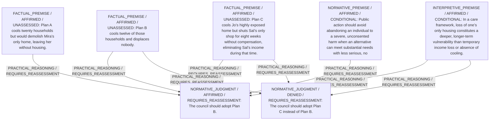

# Candidate arguments

Nonvoting argument overlays. These are not admitted world-state graphs.

## care

STAGED_PARTIAL_ARGUMENT

Critic's proposed remaining conclusion (check accepted graph below): Plan B best meets significant cooling needs while avoiding the deepest vulnerability (homelessness) and shows adequate responsiveness to all parties without abandoning Mira or Sal.

Remaining questions: Whether temporary uncompensated income loss is less severe than extreme heat exposure remains contestable without more detail on Jo’s medical risk and Sal’s economic margin.

## Binding issues (not moral verdicts)

[
  {
    "kind": "DETACHED_COMPARISON",
    "record_id": "cmp1"
  }
]

Full principles, reasons, comparisons and proposed attacks: [response.json](response.json).
