# Candidate arguments

Nonvoting argument overlays. These are not admitted world-state graphs.

## contractualist

STAGED_PARTIAL_ARGUMENT

Critic's proposed remaining conclusion (check accepted graph below): Plan B is the only option that no party can reasonably reject under the most plausible principles: A is ruled out by Mira’s severe uncompensated homelessness, and C remains contestable because Sal’s serious but temporary economic loss and Jo’s serious heat risk present roughly comparable grounds. With that tie unresolved, the council should adopt Plan B.

```mermaid
flowchart TB
n0["FACTUAL_PREMISE / AFFIRMED / UNASSESSED: Plan A cools twenty households."]
n1["FACTUAL_PREMISE / AFFIRMED / UNASSESSED: Plan A requires demolishing Mira&#x27;s occupied home, leaving her without housing."]
n2["FACTUAL_PREMISE / AFFIRMED / UNASSESSED: Plan B cools twelve of those same households and displaces nobody."]
n3["FACTUAL_PREMISE / AFFIRMED / UNASSESSED: Plan C cools Jo&#x27;s home, which has the greatest heat exposure, but requires closing Sal&#x27;s only shop for eight weeks without compensation, depriving Sal"]
n4["FACTUAL_PREMISE / AFFIRMED / UNASSESSED: Jo&#x27;s home is not cooled by A or B."]
n5["PRINCIPLE / AFFIRMED / CONDITIONAL: It is unreasonable to impose a severe uncompensated displacement on an unwilling individual if a feasible alternative benefits somewhat fewer others w"]
n6["PRINCIPLE / AFFIRMED / CONDITIONAL: A temporary income loss imposed on an unwilling individual may be justifiable when it is the only way to avert a serious heat risk for another and avo"]
n7["PERSONAL_REASON / AFFIRMED / UNASSESSED: Homelessness is a very severe loss that no reasonable person would accept merely so that eight additional households (over Plan B) receive cooling."]
n8["PERSONAL_REASON / AFFIRMED / UNASSESSED: Losing the only source of income for eight weeks without compensation is a serious setback that Sal can reasonably reject if others could be helped wi"]
n9["PERSONAL_REASON / AFFIRMED / UNASSESSED: Facing the greatest heat exposure, Jo values immediate cooling and may reasonably object to any plan that leaves her without relief when a feasible pl"]
n10["PERSONAL_REASON / AFFIRMED / UNASSESSED: Receiving cooling improves safety and comfort; losing that benefit (relative to Plan A) is a moderate cost that a household could reasonably bear if a"]
```

Remaining questions: Whether an eight-week uncompensated closure is less severe than enduring the greatest heat exposure remains disputed.; Some may hold that protecting against direct health risks should systematically outweigh economic losses even if severe.

Original construction problems retained: 10

## Binding issues (not moral verdicts)

[
  {
    "kind": "CONSTRUCTION",
    "path": "supports/0",
    "proposal": {
      "operation": "SOURCE",
      "inputs": [
        "f1"
      ],
      "output": "f1",
      "explanation": ": quoted from scenario"
    },
    "error": "Self-dependent support"
  },
  {
    "kind": "CONSTRUCTION",
    "path": "supports/1",
    "proposal": {
      "operation": "SOURCE",
      "inputs": [
        "f2"
      ],
      "output": "f2",
      "explanation": ": quoted from scenario"
    },
    "error": "Self-dependent support"
  },
  {
    "kind": "CONSTRUCTION",
    "path": "supports/2",
    "proposal": {
      "operation": "SOURCE",
      "inputs": [
        "f3"
      ],
      "output": "f3",
      "explanation": ": quoted from scenario"
    },
    "error": "Self-dependent support"
  },
  {
    "kind": "CONSTRUCTION",
    "path": "supports/3",
    "proposal": {
      "operation": "SOURCE",
      "inputs": [
        "f4"
      ],
      "output": "f4",
      "explanation": ": quoted from scenario"
    },
    "error": "Self-dependent support"
  },
  {
    "kind": "CONSTRUCTION",
    "path": "supports/4",
    "proposal": {
      "operation": "SOURCE",
      "inputs": [
        "f5"
      ],
      "output": "f5",
      "explanation": ": quoted from scenario"
    },
    "error": "Self-dependent support"
  },
  {
    "kind": "CONSTRUCTION",
    "path": "supports/5",
    "proposal": {
      "operation": "ASSUMPTION",
      "inputs": [
        "p1"
      ],
      "output": "p1",
      "explanation": "Principle proposed for evaluation"
    },
    "error": "Self-dependent support"
  },
  {
    "kind": "CONSTRUCTION",
    "path": "supports/6",
    "proposal": {
      "operation": "ASSUMPTION",
      "inputs": [
        "p2"
      ],
      "output": "p2",
      "explanation": "Principle proposed for evaluation"
    },
    "error": "Self-dependent support"
  },
  {
    "kind": "CONSTRUCTION",
    "path": "supports/7",
    "proposal": {
      "operation": "PRACTICAL_REASONING",
      "inputs": [
        "p1",
        "f2",
        "f3",
        "r_mira",
        "r_thm"
      ],
      "output": "c1",
      "explanation": "From P1 and Mira\u2019s reason, Plan A is reasonably rejectable, Plan B is not, so select B over A."
    },
    "error": "Dangling support reference"
  },
  {
    "kind": "CONSTRUCTION",
    "path": "supports/8",
    "proposal": {
      "operation": "PRACTICAL_REASONING",
      "inputs": [
        "p2",
        "f4",
        "f5",
        "r_sal",
        "r_jo"
      ],
      "output": "c2",
      "explanation": "From P2, assess whether Sal\u2019s objection outweighs Jo\u2019s need; leaves comparison between B and C open."
    },
    "error": "Dangling support reference"
  },
  {
    "kind": "CONSTRUCTION",
    "path": "supports/9",
    "proposal": {
      "operation": "NORM_PRIORITY",
      "inputs": [
        "c1",
        "c2"
      ],
      "output": "final_pref",
      "explanation": "Because P1 labels A impermissible and B acceptable, while P2 leaves B vs C disputed, B is the only option that no individual has a decisive reasonable rejection against."
    },
    "error": "Dangling support reference"
  },
  {
    "kind": "PERSON_SOURCE_BINDING_MISSING",
    "record_id": "Mira"
  },
  {
    "kind": "PERSON_SOURCE_BINDING_MISSING",
    "record_id": "Sal"
  },
  {
    "kind": "MISSING_STATEMENT_REFERENCE",
    "record_id": "Reason_Mira_A"
  },
  {
    "kind": "DETACHED_REASON_SUPPORT",
    "record_id": "Reason_Mira_A"
  },
  {
    "kind": "DETACHED_REASON_SUPPORT",
    "record_id": "Reason_Mira_A"
  },
  {
    "kind": "DETACHED_REASON_SUPPORT",
    "record_id": "Reason_Mira_A"
  },
  {
    "kind": "MISSING_STATEMENT_REFERENCE",
    "record_id": "Reason_THM_A"
  },
  {
    "kind": "DETACHED_REASON_SUPPORT",
    "record_id": "Reason_THM_A"
  },
  {
    "kind": "DETACHED_REASON_SUPPORT",
    "record_id": "Reason_THM_A"
  },
  {
    "kind": "DETACHED_REASON_SUPPORT",
    "record_id": "Reason_THM_A"
  },
  {
    "kind": "MISSING_STATEMENT_REFERENCE",
    "record_id": "Reason_THM_B"
  },
  {
    "kind": "DETACHED_REASON_SUPPORT",
    "record_id": "Reason_THM_B"
  },
  {
    "kind": "DETACHED_REASON_SUPPORT",
    "record_id": "Reason_THM_B"
  },
  {
    "kind": "MISSING_STATEMENT_REFERENCE",
    "record_id": "Reason_Sal_C"
  },
  {
    "kind": "DETACHED_REASON_SUPPORT",
    "record_id": "Reason_Sal_C"
  },
  {
    "kind": "DETACHED_REASON_SUPPORT",
    "record_id": "Reason_Sal_C"
  },
  {
    "kind": "DETACHED_REASON_SUPPORT",
    "record_id": "Reason_Sal_C"
  },
  {
    "kind": "MISSING_STATEMENT_REFERENCE",
    "record_id": "Reason_Jo_C"
  },
  {
    "kind": "DETACHED_REASON_SUPPORT",
    "record_id": "Reason_Jo_C"
  },
  {
    "kind": "DETACHED_REASON_SUPPORT",
    "record_id": "Reason_Jo_C"
  },
  {
    "kind": "DETACHED_REASON_SUPPORT",
    "record_id": "Reason_Jo_C"
  },
  {
    "kind": "DETACHED_REASON_SUPPORT",
    "record_id": "Reason_Jo_C"
  },
  {
    "kind": "MISSING_STATEMENT_REFERENCE",
    "record_id": "cmp1"
  },
  {
    "kind": "MISSING_STATEMENT_REFERENCE",
    "record_id": "cmp2"
  },
  {
    "kind": "MISSING_STATEMENT_REFERENCE",
    "record_id": "obj1"
  },
  {
    "kind": "MISSING_STATEMENT_REFERENCE",
    "record_id": "obj1"
  },
  {
    "kind": "MISSING_SUPPORT_TARGET",
    "record_id": "obj1"
  },
  {
    "kind": "ATTACK_TARGET_KIND_MISMATCH",
    "record_id": "obj1"
  },
  {
    "kind": "MISSING_STATEMENT_REFERENCE",
    "record_id": "A"
  },
  {
    "kind": "MISSING_STATEMENT_REFERENCE",
    "record_id": "B"
  },
  {
    "kind": "MISSING_STATEMENT_REFERENCE",
    "record_id": "C"
  }
]

Full principles, reasons, comparisons and proposed attacks: [response.json](response.json).
