# Candidate arguments

Nonvoting argument overlays. These are not admitted world-state graphs.

## deontological

STAGED_PARTIAL_ARGUMENT

Critic's proposed remaining conclusion (check accepted graph below): Plan B best complies with perfect duties because it aids twelve households while violating no one’s stringent rights; Plans A and C would breach the unconsented basic‐rights of Mira and Sal, duties that deontological priority rules treat as overriding the imperfect duty of heat relief.

```mermaid
flowchart TB
n0["FACTUAL_PREMISE / AFFIRMED / UNASSESSED: Plan A cools twenty households."]
n1["FACTUAL_PREMISE / AFFIRMED / UNASSESSED: Plan A requires demolishing Mira&#x27;s occupied home, leaving her without housing, and Mira refuses."]
n2["FACTUAL_PREMISE / AFFIRMED / UNASSESSED: Plan B cools twelve of those same households and displaces nobody."]
n3["FACTUAL_PREMISE / AFFIRMED / UNASSESSED: No additional cooling, relocation, or compensation plan is available in this exercise."]
n4["NORMATIVE_PREMISE / AFFIRMED / CONDITIONAL: There is a stringent duty not to destroy a person&#x27;s home without that person&#x27;s voluntary consent."]
n5["NORMATIVE_PREMISE / AFFIRMED / CONDITIONAL: There is a stringent duty not to deprive a person of her sole livelihood for an extended period without her voluntary consent or compensation."]
n6["NORMATIVE_PREMISE / AFFIRMED / CONDITIONAL: Public authorities have an imperfect duty to mitigate serious heat-related harms to residents when doing so is compatible with respecting basic rights"]
n7["INTERPRETIVE_PREMISE / AFFIRMED / CONDITIONAL: Demolishing an occupied home over the resident&#x27;s refusal would constitute using that person merely as a means to an end of cooling others."]
n8["INTERPRETIVE_PREMISE / AFFIRMED / CONDITIONAL: Closing Sal&#x27;s only shop without compensation over her refusal would likewise treat Sal merely as a means."]
n9["NORMATIVE_JUDGMENT / AFFIRMED / UNASSESSED: The council ought to adopt Plan B."]
n10["NORMATIVE_JUDGMENT / AFFIRMED / REQUIRES_REASSESSMENT: The council ought not adopt Plan A."]
n11["NORMATIVE_JUDGMENT / AFFIRMED / UNASSESSED: The council ought not adopt Plan C."]
n1 -->|PRACTICAL_REASONING / REQUIRES_REASSESSMENT| n10
n4 -->|PRACTICAL_REASONING / REQUIRES_REASSESSMENT| n10
n7 -->|PRACTICAL_REASONING / REQUIRES_REASSESSMENT| n10
n2 -->|PRACTICAL_REASONING / REQUIRES_REASSESSMENT| n9
n6 -->|PRACTICAL_REASONING / REQUIRES_REASSESSMENT| n9
n4 -->|NORM_PRIORITY / UNASSESSED| n9
n6 -->|NORM_PRIORITY / UNASSESSED| n9
```

Remaining questions: Some reject the priority of negative over positive duties and would still weigh numbers of people helped, leaving debate unresolved on consequentialist grounds.

Original construction problems retained: 3

## Binding issues (not moral verdicts)

[
  {
    "kind": "CONSTRUCTION",
    "path": "statements/3",
    "proposal": {
      "kind": "FACTUAL_PREMISE",
      "text": "Plan C cools Jo's home but requires closing Sal's only shop for eight weeks without compensation, depriving Sal of income, and Sal refuses.",
      "polarity": "AFFIRMED",
      "modality": "ASSERTED",
      "hypothesis_ids": [],
      "citations": [
        {
          "evidence_id": "SCENE",
          "value_path": "",
          "quote": "Plan C ... requires closing Sal's only shop for eight weeks without compensation, depriving Sal of income during that period. Sal refuses"
        }
      ],
      "handle": "sF4"
    },
    "error": "Citation quote does not match exact location"
  },
  {
    "kind": "CONSTRUCTION",
    "path": "supports/3",
    "proposal": {
      "operation": "SOURCE",
      "inputs": [],
      "output": "sF4",
      "explanation": "Taken directly from scenario."
    },
    "error": "Dangling support reference"
  },
  {
    "kind": "CONSTRUCTION",
    "path": "supports/9",
    "proposal": {
      "operation": "PRACTICAL_REASONING",
      "inputs": [
        "sF4",
        "sN2",
        "sI2"
      ],
      "output": "cjC",
      "explanation": "Closing Sal's sole livelihood without consent violates stringent duty; duty overrides aid to Jo."
    },
    "error": "Dangling support reference"
  },
  {
    "kind": "PERSON_SOURCE_BINDING_MISSING",
    "record_id": "council"
  },
  {
    "kind": "DETACHED_REASON_SUPPORT",
    "record_id": "R2A"
  },
  {
    "kind": "DETACHED_REASON_SUPPORT",
    "record_id": "R2A"
  },
  {
    "kind": "DETACHED_REASON_SUPPORT",
    "record_id": "R2B"
  },
  {
    "kind": "MISSING_STATEMENT_REFERENCE",
    "record_id": "R2B"
  },
  {
    "kind": "MISSING_STATEMENT_REFERENCE",
    "record_id": "R1C"
  },
  {
    "kind": "DETACHED_REASON_SUPPORT",
    "record_id": "R1C"
  },
  {
    "kind": "DETACHED_REASON_SUPPORT",
    "record_id": "R1C"
  },
  {
    "kind": "MISSING_STATEMENT_REFERENCE",
    "record_id": "R2C"
  },
  {
    "kind": "DETACHED_REASON_SUPPORT",
    "record_id": "R2C"
  },
  {
    "kind": "DETACHED_COMPARISON",
    "record_id": "Comp1"
  },
  {
    "kind": "DETACHED_COMPARISON",
    "record_id": "Comp2"
  },
  {
    "kind": "DETACHED_COMPARISON",
    "record_id": "Comp3"
  },
  {
    "kind": "MISSING_STATEMENT_REFERENCE",
    "record_id": "O1"
  },
  {
    "kind": "MISSING_STATEMENT_REFERENCE",
    "record_id": "O1"
  }
]

Full principles, reasons, comparisons and proposed attacks: [response.json](response.json).
