# Candidate arguments

Nonvoting argument overlays. These are not admitted world-state graphs.

## utilitarian

STAGED_PARTIAL_ARGUMENT

Critic's proposed remaining conclusion (check accepted graph below): Utilitarian comparison supports adopting Plan B, because it secures substantial heat-relief for twelve households without imposing the very large welfare losses found in Plans A and C.

```mermaid
flowchart TB
n0["PRINCIPLE / AFFIRMED / CONDITIONAL: Choose the plan that produces the greatest expected aggregate welfare for all affected parties."]
n1["FACTUAL_PREMISE / AFFIRMED / UNASSESSED: Plan A cools twenty households."]
n2["FACTUAL_PREMISE / AFFIRMED / UNASSESSED: Plan A demolishes Mira’s home, leaving her without housing."]
n3["FACTUAL_PREMISE / AFFIRMED / UNASSESSED: Plan B cools twelve of those households and displaces nobody."]
n4["FACTUAL_PREMISE / AFFIRMED / UNASSESSED: Plan C cools Jo’s home, which has the greatest heat exposure."]
n5["FACTUAL_PREMISE / AFFIRMED / UNASSESSED: Plan C forces Sal’s only shop to close for eight weeks without compensation, depriving Sal of income."]
n6["INTERPRETIVE_PREMISE / AFFIRMED / CONDITIONAL: Losing one’s only housing for an indefinite period imposes a very large welfare loss, greater than the incremental cooling benefit to eight additional"]
n7["INTERPRETIVE_PREMISE / AFFIRMED / CONDITIONAL: Losing the sole source of income for eight weeks imposes a substantial but temporary welfare loss, likely exceeding the cooling benefit to a single ho"]
n8["INTERPRETIVE_PREMISE / AFFIRMED / CONDITIONAL: Twelve households receiving cooling during a heat-wave gain a significant welfare benefit that, in aggregate, exceeds the single-household benefit to "]
n9["NORMATIVE_PREMISE / AFFIRMED / CONDITIONAL: When comparing harms and benefits, severe, long-lasting deprivations such as homelessness have lexical priority over moderate, time-limited comfort ga"]
n10["NORMATIVE_JUDGMENT / AFFIRMED / UNASSESSED: Plan A yields lower net aggregate welfare than Plan B."]
n11["NORMATIVE_JUDGMENT / AFFIRMED / UNASSESSED: Plan C yields lower net aggregate welfare than Plan B."]
n12["NORMATIVE_JUDGMENT / AFFIRMED / REQUIRES_REASSESSMENT: Among the three options, Plan B maximises expected aggregate welfare."]
n10 -->|PRACTICAL_REASONING / REQUIRES_REASSESSMENT| n12
n11 -->|PRACTICAL_REASONING / REQUIRES_REASSESSMENT| n12
n0 -->|PRACTICAL_REASONING / REQUIRES_REASSESSMENT| n12
```

Remaining questions: Comparability of severe harms with comfort benefits; Priority claims for the worst-off vs sum-maximisation

Original construction problems retained: 5

## Binding issues (not moral verdicts)

[
  {
    "kind": "CONSTRUCTION",
    "path": "supports/0",
    "proposal": {
      "operation": "ASSUMPTION",
      "inputs": [
        "I1",
        "I3",
        "N1"
      ],
      "output": "C1",
      "explanation": "Homelessness to Mira outweighs extra eight households benefit."
    },
    "error": "Assumptions must be explicit interpretive/normative roots"
  },
  {
    "kind": "CONSTRUCTION",
    "path": "supports/1",
    "proposal": {
      "operation": "ASSUMPTION",
      "inputs": [
        "I2",
        "I3"
      ],
      "output": "C2",
      "explanation": "Sal\u2019s income loss outweighs Jo\u2019s single-household benefit vs twelve-household benefit."
    },
    "error": "Assumptions must be explicit interpretive/normative roots"
  },
  {
    "kind": "CONSTRUCTION",
    "path": "supports/3",
    "proposal": {
      "operation": "SOURCE",
      "inputs": [
        "F1",
        "F2"
      ],
      "output": "I1",
      "explanation": "Draw magnitude comparison between homelessness and comfort."
    },
    "error": "Source route requires citations and no argument premises"
  },
  {
    "kind": "CONSTRUCTION",
    "path": "supports/4",
    "proposal": {
      "operation": "SOURCE",
      "inputs": [
        "F4",
        "F5"
      ],
      "output": "I2",
      "explanation": "Derive relative magnitudes."
    },
    "error": "Source route requires citations and no argument premises"
  },
  {
    "kind": "CONSTRUCTION",
    "path": "supports/5",
    "proposal": {
      "operation": "SOURCE",
      "inputs": [
        "F1",
        "F3",
        "F4"
      ],
      "output": "I3",
      "explanation": "Compare beneficiaries count."
    },
    "error": "Source route requires citations and no argument premises"
  },
  {
    "kind": "DETACHED_REASON_SUPPORT",
    "record_id": "R_A"
  },
  {
    "kind": "DETACHED_REASON_SUPPORT",
    "record_id": "R_A"
  },
  {
    "kind": "DETACHED_REASON_SUPPORT",
    "record_id": "R_A"
  },
  {
    "kind": "DETACHED_REASON_SUPPORT",
    "record_id": "R_A"
  },
  {
    "kind": "DETACHED_REASON_SUPPORT",
    "record_id": "R_B"
  },
  {
    "kind": "DETACHED_REASON_SUPPORT",
    "record_id": "R_B"
  },
  {
    "kind": "DETACHED_REASON_SUPPORT",
    "record_id": "R_C"
  },
  {
    "kind": "DETACHED_REASON_SUPPORT",
    "record_id": "R_C"
  },
  {
    "kind": "DETACHED_REASON_SUPPORT",
    "record_id": "R_C"
  },
  {
    "kind": "DETACHED_COMPARISON",
    "record_id": "COMP1"
  },
  {
    "kind": "DETACHED_COMPARISON",
    "record_id": "COMP2"
  },
  {
    "kind": "MISSING_STATEMENT_REFERENCE",
    "record_id": "OB1"
  },
  {
    "kind": "MISSING_STATEMENT_REFERENCE",
    "record_id": "OB1"
  },
  {
    "kind": "VERDICT_USED_AS_PREMISE",
    "record_id": "STATEMENT:a61fcee052e38cf5f2c0ed35"
  }
]

Full principles, reasons, comparisons and proposed attacks: [response.json](response.json).
