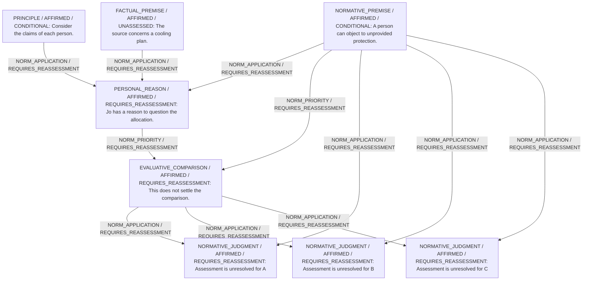

# Framework contribution

Decision status: UNRESOLVED

## Critical unanswered questions

**q_priority — NORMATIVE / DECISION_DEPENDENCY**

Does the greater exposure justify prioritizing one household over others?

Affected people: jo.
Options: B, C.

Why it matters: The proposed allocation needs a comparison of personal claims.

What could help: A defended priority warrant; counting alone does not supply one.

- If A stronger individual claim has priority here: C gains a reason against B, subject to other affected people.
- If A justified competing priority applies: B may remain defensible, conditional on that priority.

These are proposed questions and conditional arguments, not settled moral findings.

# Candidate arguments

Nonvoting argument overlays. These are not admitted world-state graphs.

## contractualist

STAGED_ARGUMENT

Critic's proposed remaining conclusion (check accepted graph below): The comparison is open: a defended priority warrant is missing.

Remaining questions: Comparison remains open.

## Binding issues (not moral verdicts)

[]

## Comparison bookkeeping (not semantic validation)

{
  "version": "complaint-comparison/0.2",
  "findings": [],
  "status": "NO_STRUCTURAL_MISMATCH_FOUND",
  "matrix_authority": "MODEL_PROPOSED_NOT_SOURCE_VERIFIED",
  "semantic_support": "NOT_INDEPENDENTLY_ASSESSED",
  "moral_ranking_computed": false,
  "operative": false,
  "derived_position_changes": [
    {
      "comparison_id": "comparison",
      "from_action_id": "B",
      "to_action_id": "C",
      "positions": [
        {
          "burden_id": "heat",
          "person_id": "jo",
          "description": "Unrelieved heat exposure.",
          "from": {
            "status": "PRESENT",
            "raw_position_indices": [
              1
            ],
            "descriptions": [
              "Cooling under C; no cooling under A or B."
            ]
          },
          "to": {
            "status": "ABSENT",
            "raw_position_indices": [
              2
            ],
            "descriptions": [
              "Cooling under C; no cooling under A or B."
            ]
          },
          "change": "RELIEVED"
        }
      ],
      "authority": "DERIVED_FROM_MODEL_MATRIX_NOT_SOURCE_VERIFIED",
      "proposed_comparison_status": "UNRESOLVED",
      "moral_ranking_computed": false
    }
  ],
  "recommendation_status": "UNRESOLVED",
  "remaining_complaint_ids": [
    "reason"
  ]
}

## Burdens by option

| Burden / person | Option | Status |
| --- | --- | --- |
| Unrelieved heat exposure. / jo | A | PRESENT |
| Unrelieved heat exposure. / jo | B | PRESENT |
| Unrelieved heat exposure. / jo | C | ABSENT |

Full principles, reasons, comparisons and proposed attacks: [response.json](response.json).
