# Framework contribution

Decision status: UNRESOLVED

## Critical unanswered questions

**Q1 — NORMATIVE / DECISION_DEPENDENCY**

Does the obligation to keep a promise retain priority when fulfilling it imposes a certainty of death on a third party who could otherwise have an 80% chance of survival?

Affected people: P_Rowan, P_Sasha, P_Ellis.
Options: A, B.

Why it matters: Determines which principle is justifiable to all; without resolution the comparison stays open.

What could help: Argument or precedent within contractualism establishing the relative strength of survival-probability claims versus prior-promise claims.

- If If survival priority overrides promise in life-threatening cases: Action A becomes defensible and likely preferable.
- If If promise-keeping trumps higher survival chance: Action B becomes defensible and likely preferable.

**Q2 — FACTUAL / RESIDUAL_CONCERN**

Did Sasha materially rely on Ellis's promise in a way that increased Sasha's current peril?

Affected people: P_Sasha.
Options: A, B.

Why it matters: Actual reliance could strengthen Sasha's promise-based complaint.

What could help: Evidence of actions Sasha took based on the promise.

- If If no reliance: Weight of promise may diminish but not disappear.

These are proposed questions and conditional arguments, not settled moral findings.

# Candidate arguments

Nonvoting argument overlays. These are not admitted world-state graphs.

## contractualist

STAGED_PARTIAL_ARGUMENT

Critic's proposed remaining conclusion (check accepted graph below): Contractualist comparison between honoring the higher ex ante chance of saving Rowan (Action A) and honoring Ellis’s prior promise to Sasha (Action B) is presently unresolved because the record does not settle the normative priority between PR1 and PR2.

```mermaid
flowchart TB
n0["FACTUAL_PREMISE / AFFIRMED / UNASSESSED: If Ellis gives the blanket to Rowan, Rowan has an 80% chance of survival."]
n1["FACTUAL_PREMISE / AFFIRMED / UNASSESSED: If Ellis gives the blanket to Sasha, Sasha has a 60% chance of survival."]
n2["FACTUAL_PREMISE / AFFIRMED / UNASSESSED: The hiker who does not get the blanket will die."]
n3["FACTUAL_PREMISE / AFFIRMED / UNASSESSED: Before learning about Rowan, Ellis promised Sasha that Sasha would get the blanket."]
n4["NORMATIVE_PREMISE / AFFIRMED / CONDITIONAL: Other things equal, an actor should protect the party with the greater chance of survival."]
n5["NORMATIVE_PREMISE / AFFIRMED / CONDITIONAL: Breaking a promise you freely made is presumptively wrong even when new information reveals a higher-survival alternative."]
n6["NORMATIVE_JUDGMENT / UNKNOWN / UNASSESSED: Giving the blanket to Rowan is permissible."]
n7["NORMATIVE_JUDGMENT / UNKNOWN / UNASSESSED: Giving the blanket to Sasha is permissible."]
```

Remaining questions: Whether promise-keeping retains weight when it leads to certain death for an uninvolved third party

## Binding issues (not moral verdicts)

[
  {
    "kind": "PRINCIPLE_KIND_MISMATCH",
    "record_id": "PR1"
  },
  {
    "kind": "PRINCIPLE_KIND_MISMATCH",
    "record_id": "PR2"
  },
  {
    "kind": "DETACHED_REASON_SUPPORT",
    "record_id": "R1"
  },
  {
    "kind": "DETACHED_REASON_SUPPORT",
    "record_id": "R1"
  },
  {
    "kind": "DETACHED_REASON_SUPPORT",
    "record_id": "R2"
  },
  {
    "kind": "DETACHED_REASON_SUPPORT",
    "record_id": "R2"
  },
  {
    "kind": "DETACHED_REASON_SUPPORT",
    "record_id": "R3"
  },
  {
    "kind": "DETACHED_REASON_SUPPORT",
    "record_id": "R3"
  },
  {
    "kind": "DETACHED_REASON_SUPPORT",
    "record_id": "R3"
  },
  {
    "kind": "DETACHED_REASON_SUPPORT",
    "record_id": "R4"
  },
  {
    "kind": "DETACHED_REASON_SUPPORT",
    "record_id": "R4"
  },
  {
    "kind": "DETACHED_REASON_SUPPORT",
    "record_id": "R4"
  },
  {
    "kind": "DETACHED_REASON_SUPPORT",
    "record_id": "R5"
  },
  {
    "kind": "DETACHED_REASON_SUPPORT",
    "record_id": "R5"
  },
  {
    "kind": "MISSING_STATEMENT_REFERENCE",
    "record_id": "C1"
  }
]

## Comparison bookkeeping (not semantic validation)

{
  "version": "complaint-comparison/0.2",
  "findings": [
    {
      "code": "BURDEN_TRANSITION_MISMATCH",
      "record_id": "C1",
      "burden_id": "B1",
      "claim": "relieved_burden_ids",
      "observed": [
        "PRESENT",
        "PRESENT"
      ],
      "expected": [
        "PRESENT",
        "ABSENT"
      ]
    },
    {
      "code": "BURDEN_TRANSITION_MISMATCH",
      "record_id": "C1",
      "burden_id": "B2",
      "claim": "introduced_burden_ids",
      "observed": [
        "PRESENT",
        "PRESENT"
      ],
      "expected": [
        "ABSENT",
        "PRESENT"
      ]
    },
    {
      "code": "BURDEN_TRANSITION_MISMATCH",
      "record_id": "C1",
      "burden_id": "B3",
      "claim": "introduced_burden_ids",
      "observed": [
        "PRESENT",
        "ABSENT"
      ],
      "expected": [
        "ABSENT",
        "PRESENT"
      ]
    },
    {
      "code": "BURDEN_TRANSITION_MISMATCH",
      "record_id": "C1",
      "burden_id": "B4",
      "claim": "introduced_burden_ids",
      "observed": [
        "PRESENT",
        "ABSENT"
      ],
      "expected": [
        "ABSENT",
        "PRESENT"
      ]
    },
    {
      "code": "RETAINED_BURDEN_OMITTED",
      "record_id": "C1",
      "burden_id": "B1"
    },
    {
      "code": "RETAINED_BURDEN_OMITTED",
      "record_id": "C1",
      "burden_id": "B2"
    }
  ],
  "status": "REVIEW_REQUIRED",
  "matrix_authority": "MODEL_PROPOSED_NOT_SOURCE_VERIFIED",
  "semantic_support": "NOT_INDEPENDENTLY_ASSESSED",
  "moral_ranking_computed": false,
  "operative": false,
  "derived_position_changes": [
    {
      "comparison_id": "C1",
      "from_action_id": "A",
      "to_action_id": "B",
      "positions": [
        {
          "burden_id": "B1",
          "person_id": "P_Rowan",
          "description": "Risk of death from hypothermia",
          "from": {
            "status": "PRESENT",
            "raw_position_indices": [
              0
            ],
            "descriptions": [
              "Rowan faces 20% death risk with blanket"
            ]
          },
          "to": {
            "status": "PRESENT",
            "raw_position_indices": [
              1
            ],
            "descriptions": [
              "Rowan faces certain death without blanket"
            ]
          },
          "change": "REMAINS_WITH_POSSIBLY_DIFFERENT_EXTENT"
        },
        {
          "burden_id": "B2",
          "person_id": "P_Sasha",
          "description": "Risk of death from hypothermia",
          "from": {
            "status": "PRESENT",
            "raw_position_indices": [
              2
            ],
            "descriptions": [
              "Sasha faces certain death without blanket"
            ]
          },
          "to": {
            "status": "PRESENT",
            "raw_position_indices": [
              3
            ],
            "descriptions": [
              "Sasha faces 40% death risk with blanket"
            ]
          },
          "change": "REMAINS_WITH_POSSIBLY_DIFFERENT_EXTENT"
        },
        {
          "burden_id": "B3",
          "person_id": "P_Sasha",
          "description": "Broken promise/assurance if blanket withheld",
          "from": {
            "status": "PRESENT",
            "raw_position_indices": [
              4
            ],
            "descriptions": [
              "Promise to Sasha would be broken"
            ]
          },
          "to": {
            "status": "ABSENT",
            "raw_position_indices": [
              5
            ],
            "descriptions": [
              "Promise to Sasha is kept"
            ]
          },
          "change": "RELIEVED"
        },
        {
          "burden_id": "B4",
          "person_id": "P_Ellis",
          "description": "Moral cost of breaking a freely-given promise",
          "from": {
            "status": "PRESENT",
            "raw_position_indices": [
              6
            ],
            "descriptions": [
              "Ellis violates own assurance"
            ]
          },
          "to": {
            "status": "ABSENT",
            "raw_position_indices": [
              7
            ],
            "descriptions": [
              "Ellis keeps promise"
            ]
          },
          "change": "RELIEVED"
        }
      ],
      "authority": "DERIVED_FROM_MODEL_MATRIX_NOT_SOURCE_VERIFIED",
      "proposed_comparison_status": "UNRESOLVED",
      "moral_ranking_computed": false
    }
  ],
  "recommendation_status": "UNRESOLVED",
  "remaining_complaint_ids": [
    "R1",
    "R3",
    "R5"
  ]
}

## Burdens by option

| Burden / person | Option | Status |
| --- | --- | --- |
| Risk of death from hypothermia / P_Rowan | A | PRESENT |
| Risk of death from hypothermia / P_Rowan | B | PRESENT |
| Risk of death from hypothermia / P_Sasha | A | PRESENT |
| Risk of death from hypothermia / P_Sasha | B | PRESENT |
| Broken promise/assurance if blanket withheld / P_Sasha | A | PRESENT |
| Broken promise/assurance if blanket withheld / P_Sasha | B | ABSENT |
| Moral cost of breaking a freely-given promise / P_Ellis | A | PRESENT |
| Moral cost of breaking a freely-given promise / P_Ellis | B | ABSENT |

Full principles, reasons, comparisons and proposed attacks: [response.json](response.json).
