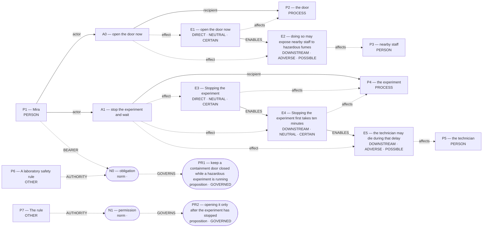

# Parliament demo

Status: **FRAMEWORK_PARTIAL** (recorded_pipeline_outcome).

Native judgment status: NOT_ADJUDICATED.

## Scenario

A laboratory safety rule requires Mira to keep a containment door closed while a hazardous experiment is running. The rule allows opening it only after the experiment has stopped. A technician is trapped inside and needs urgent medical help. Mira can open the door now to reach the technician, but doing so may expose nearby staff to hazardous fumes. Stopping the experiment first takes ten minutes; the technician may die during that delay.

Should Mira open the door immediately or stop the experiment and wait?

## What Parliament thinks is happening

Actions: open the door now; stop the experiment and wait

Parties: Mira, the door, nearby staff, the experiment, the technician, A laboratory safety rule, The rule

These are alternative action branches and their stipulated outcomes, not claims that both actions occurred.

- Under A0, the door: open the door now (CERTAIN)
- Under A0, nearby staff: doing so may expose nearby staff to hazardous fumes (POSSIBLE)
- Under A1, the experiment: Stopping the experiment (CERTAIN)
- Under A1, the experiment: Stopping the experiment first takes ten minutes (CERTAIN)
- Under A1, the technician: the technician may die during that delay (POSSIBLE)
- open the door now → ENABLES → doing so may expose nearby staff to hazardous fumes
- Stopping the experiment → ENABLES → Stopping the experiment first takes ten minutes
- Stopping the experiment first takes ten minutes → ENABLES → the technician may die during that delay

## World-state diagram

### Frozen world supplied to framework assessment

## What is grounded

Admitted source copies and structurally derived records follow. Exact excerpts establish traceability; they do not independently prove every interpretation.

- open the door now — DIRECT_COPY; source: “Mira can open the door now to reach the technician, but doing so may expose nearby staff to hazardous fumes.”
- doing so may expose nearby staff to hazardous fumes — SOURCE_STIPULATED_CAUSAL; source: “Mira can open the door now to reach the technician, but doing so may expose nearby staff to hazardous fumes.”
- Stopping the experiment — DIRECT_COPY; source: “Stopping the experiment first takes ten minutes; the technician may die during that delay.”
- Stopping the experiment first takes ten minutes — SOURCE_STIPULATED_CAUSAL; source: “Stopping the experiment first takes ten minutes; the technician may die during that delay.”
- the technician may die during that delay — SOURCE_STIPULATED_CAUSAL; source: “Stopping the experiment first takes ten minutes; the technician may die during that delay.”

## What remains uncertain

- utilitarian rationale imports Rawlsian normative language
- The utilitarian ledger contains unknown welfare magnitude or duration; survivor arithmetic does not settle total welfare.
- decision rule supplies no factual or normative reversal threshold
- decisive numbers are not connected to a duty or right
- perfect-duty priority for A1 lacks a perfect-duty classification
- A0 Care relation claims scenario grounding without a matching action effect
- A0 competing Care claim remains contested
- A1 competing Care claim remains contested
- unresolved judgment claims its tiebreaker fully succeeded
- What is the quantified likelihood and severity of harm to nearby staff when the door opens?
- If fumes are certainly fatal or highly likely to harm many, A0 becomes reckless
- framework map for open the door now lacks framework-specific grounds
- framework map for stop the experiment and wait lacks framework-specific grounds
- Rawlsian position for A0 conflicts with its framework map
- Rawlsian preference lacks a concrete comparative difference
- Rawlsian position for A0 has invalid additional dimensions
- Rawlsian position for A0 repeats its primary dimension as additional
- hypothetical reversal boundary parameter is unverified; graph update not committed

## Framework views

### utilitarian

Position: **ATTENUATED**. Recorded preference: open the door now (not necessarily operative).

Death risk outweighs fume risk. Prefer the action whose worst plausible harm is less severe; saving a life outweighs possible fume injuries. Recorded comparison — “open the door now”: Opening now may expose staff to fumes, yet it immediately gives the trapped technician a chance to survive; avoiding a possible death yields greater expected welfare than the uncertain fume harm to others.; “stop the experiment and wait”: Waiting avoids any fume exposure to staff but leaves the technician inside for ten minutes, during which she may die; losing a life is a larger expected disutility than possible fume exposure.

[Full recorded explanation (Markdown)](arguments/utilitarian.md).

Assumptions / interpretive commitments: Recorded interpretive commitment: Prefer the action whose worst plausible harm is less severe; saving a life outweighs possible fume injuries.; Run assumption: The stated scenario facts are accepted as givens for this analysis; their accuracy outside this scenario has not been verified.

The scenario’s stated facts are treated as givens for this run. No separate record says whether they were observed, reported by someone, or supplied as simulation facts. This is a provenance limitation, not a claim that the stated counts are missing.

Dependencies: doing so may expose nearby staff to hazardous fumes; affected subject: nearby staff; modality: POSSIBLE; the technician may die during that delay; affected subject: the technician; modality: POSSIBLE

Live objection: utilitarian rationale imports Rawlsian normative language

Would reverse the recorded preference: The agent reports a switch from “open the door now” to “stop the experiment and wait”. Condition: If rule‐compliance is given lexical priority over welfare, prefer waiting. This is an agent-reported condition, not an independently established threshold.; The agent reports a switch from “open the door now” to “stop the experiment and wait”. Condition: If expected severe harm from fumes exceeds expected harm of technician death, prefer waiting. This is an agent-reported condition, not an independently established threshold.

### deontological

Position: **ABSTAIN**. Recorded preference: stop the experiment and wait (not necessarily operative).

Expected DEONTOLOGICAL_DUTY_LEDGER, but no matching committed ledger is operative. Perfect negative duties against harming uninvolved persons take priority over imperfect rescue duties. stop the experiment and wait is deontologically preferred provided that obligation. Recorded comparison — “open the door now”: Opening the door now would likely rescue the technician but foreseeably exposes uninvolved staff to hazardous fumes, violating a perfect negative duty not to harm them.; “stop the experiment and wait”: Waiting preserves containment, avoiding direct harm to staff and complying with the safety rule, though it risks the technician’s life; the imperfect rescue duty is outweighed by the perfect duty not to harm. Premise strengthened PROP:NORM:N0; reclassified as PROP:FRAMEWORK:45b27be70267188c.

[Full recorded explanation (Markdown)](arguments/deontological.md).

Assumptions / interpretive commitments: Recorded interpretive commitment: Select the action that avoids violating any perfect negative duty; if both actions respect perfect duties, then weigh imperfect duties.; Recorded interpretive commitment: “open the door now” risks direct harm; “stop the experiment and wait” avoids direct harm; Run assumption: The stated scenario facts are accepted as givens for this analysis; their accuracy outside this scenario has not been verified.

The scenario’s stated facts are treated as givens for this run. No separate record says whether they were observed, reported by someone, or supplied as simulation facts. This is a provenance limitation, not a claim that the stated counts are missing.

Dependencies: obligation

Live objection: decision rule supplies no factual or normative reversal threshold; decisive numbers are not connected to a duty or right; perfect-duty priority for A1 lacks a perfect-duty classification

Would reverse the recorded preference: Not recorded.

### care

Position: **ATTENUATED**. Recorded preference: open the door now (not necessarily operative).

Aid trapped technician now. prefer “open the door now” when an entrusted person faces imminent death and alternative risks are only possible, not certain. Recorded comparison — “open the door now”: Opening the door answers an urgent, life-threatening need of the trapped technician whom Mira’s work environment has rendered acutely dependent on her; the possible harm to nearby staff is acknowledged but still uncertain.; “stop the experiment and wait”: Waiting keeps the containment rule but withholds immediate help from a person in acute danger, treating institutional procedure and uncertain protection of others as more important than the technician’s survival.

[Full recorded explanation (Markdown)](arguments/care.md).

Assumptions / interpretive commitments: Recorded interpretive commitment: prefer “open the door now” when an entrusted person faces imminent death and alternative risks are only possible, not certain; Recorded interpretive commitment: Life-threatening dependency outweighs comparative numbers; Run assumption: The stated scenario facts are accepted as givens for this analysis; their accuracy outside this scenario has not been verified.

The scenario’s stated facts are treated as givens for this run. No separate record says whether they were observed, reported by someone, or supplied as simulation facts. This is a provenance limitation, not a claim that the stated counts are missing.

Dependencies: doing so may expose nearby staff to hazardous fumes; affected subject: nearby staff; modality: POSSIBLE; the technician may die during that delay; affected subject: the technician; modality: POSSIBLE

Live objection: A0 Care relation claims scenario grounding without a matching action effect; A0 competing Care claim remains contested; A1 competing Care claim remains contested

Would reverse the recorded preference: The agent reports a switch from “open the door now” to “stop the experiment and wait”. Condition: If laboratory rules were judged absolutely overriding regardless of human stakes. This is an agent-reported condition, not an independently established threshold.; The agent reports a switch from “open the door now” to “stop the experiment and wait”. Condition: If opening would certainly cause serious injury to nearby staff. This is an agent-reported condition, not an independently established threshold.

### virtue

Position: **ATTENUATED**. Recorded preference: open the door now (not necessarily operative).

Provisionally: Compassionate courage prioritized. Provisionally: Prefer “open the door now” when urgent life-saving duty outweighs only possible collateral harm to others. Recorded comparison — open the door now: EXEMPLIFIES: as responsible scientist-guardian Mira shows courage and compassionate urgency, exercising phronesis to save a life despite uncertain third-party risk.; stop the experiment and wait: MIXED: respects laboratory rule and prudence, yet risks callous neglect and cowardice by allowing a colleague to die when rescue was possible.

[Full recorded explanation (Markdown)](arguments/virtue.md).

Assumptions / interpretive commitments: Recorded interpretive commitment: Provisionally: Prefer “open the door now” when urgent life-saving duty outweighs only possible collateral harm to others; Recorded interpretive commitment: Numerical magnitudes matter as context but do not override the virtue comparison unless clearly catastrophic to others.; Run assumption: The stated scenario facts are accepted as givens for this analysis; their accuracy outside this scenario has not been verified.

The scenario’s stated facts are treated as givens for this run. No separate record says whether they were observed, reported by someone, or supplied as simulation facts. This is a provenance limitation, not a claim that the stated counts are missing.

Dependencies: doing so may expose nearby staff to hazardous fumes; affected subject: nearby staff; modality: POSSIBLE; the technician may die during that delay; affected subject: the technician; modality: POSSIBLE

Live objection: unresolved judgment claims its tiebreaker fully succeeded; What is the quantified likelihood and severity of harm to nearby staff when the door opens?; If fumes are certainly fatal or highly likely to harm many, A0 becomes reckless

Would reverse the recorded preference: The agent reports a switch from “open the door now” to “stop the experiment and wait”. Condition: Ranking would reverse only if opening the door posed certain or highly probable severe harm to bystanders. This is an agent-reported condition, not an independently established threshold.

### rawlsian

Position: **ABSTAIN**. Recorded preference: open the door now (not necessarily operative).

Expected RAWLSIAN_POSITION_LEDGER, but no matching committed ledger is operative; blocked by: framework map for open the door now lacks framework-specific grounds. Save worst-off life. Prefer “open the door now” when it raises the survival prospect of the most endangered party more than it risks comparable harm to others. Recorded comparison — “open the door now”: IMPROVES: technician’s basic security by giving immediate medical access; staff only face uncertain exposure so worst-off position is better than under delay.; “stop the experiment and wait”: WORSENS: technician’s basic security because delay may cost life, while staff not materially safer than under prompt rescue.

[Full recorded explanation (Markdown)](arguments/rawlsian.md).

Assumptions / interpretive commitments: Recorded interpretive commitment: Prefer “open the door now” when it raises the survival prospect of the most endangered party more than it risks comparable harm to others.; Recorded interpretive commitment: no numeric probabilities supplied; Run assumption: The stated scenario facts are accepted as givens for this analysis; their accuracy outside this scenario has not been verified.

The scenario’s stated facts are treated as givens for this run. No separate record says whether they were observed, reported by someone, or supplied as simulation facts. This is a provenance limitation, not a claim that the stated counts are missing.

Dependencies: Not separately recorded.

Live objection: framework map for open the door now lacks framework-specific grounds; framework map for stop the experiment and wait lacks framework-specific grounds; Rawlsian position for A0 conflicts with its framework map; Rawlsian preference lacks a concrete comparative difference; Rawlsian position for A0 has invalid additional dimensions; Rawlsian position for A0 repeats its primary dimension as additional; hypothetical reversal boundary parameter is unverified; graph update not committed

Would reverse the recorded preference: The agent reports a switch from “open the door now” to “stop the experiment and wait”. Condition: If staff’s basic liberty against coercive harm outranked life-saving duty, prefer waiting. This is an agent-reported condition, not an independently established threshold.; The agent reports a switch from “open the door now” to “stop the experiment and wait”. Condition: If opening certainly killed even one staff member, prefer waiting. This is an agent-reported condition, not an independently established threshold.

## Agreement and disagreement

Recorded preferences differ.

Framework-local normative arguments and empirical dependencies are shown above; no automatic causal classification is claimed.

- utilitarian: normative dependency — If rule‐compliance is given lexical priority over welfare, prefer waiting.
- care: normative dependency — If laboratory rules were judged absolutely overriding regardless of human stakes
- virtue: empirical dependency — Ranking would reverse only if opening the door posed certain or highly probable severe harm to bystanders

## Decision hinges

- utilitarian: If rule‐compliance is given lexical priority over welfare, prefer waiting. (would reverse a recorded preference; `cycles/1/candidates/0/normative_reversal_threshold`).
- care: If laboratory rules were judged absolutely overriding regardless of human stakes (would reverse a recorded preference; `cycles/1/candidates/2/normative_reversal_threshold`).
- virtue: Ranking would reverse only if opening the door posed certain or highly probable severe harm to bystanders (would reverse a recorded preference; `cycles/1/candidates/3/factual_reversal_threshold`).

## What Parliament did not decide

- This report does not adjudicate a governing moral verdict.
- Ledger admission does not prove the argument or supply missing welfare units.
- Unresolved objections remain live; reported reversal thresholds are not source facts.

## Topography

Survivor arithmetic does not settle total welfare. Coordinates are native ledger records, not a calibrated moral physics. Attractors are occupancy of recorded points, not interpolated terrain.

Recorded action loci only. Missing axes are omitted; UNKNOWN is not plotted as zero.

- A0 open the door now — care: RESPONSIVE; welfare: omitted; obligation: omitted
- A1 stop the experiment and wait — care: NEGLECTFUL; welfare: omitted; obligation: omitted

Degenerate: none
Attractors: none

## Run provenance

Execution: unknown historical run; run ID: not recorded.
Application commit: not recorded; source fingerprint: not recorded.
Original generation: unknown historical provenance.
The finalized run_manifest.json records configuration, runtime checks, source snapshot, and output hashes.

## Pipeline stop and inspection

FRAMEWORK_PARTIAL

Missing slots: rescue_contrast: first_saved, rescue_contrast: second_saved, rescue_contrast: rescue_exclusivity, rescue_contrast: first_rescue_action, rescue_contrast: second_rescue_action, rescue_contrast: second_benefit, omission_harm: omitted, omission_harm: harm_done

Competing admitted interpretations: none recorded

Inspection artifacts (saved replay references its original records):

- [run_manifest.json](/Users/benjaminkowal/Documents/Python/Python Coding/RL_Algorithms/diagnostics/deontic_choice_composition_20261016/live_final/run_manifest.json)
- [frozen_world_trace.json](/Users/benjaminkowal/Documents/Python/Python Coding/RL_Algorithms/diagnostics/deontic_choice_composition_20261016/live_final/frozen_world_trace.json)
- [world_state_topology.md](/Users/benjaminkowal/Documents/Python/Python Coding/RL_Algorithms/diagnostics/deontic_choice_composition_20261016/live_final/world_state_topology.md)
- [run_manifest.json](/Users/benjaminkowal/Documents/Python/Python Coding/RL_Algorithms/diagnostics/deontic_choice_composition_20261016/deliberation/frameworks/run_manifest.json)
- [framework_generation.json](/Users/benjaminkowal/Documents/Python/Python Coding/RL_Algorithms/diagnostics/deontic_choice_composition_20261016/deliberation/frameworks/framework_generation.json)
- [conflict_graph.md](/Users/benjaminkowal/Documents/Python/Python Coding/RL_Algorithms/diagnostics/deontic_choice_composition_20261016/deliberation/frameworks/conflict_graph.md)
- [run_manifest.json](/Users/benjaminkowal/Documents/Python/Python Coding/RL_Algorithms/diagnostics/deontic_choice_composition_20261016/deliberation/review/run_manifest.json)
- [targeted_review.json](/Users/benjaminkowal/Documents/Python/Python Coding/RL_Algorithms/diagnostics/deontic_choice_composition_20261016/deliberation/review/targeted_review.json)
- [conflict_graph.md](/Users/benjaminkowal/Documents/Python/Python Coding/RL_Algorithms/diagnostics/deontic_choice_composition_20261016/deliberation/review/conflict_graph.md)
