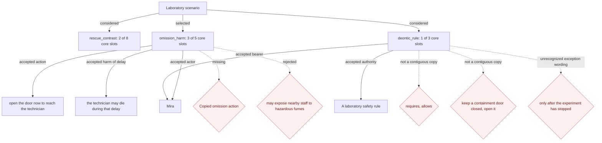

# Laboratory rule — live template inspection

Model: `gpt-4o-mini`. Exact original scenario; current cloze version blueprint-cloze-chooser/0.16.

No world was constructed or admitted. No ethical framework arguments were run. The Mermaid below is a diagnostic of actual candidate slots, not a world-state graph.

| Considered order | Template | Core slots filled | Result |
| --- | --- | --- | --- |
| 1 | `rescue_contrast` | 2/8 | PARTIAL |
| 2 | `omission_harm` | 3/5 | PARTIAL — selected |
| 3 | `deontic_rule` | 1/3 | PARTIAL |

## Failed candidate structure

## Diagnosis

- The two actual options are opening now versus stopping and waiting. The latter is not simply a copied negation of opening; the omission model invented a negative fill and the copy check rejected it.
- `deontic_words` returned `requires, allows` and `governed_action` returned `keep a containment door closed, open it`. Neither comma-joined answer appears in the source. The existing answer protocol supports a list of separate copies, but this response did not use it.
- Separately, `_DEONTIC_WORDS` does not include requires/allows, and the exception check does not include only after. Splitting the answers alone would therefore not repair all the failures.
- The harm check does not recognize exposure to hazardous fumes; it requires one of its existing harm verbs.
- Rescue incorrectly accepted technician death in its first-benefit slot. That slot checks outcome wording, not beneficial polarity. Its proposal still failed its other core slots.
- Even a successfully filled deontic candidate currently builds one governed proposition and one norm. Representing the obligation plus conditional permission requires keeping both operator/content pairs and their scope, rather than merging them into one norm.

No chooser/compiler/validator code was changed for this live inspection. The earlier compact-slot increment is active; it does not solve these construction gaps.

Raw outputs: [candidate attempts](run/candidate_graphs.md), [cloze result and original completions](run/blueprint_candidate.json), [preparation manifest](run/preparation_manifest.json).
