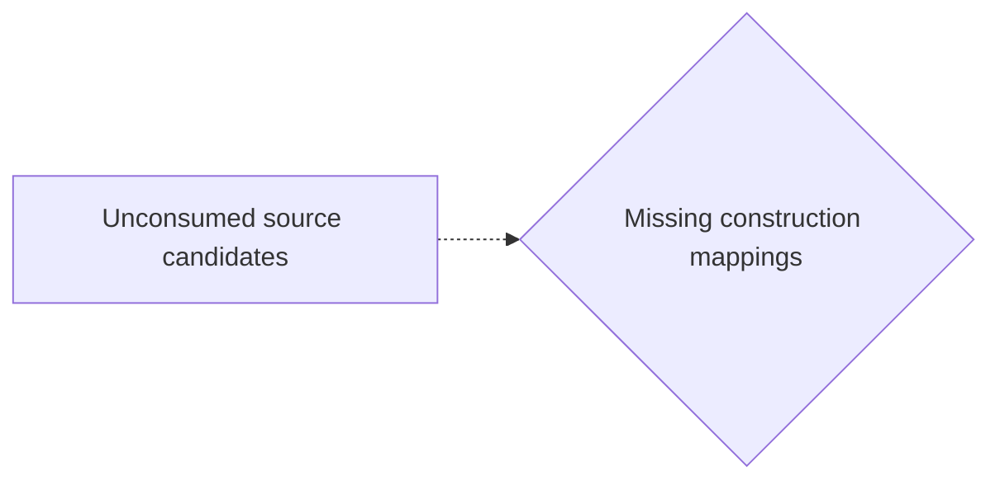
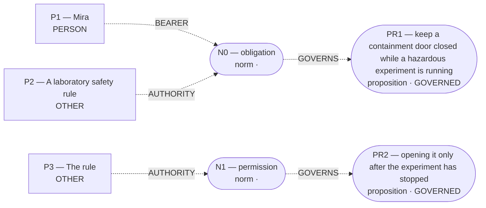

# Candidate world attempts

Chosen blueprint: **deontic_rule**  
Chooser status: **FILLED**

## 1. rescue_contrast (alternative; baseline)

Template status: **PARTIAL**  
Proposal status: **WITHHELD**  
Contract valid: **true**  
Missing slots: `first_saved`, `second_saved`, `rescue_exclusivity`, `first_rescue_action`, `second_rescue_action`, `first_harm`, `second_benefit`, `second_harm`

World withheld:

- Required slots remain unfilled: first_saved, second_saved, rescue_exclusivity, first_rescue_action, second_rescue_action, second_benefit

Source constructions retained outside the admitted world:

Parser proposals below preserve alternatives and local scope; they do not establish occurrence or a resolved interpretation.

Unconsumed parser candidates: **67**. These are visible mapping gaps, not admission failures.



- `c0`: Which construction should preserve this PREDICATION reading?
- `c1`: Which construction should preserve this PREDICATION reading?
- `c2`: Which construction should preserve this PREDICATION reading?
- `c3`: Which construction should preserve this PREDICATION reading?
- `c4`: Which construction should preserve this PREDICATION reading?
- `c5`: Which construction should preserve this PREDICATION reading?
- `c6`: Which construction should preserve this PREDICATION reading?
- `c7`: Which construction should preserve this PREDICATION reading?
- `c8`: Which construction should preserve this PREDICATION reading?
- `c9`: Which construction should preserve this PREDICATION reading?
- `c10`: Which construction should preserve this PREDICATION reading?
- `c11`: Which construction should preserve this PREDICATION reading?
- `c12`: Which construction should preserve this PREDICATION reading?
- `c13`: Which construction should preserve this PREDICATION reading?
- `c14`: Which construction should preserve this PREDICATION reading?
- `c15`: Which construction should preserve this PREDICATION reading?
- `c16`: Which construction should preserve this PREDICATION reading?
- `c17`: Which construction should preserve this PREDICATION reading?
- `c18`: Which construction should preserve this PREDICATION reading?
- `c19`: Which construction should preserve this MODALITY reading?
- `c20`: Which construction should preserve this MODALITY reading?
- `c21`: Which construction should preserve this MODALITY reading?
- `c22`: Which construction should preserve this MODALITY reading?
- `c23`: Which construction should preserve this MODALITY reading?
- `c24`: Which construction should preserve this MODALITY reading?
- `c25`: Which construction should preserve this MODALITY reading?
- `c26`: Which construction should preserve this MODALITY reading?
- `c27`: Which construction should preserve this MODALITY reading?
- `c28`: Which construction should preserve this PARTICIPANT reading?
- `c29`: Which construction should preserve this PARTICIPANT reading?
- `c30`: Which construction should preserve this PARTICIPANT reading?
- `c31`: Which construction should preserve this PARTICIPANT reading?
- `c32`: Which construction should preserve this PARTICIPANT reading?
- `c33`: Which construction should preserve this PARTICIPANT reading?
- `c34`: Which construction should preserve this PARTICIPANT reading?
- `c35`: Which construction should preserve this PARTICIPANT reading?
- `c36`: Which construction should preserve this PARTICIPANT reading?
- `c37`: Which construction should preserve this PARTICIPANT reading?
- `c38`: Which construction should preserve this PARTICIPANT reading?
- `c39`: Which construction should preserve this PARTICIPANT reading?
- `c40`: Which construction should preserve this PARTICIPANT reading?
- `c41`: Which construction should preserve this PARTICIPANT reading?
- `c42`: Which construction should preserve this PARTICIPANT reading?
- `c43`: Which construction should preserve this PARTICIPANT reading?
- `c44`: Which construction should preserve this PARTICIPANT reading?
- `c45`: Which construction should preserve this PARTICIPANT reading?
- `c46`: Which construction should preserve this PARTICIPANT reading?
- `c47`: Which construction should preserve this EVENT_LINK reading?
- `c48`: Which construction should preserve this EVENT_LINK reading?
- `c49`: Which construction should preserve this EVENT_LINK reading?
- `c50`: Which construction should preserve this PARTICIPANT reading?
- `c51`: Which construction should preserve this QUANTITY reading?
- `c52`: Which construction should preserve this SAME_REFERENT reading?
- `c53`: Which construction should preserve this SAME_REFERENT reading?
- `c54`: Which construction should preserve this SAME_REFERENT reading?
- `c55`: Which construction should preserve this SAME_REFERENT reading?
- `c56`: Which construction should preserve this SAME_REFERENT reading?
- `c57`: Which construction should preserve this SAME_REFERENT reading?
- `c58`: Which construction should preserve this SAME_REFERENT reading?
- `c59`: Which construction should preserve this SAME_REFERENT reading?
- `c60`: Which construction should preserve this SAME_REFERENT reading?
- `c61`: Which construction should preserve this SAME_REFERENT reading?
- `c62`: Which construction should preserve this SAME_REFERENT reading?
- `c63`: Which construction should preserve this SAME_REFERENT reading?
- `c64`: Which construction should preserve this SAME_REFERENT reading?
- `c65`: Which construction should preserve this SAME_REFERENT reading?
- `c66`: Which construction should preserve this SAME_REFERENT reading?

## 2. omission_harm (alternative; baseline)

Template status: **PARTIAL**  
Proposal status: **WITHHELD**  
Contract valid: **true**  
Missing slots: `omitted`, `harm_done`, `done_hedge`, `omitted_hedge`, `group_counts`, `instrument`, `controllable_process`, `done_patient`, `done_quantity`, `omitted_quantity`, `instrument_entity`

World withheld:

- Required slots remain unfilled: omitted, harm_done

Source constructions retained outside the admitted world:

Parser proposals below preserve alternatives and local scope; they do not establish occurrence or a resolved interpretation.

Unconsumed parser candidates: **67**. These are visible mapping gaps, not admission failures.


- `c0`: Which construction should preserve this PREDICATION reading?
- `c1`: Which construction should preserve this PREDICATION reading?
- `c2`: Which construction should preserve this PREDICATION reading?
- `c3`: Which construction should preserve this PREDICATION reading?
- `c4`: Which construction should preserve this PREDICATION reading?
- `c5`: Which construction should preserve this PREDICATION reading?
- `c6`: Which construction should preserve this PREDICATION reading?
- `c7`: Which construction should preserve this PREDICATION reading?
- `c8`: Which construction should preserve this PREDICATION reading?
- `c9`: Which construction should preserve this PREDICATION reading?
- `c10`: Which construction should preserve this PREDICATION reading?
- `c11`: Which construction should preserve this PREDICATION reading?
- `c12`: Which construction should preserve this PREDICATION reading?
- `c13`: Which construction should preserve this PREDICATION reading?
- `c14`: Which construction should preserve this PREDICATION reading?
- `c15`: Which construction should preserve this PREDICATION reading?
- `c16`: Which construction should preserve this PREDICATION reading?
- `c17`: Which construction should preserve this PREDICATION reading?
- `c18`: Which construction should preserve this PREDICATION reading?
- `c19`: Which construction should preserve this MODALITY reading?
- `c20`: Which construction should preserve this MODALITY reading?
- `c21`: Which construction should preserve this MODALITY reading?
- `c22`: Which construction should preserve this MODALITY reading?
- `c23`: Which construction should preserve this MODALITY reading?
- `c24`: Which construction should preserve this MODALITY reading?
- `c25`: Which construction should preserve this MODALITY reading?
- `c26`: Which construction should preserve this MODALITY reading?
- `c27`: Which construction should preserve this MODALITY reading?
- `c28`: Which construction should preserve this PARTICIPANT reading?
- `c29`: Which construction should preserve this PARTICIPANT reading?
- `c30`: Which construction should preserve this PARTICIPANT reading?
- `c31`: Which construction should preserve this PARTICIPANT reading?
- `c32`: Which construction should preserve this PARTICIPANT reading?
- `c33`: Which construction should preserve this PARTICIPANT reading?
- `c34`: Which construction should preserve this PARTICIPANT reading?
- `c35`: Which construction should preserve this PARTICIPANT reading?
- `c36`: Which construction should preserve this PARTICIPANT reading?
- `c37`: Which construction should preserve this PARTICIPANT reading?
- `c38`: Which construction should preserve this PARTICIPANT reading?
- `c39`: Which construction should preserve this PARTICIPANT reading?
- `c40`: Which construction should preserve this PARTICIPANT reading?
- `c41`: Which construction should preserve this PARTICIPANT reading?
- `c42`: Which construction should preserve this PARTICIPANT reading?
- `c43`: Which construction should preserve this PARTICIPANT reading?
- `c44`: Which construction should preserve this PARTICIPANT reading?
- `c45`: Which construction should preserve this PARTICIPANT reading?
- `c46`: Which construction should preserve this PARTICIPANT reading?
- `c47`: Which construction should preserve this EVENT_LINK reading?
- `c48`: Which construction should preserve this EVENT_LINK reading?
- `c49`: Which construction should preserve this EVENT_LINK reading?
- `c50`: Which construction should preserve this PARTICIPANT reading?
- `c51`: Which construction should preserve this QUANTITY reading?
- `c52`: Which construction should preserve this SAME_REFERENT reading?
- `c53`: Which construction should preserve this SAME_REFERENT reading?
- `c54`: Which construction should preserve this SAME_REFERENT reading?
- `c55`: Which construction should preserve this SAME_REFERENT reading?
- `c56`: Which construction should preserve this SAME_REFERENT reading?
- `c57`: Which construction should preserve this SAME_REFERENT reading?
- `c58`: Which construction should preserve this SAME_REFERENT reading?
- `c59`: Which construction should preserve this SAME_REFERENT reading?
- `c60`: Which construction should preserve this SAME_REFERENT reading?
- `c61`: Which construction should preserve this SAME_REFERENT reading?
- `c62`: Which construction should preserve this SAME_REFERENT reading?
- `c63`: Which construction should preserve this SAME_REFERENT reading?
- `c64`: Which construction should preserve this SAME_REFERENT reading?
- `c65`: Which construction should preserve this SAME_REFERENT reading?
- `c66`: Which construction should preserve this SAME_REFERENT reading?

## 3. deontic_rule (selected; baseline)

Template status: **FILLED**  
Proposal status: **FILLED**  
Contract valid: **true**  
Missing slots: `target`, `sanction`, `second_bearer`

### deontic_rule candidate graph



Native admission:

```json
{
  "blueprint_id": "deontic_rule",
  "rank": 2,
  "variant": "baseline",
  "candidate_path": "/Users/benjaminkowal/Documents/Python/Python Coding/RL_Algorithms/diagnostics/deontic_lab_template_live_20261015/after_rule_bundles/admission_attempts/02_deontic_rule/candidate.json",
  "overlay_path": "/Users/benjaminkowal/Documents/Python/Python Coding/RL_Algorithms/diagnostics/deontic_lab_template_live_20261015/after_rule_bundles/admission_attempts/02_deontic_rule/hypothesis_overlay.json",
  "status": "ADMITTED",
  "admission": {
    "status": "COMMITTED",
    "world_model_status": "COMMITTED",
    "effects": 0,
    "causal_links": 0,
    "frozen_trace_valid": false,
    "discourse_committed": true,
    "relent_workspace": {
      "established": [],
      "not_established": [
        {
          "kind": "proposition",
          "proposition_id": "PR1",
          "predication": "keep a containment door closed while a hazardous experiment is running",
          "status": "GOVERNED"
        },
        {
          "kind": "proposition",
          "proposition_id": "PR2",
          "predication": "opening it only after the experiment has stopped",
          "status": "GOVERNED"
        },
        {
          "kind": "normative_proposition",
          "norm_id": "N0",
          "force": "obligation",
          "governed_proposition_id": "PR1",
          "status": "normative"
        },
        {
          "kind": "normative_proposition",
          "norm_id": "N1",
          "force": "permission",
          "governed_proposition_id": "PR2",
          "status": "normative"
        }
      ],
      "duty_ledger_citations": [
        {
          "kind": "norm",
          "norm_id": "N0"
        },
        {
          "kind": "norm",
          "norm_id": "N1"
        }
      ],
      "ev_forbidden_proposition_ids": [
        "PR1",
        "PR2"
      ],
      "factual_status_sources": [
        "occurrence_effects"
      ]
    },
    "fingerprint_sha256": null
  },
  "trace_path": "/Users/benjaminkowal/Documents/Python/Python Coding/RL_Algorithms/diagnostics/deontic_lab_template_live_20261015/after_rule_bundles/admission_attempts/02_deontic_rule/frozen_world_trace.json"
}
```

Source constructions retained outside the admitted world:

Parser proposals below preserve alternatives and local scope; they do not establish occurrence or a resolved interpretation.

Unconsumed parser candidates: **67**. These are visible mapping gaps, not admission failures.


- `c0`: Which construction should preserve this PREDICATION reading?
- `c1`: Which construction should preserve this PREDICATION reading?
- `c2`: Which construction should preserve this PREDICATION reading?
- `c3`: Which construction should preserve this PREDICATION reading?
- `c4`: Which construction should preserve this PREDICATION reading?
- `c5`: Which construction should preserve this PREDICATION reading?
- `c6`: Which construction should preserve this PREDICATION reading?
- `c7`: Which construction should preserve this PREDICATION reading?
- `c8`: Which construction should preserve this PREDICATION reading?
- `c9`: Which construction should preserve this PREDICATION reading?
- `c10`: Which construction should preserve this PREDICATION reading?
- `c11`: Which construction should preserve this PREDICATION reading?
- `c12`: Which construction should preserve this PREDICATION reading?
- `c13`: Which construction should preserve this PREDICATION reading?
- `c14`: Which construction should preserve this PREDICATION reading?
- `c15`: Which construction should preserve this PREDICATION reading?
- `c16`: Which construction should preserve this PREDICATION reading?
- `c17`: Which construction should preserve this PREDICATION reading?
- `c18`: Which construction should preserve this PREDICATION reading?
- `c19`: Which construction should preserve this MODALITY reading?
- `c20`: Which construction should preserve this MODALITY reading?
- `c21`: Which construction should preserve this MODALITY reading?
- `c22`: Which construction should preserve this MODALITY reading?
- `c23`: Which construction should preserve this MODALITY reading?
- `c24`: Which construction should preserve this MODALITY reading?
- `c25`: Which construction should preserve this MODALITY reading?
- `c26`: Which construction should preserve this MODALITY reading?
- `c27`: Which construction should preserve this MODALITY reading?
- `c28`: Which construction should preserve this PARTICIPANT reading?
- `c29`: Which construction should preserve this PARTICIPANT reading?
- `c30`: Which construction should preserve this PARTICIPANT reading?
- `c31`: Which construction should preserve this PARTICIPANT reading?
- `c32`: Which construction should preserve this PARTICIPANT reading?
- `c33`: Which construction should preserve this PARTICIPANT reading?
- `c34`: Which construction should preserve this PARTICIPANT reading?
- `c35`: Which construction should preserve this PARTICIPANT reading?
- `c36`: Which construction should preserve this PARTICIPANT reading?
- `c37`: Which construction should preserve this PARTICIPANT reading?
- `c38`: Which construction should preserve this PARTICIPANT reading?
- `c39`: Which construction should preserve this PARTICIPANT reading?
- `c40`: Which construction should preserve this PARTICIPANT reading?
- `c41`: Which construction should preserve this PARTICIPANT reading?
- `c42`: Which construction should preserve this PARTICIPANT reading?
- `c43`: Which construction should preserve this PARTICIPANT reading?
- `c44`: Which construction should preserve this PARTICIPANT reading?
- `c45`: Which construction should preserve this PARTICIPANT reading?
- `c46`: Which construction should preserve this PARTICIPANT reading?
- `c47`: Which construction should preserve this EVENT_LINK reading?
- `c48`: Which construction should preserve this EVENT_LINK reading?
- `c49`: Which construction should preserve this EVENT_LINK reading?
- `c50`: Which construction should preserve this PARTICIPANT reading?
- `c51`: Which construction should preserve this QUANTITY reading?
- `c52`: Which construction should preserve this SAME_REFERENT reading?
- `c53`: Which construction should preserve this SAME_REFERENT reading?
- `c54`: Which construction should preserve this SAME_REFERENT reading?
- `c55`: Which construction should preserve this SAME_REFERENT reading?
- `c56`: Which construction should preserve this SAME_REFERENT reading?
- `c57`: Which construction should preserve this SAME_REFERENT reading?
- `c58`: Which construction should preserve this SAME_REFERENT reading?
- `c59`: Which construction should preserve this SAME_REFERENT reading?
- `c60`: Which construction should preserve this SAME_REFERENT reading?
- `c61`: Which construction should preserve this SAME_REFERENT reading?
- `c62`: Which construction should preserve this SAME_REFERENT reading?
- `c63`: Which construction should preserve this SAME_REFERENT reading?
- `c64`: Which construction should preserve this SAME_REFERENT reading?
- `c65`: Which construction should preserve this SAME_REFERENT reading?
- `c66`: Which construction should preserve this SAME_REFERENT reading?

## 4. primitive_composition (alternative; composition)

Template status: **WITHHELD**  
Proposal status: **WITHHELD**  
Contract valid: **true**  
Missing slots: none

World withheld:

- No supported conditional branch was extracted.

Source constructions retained outside the admitted world:

Parser proposals below preserve alternatives and local scope; they do not establish occurrence or a resolved interpretation.

Unconsumed parser candidates: **67**. These are visible mapping gaps, not admission failures.


- `c0`: Which construction should preserve this PREDICATION reading?
- `c1`: Which construction should preserve this PREDICATION reading?
- `c2`: Which construction should preserve this PREDICATION reading?
- `c3`: Which construction should preserve this PREDICATION reading?
- `c4`: Which construction should preserve this PREDICATION reading?
- `c5`: Which construction should preserve this PREDICATION reading?
- `c6`: Which construction should preserve this PREDICATION reading?
- `c7`: Which construction should preserve this PREDICATION reading?
- `c8`: Which construction should preserve this PREDICATION reading?
- `c9`: Which construction should preserve this PREDICATION reading?
- `c10`: Which construction should preserve this PREDICATION reading?
- `c11`: Which construction should preserve this PREDICATION reading?
- `c12`: Which construction should preserve this PREDICATION reading?
- `c13`: Which construction should preserve this PREDICATION reading?
- `c14`: Which construction should preserve this PREDICATION reading?
- `c15`: Which construction should preserve this PREDICATION reading?
- `c16`: Which construction should preserve this PREDICATION reading?
- `c17`: Which construction should preserve this PREDICATION reading?
- `c18`: Which construction should preserve this PREDICATION reading?
- `c19`: Which construction should preserve this MODALITY reading?
- `c20`: Which construction should preserve this MODALITY reading?
- `c21`: Which construction should preserve this MODALITY reading?
- `c22`: Which construction should preserve this MODALITY reading?
- `c23`: Which construction should preserve this MODALITY reading?
- `c24`: Which construction should preserve this MODALITY reading?
- `c25`: Which construction should preserve this MODALITY reading?
- `c26`: Which construction should preserve this MODALITY reading?
- `c27`: Which construction should preserve this MODALITY reading?
- `c28`: Which construction should preserve this PARTICIPANT reading?
- `c29`: Which construction should preserve this PARTICIPANT reading?
- `c30`: Which construction should preserve this PARTICIPANT reading?
- `c31`: Which construction should preserve this PARTICIPANT reading?
- `c32`: Which construction should preserve this PARTICIPANT reading?
- `c33`: Which construction should preserve this PARTICIPANT reading?
- `c34`: Which construction should preserve this PARTICIPANT reading?
- `c35`: Which construction should preserve this PARTICIPANT reading?
- `c36`: Which construction should preserve this PARTICIPANT reading?
- `c37`: Which construction should preserve this PARTICIPANT reading?
- `c38`: Which construction should preserve this PARTICIPANT reading?
- `c39`: Which construction should preserve this PARTICIPANT reading?
- `c40`: Which construction should preserve this PARTICIPANT reading?
- `c41`: Which construction should preserve this PARTICIPANT reading?
- `c42`: Which construction should preserve this PARTICIPANT reading?
- `c43`: Which construction should preserve this PARTICIPANT reading?
- `c44`: Which construction should preserve this PARTICIPANT reading?
- `c45`: Which construction should preserve this PARTICIPANT reading?
- `c46`: Which construction should preserve this PARTICIPANT reading?
- `c47`: Which construction should preserve this EVENT_LINK reading?
- `c48`: Which construction should preserve this EVENT_LINK reading?
- `c49`: Which construction should preserve this EVENT_LINK reading?
- `c50`: Which construction should preserve this PARTICIPANT reading?
- `c51`: Which construction should preserve this QUANTITY reading?
- `c52`: Which construction should preserve this SAME_REFERENT reading?
- `c53`: Which construction should preserve this SAME_REFERENT reading?
- `c54`: Which construction should preserve this SAME_REFERENT reading?
- `c55`: Which construction should preserve this SAME_REFERENT reading?
- `c56`: Which construction should preserve this SAME_REFERENT reading?
- `c57`: Which construction should preserve this SAME_REFERENT reading?
- `c58`: Which construction should preserve this SAME_REFERENT reading?
- `c59`: Which construction should preserve this SAME_REFERENT reading?
- `c60`: Which construction should preserve this SAME_REFERENT reading?
- `c61`: Which construction should preserve this SAME_REFERENT reading?
- `c62`: Which construction should preserve this SAME_REFERENT reading?
- `c63`: Which construction should preserve this SAME_REFERENT reading?
- `c64`: Which construction should preserve this SAME_REFERENT reading?
- `c65`: Which construction should preserve this SAME_REFERENT reading?
- `c66`: Which construction should preserve this SAME_REFERENT reading?
