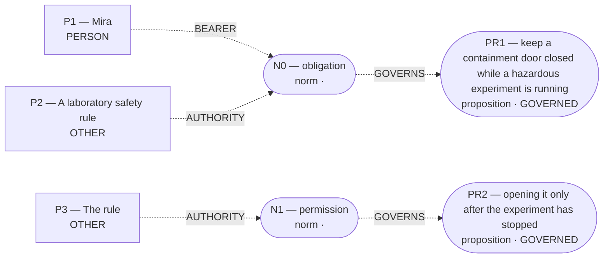

# Admitted world-state topology

Admission: **COMMITTED**  
Admitted effects: ``  
Conditions: **0**; Temporal links: **0**; Counterfactual links: **0**.

Discourse objects (not established effects):

- `PR1` (proposition): keep a containment door closed while a hazardous experiment is running
- `PR2` (proposition): opening it only after the experiment has stopped
- `N0` (norm): obligation
- `N1` (norm): permission
