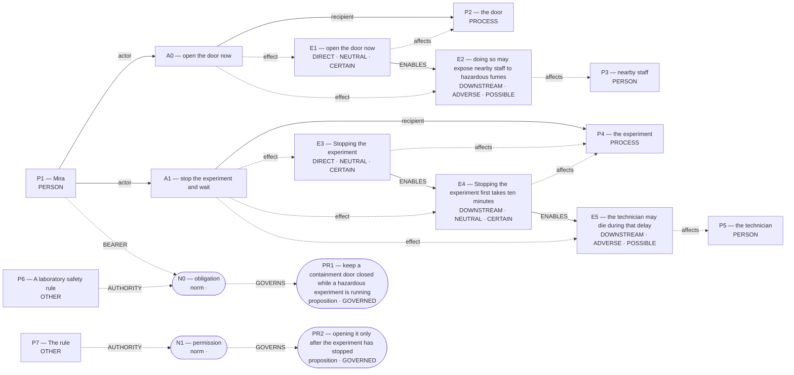

# Parliament demo

Status: **FRAMEWORK_PARTIAL** (recorded_pipeline_outcome).

Native judgment status: NOT_ADJUDICATED.

## Scenario

A laboratory safety rule requires Mira to keep a containment door closed while a hazardous experiment is running. The rule allows opening it only after the experiment has stopped. A technician is trapped inside and needs urgent medical help. Mira can open the door now to reach the technician, but doing so may expose nearby staff to hazardous fumes. Stopping the experiment first takes ten minutes; the technician may die during that delay.

Should Mira open the door immediately or stop the experiment and wait?

## What Parliament thinks is happening

Actions: open the door now; stop the experiment and wait

Parties: Mira, the door, nearby staff, the experiment, the technician, A laboratory safety rule, The rule

These are alternative action branches and their stipulated outcomes, not claims that both actions occurred.

- Under A0, the door: open the door now (CERTAIN)
- Under A0, nearby staff: doing so may expose nearby staff to hazardous fumes (POSSIBLE)
- Under A1, the experiment: Stopping the experiment (CERTAIN)
- Under A1, the experiment: Stopping the experiment first takes ten minutes (CERTAIN)
- Under A1, the technician: the technician may die during that delay (POSSIBLE)
- open the door now → ENABLES → doing so may expose nearby staff to hazardous fumes
- Stopping the experiment → ENABLES → Stopping the experiment first takes ten minutes
- Stopping the experiment first takes ten minutes → ENABLES → the technician may die during that delay

## World-state diagram

### Frozen world supplied to framework assessment

## What is grounded

Admitted source copies and structurally derived records follow. Exact excerpts establish traceability; they do not independently prove every interpretation.

- open the door now — DIRECT_COPY; source: “Mira can open the door now to reach the technician, but doing so may expose nearby staff to hazardous fumes.”
- doing so may expose nearby staff to hazardous fumes — SOURCE_STIPULATED_CAUSAL; source: “Mira can open the door now to reach the technician, but doing so may expose nearby staff to hazardous fumes.”
- Stopping the experiment — DIRECT_COPY; source: “Stopping the experiment first takes ten minutes; the technician may die during that delay.”
- Stopping the experiment first takes ten minutes — SOURCE_STIPULATED_CAUSAL; source: “Stopping the experiment first takes ten minutes; the technician may die during that delay.”
- the technician may die during that delay — SOURCE_STIPULATED_CAUSAL; source: “Stopping the experiment first takes ten minutes; the technician may die during that delay.”

## What remains uncertain

- unresolved judgment claims its tiebreaker fully succeeded
- hypothetical reversal boundary parameter is unverified; graph update not committed
- A0 ADJUDICATION_CALIBRATION: doing-harm classification lacks an agent-caused settled welfare harm on the protected party
- A0 ADJUDICATION_CALIBRATION: resolved adjudication rests on unsupported decisive premises
- A1 primary protected party lacks current-run action grounding
- whether the harm-relation follows the admitted graph's causal topology rather than a relabel chosen to fit the verdict
- mira's duty 'avoid directly harming others' protecting nearby staff ↔ mira's competing duty 'imperfect duty to rescue' protecting technician
- A0 prohibited by do not directly harm uninvolved persons ↔ whether the harm-relation follows the admitted graph's causal topology rather than a relabel chosen to fit the verdict

## Framework views

### deontological

Position: **ABSTAIN**. Recorded preference: stop the experiment and wait (not necessarily operative).

The agent assesses Mira’s duty “do not directly harm uninvolved persons” toward nearby staff. Mira is the duty-bearer; nearby staff is the protected party. The competing obligation being assessed is Mira’s “imperfect duty to rescue” toward technician. For “open the door now”, the agent proposes the maxim “open door during active hazard”. This is an interpretation of possible practical reasoning, not an established intention. Its purpose is save technician quickly; its chosen means are opening door. The proposed justification is: if everyone opened doors under hazard, lab safety collapses. The agent assesses the maxim as indefensible, and the action as impermissible. Its proposed means–ends reasoning is: harm to staff is foreseen side-effect, still forbidden. Physical means references: E1; end references: none. For Mira’s option “open the door now”, the ledger records conflicted. The agent’s stated reason is: Opening exposes others to harm, violating perfect duty. The agent assesses Mira’s duty “avoid directly harming others” toward nearby staff. Mira is the duty-bearer; nearby staff is the protected party. The competing obligation being assessed is Mira’s “imperfect duty to rescue” toward technician. For “stop the experiment and wait”, the agent proposes the maxim “wait until hazard removed”. This is an interpretation of possible practical reasoning, not an established intention. Its purpose is rescue technician safely; its chosen means are stopping experiment. The proposed justification is: safe wait could be universal. The agent assesses the maxim as defensible, and the action as permissible. Its proposed means–ends reasoning is: does not use anyone as means. Physical means references: E3; end references: none. For Mira’s option “stop the experiment and wait”, the ledger records permissible. The agent’s stated reason is: Waiting violates no perfect duty. The ledger retains unresolved issues; this does not establish that one duty overrides the other.

[Full recorded explanation (Markdown)](arguments/deontological.md).

Assumptions / interpretive commitments: Recorded interpretive commitment: Prefer the action that avoids violating a perfect negative duty even if it foregoes an imperfect positive duty.; Recorded interpretive commitment: probabilities affect whether harm counts as direct endangerment but do not outweigh duty hierarchy; Run assumption: The stated scenario facts are accepted as givens for this analysis; their accuracy outside this scenario has not been verified.

The scenario’s stated facts are treated as givens for this run. No separate record says whether they were observed, reported by someone, or supplied as simulation facts. This is a provenance limitation, not a claim that the stated counts are missing.

Dependencies: doing so may expose nearby staff to hazardous fumes; affected subject: nearby staff; modality: POSSIBLE; the technician may die during that delay; affected subject: the technician; modality: POSSIBLE

Live objection: unresolved judgment claims its tiebreaker fully succeeded; hypothetical reversal boundary parameter is unverified; graph update not committed; A0 ADJUDICATION_CALIBRATION: doing-harm classification lacks an agent-caused settled welfare harm on the protected party; A0 ADJUDICATION_CALIBRATION: resolved adjudication rests on unsupported decisive premises; A1 primary protected party lacks current-run action grounding; whether the harm-relation follows the admitted graph's causal topology rather than a relabel chosen to fit the verdict; mira's duty 'avoid directly harming others' protecting nearby staff ↔ mira's competing duty 'imperfect duty to rescue' protecting technician; A0 prohibited by do not directly harm uninvolved persons ↔ whether the harm-relation follows the admitted graph's causal topology rather than a relabel chosen to fit the verdict

Would reverse the recorded preference: The agent reports a switch from “stop the experiment and wait” to “open the door now”. Condition: If an imperfect rescue duty were raised to perfect by a special obligation, opening would prevail. This is an agent-reported condition, not an independently established threshold.; The agent reports a switch from “stop the experiment and wait” to “open the door now”. Condition: If fumes were proved harmless, opening would not violate the perfect duty. This is an agent-reported condition, not an independently established threshold.

## Agreement and disagreement

Recorded preferences agree; this is not a collective verdict.

Framework-local normative arguments and empirical dependencies are shown above; no automatic causal classification is claimed.

- deontological: normative dependency — If an imperfect rescue duty were raised to perfect by a special obligation, opening would prevail.

## Decision hinges

- deontological: If an imperfect rescue duty were raised to perfect by a special obligation, opening would prevail. (would reverse a recorded preference; `cycles/0/candidates/0/normative_reversal_threshold`).

## What Parliament did not decide

- This report does not adjudicate a governing moral verdict.
- Ledger admission does not prove the argument or supply missing welfare units.
- Unresolved objections remain live; reported reversal thresholds are not source facts.

## Topography

Survivor arithmetic does not settle total welfare. Coordinates are native ledger records, not a calibrated moral physics. Attractors are occupancy of recorded points, not interpolated terrain.

Recorded action loci only. Missing axes are omitted; UNKNOWN is not plotted as zero.

- A0 open the door now — care: omitted; welfare: omitted; obligation: CONFLICTED
- A1 stop the experiment and wait — care: omitted; welfare: omitted; obligation: PERMISSIBLE

Degenerate: none
Attractors: none

## Run provenance

Execution: unknown historical run; run ID: not recorded.
Application commit: not recorded; source fingerprint: not recorded.
Original generation: unknown historical provenance.
The finalized run_manifest.json records configuration, runtime checks, source snapshot, and output hashes.

## Pipeline stop and inspection

FRAMEWORK_PARTIAL

Missing slots: rescue_contrast: first_saved, rescue_contrast: second_saved, rescue_contrast: rescue_exclusivity, rescue_contrast: first_rescue_action, rescue_contrast: second_rescue_action, rescue_contrast: second_benefit, omission_harm: omitted, omission_harm: harm_done

Competing admitted interpretations: none recorded

Inspection artifacts (saved replay references its original records):

- [framework_generation.json](/Users/benjaminkowal/Documents/Python/Python Coding/RL_Algorithms/diagnostics/deontology_rule_attention_20261019/live/control/framework_generation.json)
- [model_calls.json](/Users/benjaminkowal/Documents/Python/Python Coding/RL_Algorithms/diagnostics/deontology_rule_attention_20261019/live/control/deontological/model_calls.json)
- [run_manifest.json](/Users/benjaminkowal/Documents/Python/Python Coding/RL_Algorithms/diagnostics/deontology_rule_attention_20261019/live/run_manifest.json)
