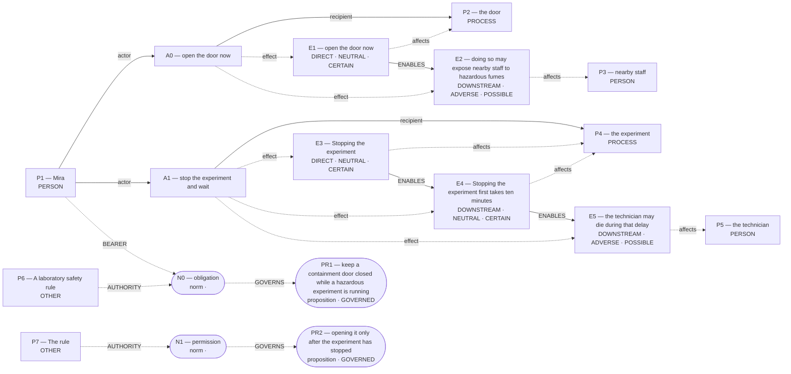

# Parliament demo

Status: **FRAMEWORK_PARTIAL** (recorded_pipeline_outcome).

Native judgment status: NOT_ADJUDICATED.

## Scenario

A laboratory safety rule requires Mira to keep a containment door closed while a hazardous experiment is running. The rule allows opening it only after the experiment has stopped. A technician is trapped inside and needs urgent medical help. Mira can open the door now to reach the technician, but doing so may expose nearby staff to hazardous fumes. Stopping the experiment first takes ten minutes; the technician may die during that delay.

Should Mira open the door immediately or stop the experiment and wait?

## What Parliament thinks is happening

Actions: open the door now; stop the experiment and wait

Parties: Mira, the door, nearby staff, the experiment, the technician, A laboratory safety rule, The rule

These are alternative action branches and their stipulated outcomes, not claims that both actions occurred.

- Under A0, the door: open the door now (CERTAIN)
- Under A0, nearby staff: doing so may expose nearby staff to hazardous fumes (POSSIBLE)
- Under A1, the experiment: Stopping the experiment (CERTAIN)
- Under A1, the experiment: Stopping the experiment first takes ten minutes (CERTAIN)
- Under A1, the technician: the technician may die during that delay (POSSIBLE)
- open the door now → ENABLES → doing so may expose nearby staff to hazardous fumes
- Stopping the experiment → ENABLES → Stopping the experiment first takes ten minutes
- Stopping the experiment first takes ten minutes → ENABLES → the technician may die during that delay

## World-state diagram

### Frozen world supplied to framework assessment

## What is grounded

Admitted source copies and structurally derived records follow. Exact excerpts establish traceability; they do not independently prove every interpretation.

- open the door now — DIRECT_COPY; source: “Mira can open the door now to reach the technician, but doing so may expose nearby staff to hazardous fumes.”
- doing so may expose nearby staff to hazardous fumes — SOURCE_STIPULATED_CAUSAL; source: “Mira can open the door now to reach the technician, but doing so may expose nearby staff to hazardous fumes.”
- Stopping the experiment — DIRECT_COPY; source: “Stopping the experiment first takes ten minutes; the technician may die during that delay.”
- Stopping the experiment first takes ten minutes — SOURCE_STIPULATED_CAUSAL; source: “Stopping the experiment first takes ten minutes; the technician may die during that delay.”
- the technician may die during that delay — SOURCE_STIPULATED_CAUSAL; source: “Stopping the experiment first takes ten minutes; the technician may die during that delay.”

## What remains uncertain

- initial=DUTY_CONSISTENCY_REPAIR: {"A1": {"dt": "IMPERFECT", "pb": "PERFECT_DUTY", "v": "PERMISSIBLE", "gv": "PRIMARY", "res": "RESOLVED"}}; repair=Duty repair changed the original duty classification

## Framework views

### deontological

Position: **ABSTAIN**. Recorded preference: withheld (not necessarily operative).

Specialist response is not schema-valid. UNRESOLVED FRAMEWORK CONFLICT: live competing derivations. No comparative leaning is yet grounded. avoid doing possible harm. Recorded comparison — “open the door now”: Permissible rescue attempt but risks direct harm and violates safety rule; “stop the experiment and wait”: Complies with standing rule and avoids direct harm to others

[Full recorded explanation (Markdown)](arguments/deontological.md).

Assumptions / interpretive commitments: Recorded interpretive commitment: Select the action that fulfills the higher-priority perfect negative duty even if an imperfect rescue duty remains unfulfilled; Run assumption: The stated scenario facts are accepted as givens for this analysis; their accuracy outside this scenario has not been verified.

The scenario’s stated facts are treated as givens for this run. No separate record says whether they were observed, reported by someone, or supplied as simulation facts. This is a provenance limitation, not a claim that the stated counts are missing.

Dependencies: Not separately recorded.

Live objection: initial=DUTY_CONSISTENCY_REPAIR: {"A1": {"dt": "IMPERFECT", "pb": "PERFECT_DUTY", "v": "PERMISSIBLE", "gv": "PRIMARY", "res": "RESOLVED"}}; repair=Duty repair changed the original duty classification

Abstention boundary (no ranking to reverse): Not recorded.

## Agreement and disagreement

No operative preference recorded.

Framework-local normative arguments and empirical dependencies are shown above; no automatic causal classification is claimed.

## Decision hinges

No explicit reversal hinge was recorded. The report does not fabricate one.

## What Parliament did not decide

- This report does not adjudicate a governing moral verdict.
- Ledger admission does not prove the argument or supply missing welfare units.
- Unresolved objections remain live; reported reversal thresholds are not source facts.

## Topography

Survivor arithmetic does not settle total welfare. Coordinates are native ledger records, not a calibrated moral physics. Attractors are occupancy of recorded points, not interpolated terrain.

No committed care, welfare, or obligation records.

## Run provenance

Execution: unknown historical run; run ID: not recorded.
Application commit: not recorded; source fingerprint: not recorded.
Original generation: unknown historical provenance.
The finalized run_manifest.json records configuration, runtime checks, source snapshot, and output hashes.

## Pipeline stop and inspection

FRAMEWORK_PARTIAL

Missing slots: rescue_contrast: first_saved, rescue_contrast: second_saved, rescue_contrast: rescue_exclusivity, rescue_contrast: first_rescue_action, rescue_contrast: second_rescue_action, rescue_contrast: second_benefit, omission_harm: omitted, omission_harm: harm_done

Competing admitted interpretations: none recorded

Inspection artifacts (saved replay references its original records):

- [framework_generation.json](/Users/benjaminkowal/Documents/Python/Python Coding/RL_Algorithms/diagnostics/deontology_rule_attention_20261019/live/rule_context/framework_generation.json)
- [model_calls.json](/Users/benjaminkowal/Documents/Python/Python Coding/RL_Algorithms/diagnostics/deontology_rule_attention_20261019/live/rule_context/deontological/model_calls.json)
- [run_manifest.json](/Users/benjaminkowal/Documents/Python/Python Coding/RL_Algorithms/diagnostics/deontology_rule_attention_20261019/live/run_manifest.json)
