# Logic_Puzzles claim/conflict projection

Read-only projection. Native records remain attributed; evidence links do not establish whole-record correctness.

```mermaid
flowchart LR
    n0["WORLD_EFFECT: open the door now"]
    n1["WORLD_EFFECT: doing so may expose nearby staff to hazardous fumes"]
    n2["WORLD_EFFECT: Stopping the experiment"]
    n3["WORLD_EFFECT: Stopping the experiment first takes ten minutes"]
    n4["WORLD_EFFECT: the technician may die during that delay"]
    n5["PROPOSITION: keep a containment door closed while a hazardous experiment is running"]
    n6["PROPOSITION: opening it only after the experiment has stopped"]
    n7["PROPOSITION: obligation"]
    n8["PROPOSITION: permission"]
    n9["PROPOSITION: open the door now; affected subject: the door"]
    n10["PROPOSITION: doing so may expose nearby staff to hazardous fumes; affected subject: nearby staff; modality: POSSIBLE"]
    n11["PROPOSITION: may — doing so may expose nearby staff to hazardous fumes"]
    n12["PROPOSITION: Stopping the experiment; affected subject: the experiment"]
    n13["PROPOSITION: Stopping the experiment first takes ten minutes; affected subject: the experiment; magnitude or qualifier: ten minutes"]
    n14["PROPOSITION: the technician may die during that delay; affected subject: the technician; modality: POSSIBLE"]
    n15["PROPOSITION: may — the technician may die during that delay"]
    n16["PROPOSITION: doing so may expose nearby staff to hazardous fumes; affected subject: nearby staff; modality: POSSIBLE"]
    n17["PROPOSITION: the technician may die during that delay; affected subject: the technician; modality: POSSIBLE"]
    n18["PROPOSITION: The lab safety rule establishes a standing obligation not to open the door during a running experiment."]
    n19["PROPOSITION: obligation"]
    n20["PROPOSITION: doing so may expose nearby staff to hazardous fumes; affected subject: nearby staff; modality: POSSIBLE"]
    n21["PROPOSITION: the technician may die during that delay; affected subject: the technician; modality: POSSIBLE"]
    n22["PROPOSITION: doing so may expose nearby staff to hazardous fumes; affected subject: nearby staff; modality: POSSIBLE"]
    n23["PROPOSITION: the technician may die during that delay; affected subject: the technician; modality: POSSIBLE"]
    n24["PROPOSITION: doing so may expose nearby staff to hazardous fumes; affected subject: nearby staff; modality: POSSIBLE"]
    n25["PROPOSITION: the technician may die during that delay; affected subject: the technician; modality: POSSIBLE"]
    n26["CLAIM: utilitarian: A0 assessment"]
    n27["CLAIM: utilitarian: A0 assessment"]
    n28["CLAIM: utilitarian: A1 assessment"]
    n29["CLAIM: utilitarian: A1 assessment"]
    n30["CLAIM: utilitarian: A1 assessment"]
    n31["UNRESOLVED_CONFLICT: utilitarian rationale imports Rawlsian normative language"]
    n32["CLAIM: deontological: A0 PROHIBITED"]
    n33["FRAMEWORK_COMMITMENT: do not impose grave foreseeable risk on uninvolved staff"]
    n34["FRAMEWORK_COMMITMENT: Perfect negative duty precedes imperfect positive duty"]
    n35["CLAIM: deontological: A1 PERMISSIBLE"]
    n36["FRAMEWORK_COMMITMENT: Negative-duty compliance outweighs imperfect rescue"]
    n37["UNRESOLVED_CONFLICT: mira&#x27;s duty &#x27;do not impose grave foreseeable risk on uninvolved staff&#x27; protecting nearby staff ↔ mira&#x27;s competing duty &#x27;Aid those in peril&#x27; protecting technician"]
    n38["UNRESOLVED_CONFLICT: A1 primary protected party lacks current-run action grounding"]
    n39["CLAIM: care: A0 RESPONSIVE"]
    n40["FRAMEWORK_COMMITMENT: Control of hazardous setup creates responsibility for occupant’s safety"]
    n41["FRAMEWORK_COMMITMENT: ACUTE_DEPENDENCY"]
    n42["CLAIM: care: A1 NEGLECTFUL"]
    n43["FRAMEWORK_COMMITMENT: Responsibility exists but is postponed"]
    n44["UNRESOLVED_CONFLICT: A0 Care relation claims scenario grounding without a matching action effect"]
    n45["UNRESOLVED_CONFLICT: A0 competing Care claim remains contested"]
    n46["UNRESOLVED_CONFLICT: A1 competing Care claim remains contested"]
    n47["CLAIM: virtue: A0 EXEMPLIFIES"]
    n48["FRAMEWORK_COMMITMENT: PRACTICAL_WISDOM"]
    n49["CLAIM: virtue: A1 MIXED"]
    n50["UNRESOLVED_CONFLICT: hypothetical reversal boundary parameter is unverified; graph update not committed"]
    n51["PROPOSED_ARGUMENT: rawlsian: argument without committed ledger"]
    n52["UNRESOLVED_CONFLICT: No committed native ledger; assess the retained argument without treating it as operative."]
    n53["UNRESOLVED_CONFLICT: framework map for open the door now lacks framework-specific grounds"]
    n54["UNRESOLVED_CONFLICT: framework map for stop the experiment and wait lacks framework-specific grounds"]
    n55["UNRESOLVED_CONFLICT: Rawlsian position for A0 conflicts with its framework map"]
    n56["UNRESOLVED_CONFLICT: Rawlsian preference lacks a concrete comparative difference"]
    n57["UNRESOLVED_CONFLICT: Rawlsian position for A0 has invalid additional dimensions"]
    n58["UNRESOLVED_CONFLICT: Rawlsian position for A0 repeats its primary dimension as additional"]
    n59["UNRESOLVED_CONFLICT: hypothetical reversal boundary parameter is unverified; graph update not committed"]
    n26 -->|"DEPENDENCY"| n16
    n26 -->|"DEPENDENCY"| n17
    n27 -->|"DEPENDENCY"| n16
    n27 -->|"DEPENDENCY"| n17
    n28 -->|"DEPENDENCY"| n16
    n28 -->|"DEPENDENCY"| n17
    n29 -->|"DEPENDENCY"| n16
    n29 -->|"DEPENDENCY"| n17
    n30 -->|"DEPENDENCY"| n16
    n30 -->|"DEPENDENCY"| n17
    n32 -->|"DEPENDENCY"| n19
    n33 -->|"SUPPORT"| n32
    n34 -->|"SUPPORT"| n32
    n35 -->|"DEPENDENCY"| n19
    n33 -->|"SUPPORT"| n35
    n36 -->|"SUPPORT"| n35
    n39 -->|"DEPENDENCY"| n20
    n39 -->|"DEPENDENCY"| n21
    n40 -->|"SUPPORT"| n39
    n41 -->|"SUPPORT"| n39
    n4 -->|"SUPPORT"| n42
    n42 -->|"DEPENDENCY"| n20
    n42 -->|"DEPENDENCY"| n21
    n43 -->|"SUPPORT"| n42
    n41 -->|"SUPPORT"| n42
    n47 -->|"DEPENDENCY"| n22
    n47 -->|"DEPENDENCY"| n23
    n48 -->|"SUPPORT"| n47
    n49 -->|"DEPENDENCY"| n22
    n49 -->|"DEPENDENCY"| n23
    n48 -->|"SUPPORT"| n49
    n52 -->|"OBJECTION"| n51
    n53 -->|"OBJECTION"| n51
    n54 -->|"OBJECTION"| n51
    n55 -->|"OBJECTION"| n51
    n56 -->|"OBJECTION"| n51
    n57 -->|"OBJECTION"| n51
    n58 -->|"OBJECTION"| n51
    n59 -->|"OBJECTION"| n51
```

Proposed review queue (at most two issues):

- mira's duty 'do not impose grave foreseeable risk on uninvolved staff' protecting nearby staff ↔ mira's competing duty 'Aid those in peril' protecting technician
- utilitarian rationale imports Rawlsian normative language
