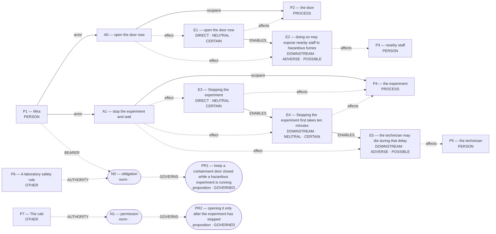

# Parliament demo

Status: **FRAMEWORK_PARTIAL** (recorded_pipeline_outcome).

Native judgment status: NOT_ADJUDICATED.

## Scenario

A laboratory safety rule requires Mira to keep a containment door closed while a hazardous experiment is running. The rule allows opening it only after the experiment has stopped. A technician is trapped inside and needs urgent medical help. Mira can open the door now to reach the technician, but doing so may expose nearby staff to hazardous fumes. Stopping the experiment first takes ten minutes; the technician may die during that delay.

Should Mira open the door immediately or stop the experiment and wait?

## What Parliament thinks is happening

Actions: open the door now; stop the experiment and wait

Parties: Mira, the door, nearby staff, the experiment, the technician, A laboratory safety rule, The rule

These are alternative action branches and their stipulated outcomes, not claims that both actions occurred.

- Under A0, the door: open the door now (CERTAIN)
- Under A0, nearby staff: doing so may expose nearby staff to hazardous fumes (POSSIBLE)
- Under A1, the experiment: Stopping the experiment (CERTAIN)
- Under A1, the experiment: Stopping the experiment first takes ten minutes (CERTAIN)
- Under A1, the technician: the technician may die during that delay (POSSIBLE)
- open the door now → ENABLES → doing so may expose nearby staff to hazardous fumes
- Stopping the experiment → ENABLES → Stopping the experiment first takes ten minutes
- Stopping the experiment first takes ten minutes → ENABLES → the technician may die during that delay

## World-state diagram

### Frozen world supplied to framework assessment

## What is grounded

Admitted source copies and structurally derived records follow. Exact excerpts establish traceability; they do not independently prove every interpretation.

- open the door now — DIRECT_COPY; source: “Mira can open the door now to reach the technician, but doing so may expose nearby staff to hazardous fumes.”
- doing so may expose nearby staff to hazardous fumes — SOURCE_STIPULATED_CAUSAL; source: “Mira can open the door now to reach the technician, but doing so may expose nearby staff to hazardous fumes.”
- Stopping the experiment — DIRECT_COPY; source: “Stopping the experiment first takes ten minutes; the technician may die during that delay.”
- Stopping the experiment first takes ten minutes — SOURCE_STIPULATED_CAUSAL; source: “Stopping the experiment first takes ten minutes; the technician may die during that delay.”
- the technician may die during that delay — SOURCE_STIPULATED_CAUSAL; source: “Stopping the experiment first takes ten minutes; the technician may die during that delay.”

## What remains uncertain

- decision rule supplies no factual or normative reversal threshold
- derived claim 1 omits source effect IDs
- derived claim 1 omits a framework derivation operation
- derived claim 1 omits its calculation or inference
- A1 primary protected party lacks current-run action grounding
- Is the laboratory rule itself morally authoritative or merely prudential?
- Does the foreseen risk meet the threshold for a perfect-duty violation if no staff member is certain to be harmed?
- which claim governs under a universal public rule
- mira's duty 'do not impose grave foreseeable risk on uninvolved staff' protecting nearby staff ↔ mira's competing duty 'Aid those in peril' protecting technician
- Optional deeper review is available for a decision-relevant question in the revised argument.

## Optional deeper review

Follow-ups examine revised arguments. Extra calls require opt-in; a model answer is not an independently verified moral resolution.

Interactive demo runs ask before proceeding. Use `--review-depth deep` to opt in in advance, or `logic_puzzles_followup.py --trace <saved-review> --output-dir <new-folder> --execute` to continue a saved review.

A decision-relevant question remains in the revised argument. Review it more deeply? Up to two additional model calls; the conclusion may remain unresolved.

For A0, your revised interpretation classifies the death or harm as a foreseen side effect, not an intended means. Distinguish intending the intervention, intending harm as an end, intending harm as a means, and foreseeing harm. Not being a means does not establish that an outcome is unintended in every respect. Explain the independent prohibition that you believe covers this foreseen harm. If another prohibition governs foreseeable lethal or serious harm, identify and defend it explicitly rather than substituting its label. Test the particular rescue maxim and the omission maxim against universalization and the strongest rescue-duty objection. Explain what justifies the duty priority in this case. The physical world establishes causal relationships, not the actor's actual intentions or the truth of the normative rule. You may retain or revise your conclusion, or acknowledge an unresolved application. A RESOLVED label alone does not settle this philosophical question.

## Framework views

### deontological

Position: **ABSTAIN**. Recorded preference: stop the experiment and wait (not necessarily operative).

The agent assesses Mira’s duty “do not impose grave foreseeable risk on uninvolved staff” toward nearby staff. Mira is the duty-bearer; nearby staff is the protected party. The competing obligation being assessed is Mira’s “Aid those in peril” toward technician. For “open the door now”, the agent proposes the maxim “Open door immediately”. This is an interpretation of possible practical reasoning, not an established intention. Its purpose is Rescue technician; its chosen means are Opening door. The proposed justification is: If everyone did likewise, predictable containment would fail. The agent assesses the maxim as indefensible, and the action as impermissible. Its proposed means–ends reasoning is: Saving one life is worth the risk. Physical means references: E1, E2; end references: none. For Mira’s option “open the door now”, the ledger records prohibited. The agent’s stated reason is: Opening knowingly endangers others.. For “stop the experiment and wait”, the agent proposes the maxim “Stop experiment first and wait”. This is an interpretation of possible practical reasoning, not an established intention. Its purpose is Avoid harming staff and comply with rule; its chosen means are Allow experiment to finish containment. The proposed justification is: Universal adherence sustains safety. The agent assesses the maxim as defensible, and the action as permissible. Its proposed means–ends reasoning is: One must not endanger others even to help. Physical means references: E3, E4; end references: none. For Mira’s option “stop the experiment and wait”, the ledger records permissible. The agent’s stated reason is: Waiting avoids active endangerment though it risks omission.. The ledger retains unresolved issues; this does not establish that one duty overrides the other.

[Full recorded explanation (Markdown)](arguments/deontological.md).

Assumptions / interpretive commitments: Recorded interpretive commitment: Provisionally: Keep the action contested until which claim governs under a universal public rule; Recorded interpretive commitment: Negative-duty priority; Run assumption: The stated scenario facts are accepted as givens for this analysis; their accuracy outside this scenario has not been verified.

The scenario’s stated facts are treated as givens for this run. No separate record says whether they were observed, reported by someone, or supplied as simulation facts. This is a provenance limitation, not a claim that the stated counts are missing.

Dependencies: obligation

Live objection: decision rule supplies no factual or normative reversal threshold; derived claim 1 omits source effect IDs; derived claim 1 omits a framework derivation operation; derived claim 1 omits its calculation or inference; A1 primary protected party lacks current-run action grounding; Is the laboratory rule itself morally authoritative or merely prudential?; Does the foreseen risk meet the threshold for a perfect-duty violation if no staff member is certain to be harmed?; which claim governs under a universal public rule; mira's duty 'do not impose grave foreseeable risk on uninvolved staff' protecting nearby staff ↔ mira's competing duty 'Aid those in peril' protecting technician

Would reverse the recorded preference: Not recorded.

## Agreement and disagreement

Recorded preferences agree; this is not a collective verdict.

Framework-local normative arguments and empirical dependencies are shown above; no automatic causal classification is claimed.

## Decision hinges

No explicit reversal hinge was recorded. The report does not fabricate one.

## What Parliament did not decide

- This report does not adjudicate a governing moral verdict.
- Ledger admission does not prove the argument or supply missing welfare units.
- Unresolved objections remain live; reported reversal thresholds are not source facts.

## Topography

Survivor arithmetic does not settle total welfare. Coordinates are native ledger records, not a calibrated moral physics. Attractors are occupancy of recorded points, not interpolated terrain.

Recorded action loci only. Missing axes are omitted; UNKNOWN is not plotted as zero.

- A0 open the door now — care: omitted; welfare: omitted; obligation: PROHIBITED
- A1 stop the experiment and wait — care: omitted; welfare: omitted; obligation: PERMISSIBLE

Degenerate: none
Attractors: none

## Run provenance

Execution: unknown historical run; run ID: not recorded.
Application commit: not recorded; source fingerprint: not recorded.
Original generation: unknown historical provenance.
The finalized run_manifest.json records configuration, runtime checks, source snapshot, and output hashes.

## Pipeline stop and inspection

FRAMEWORK_PARTIAL

Missing slots: rescue_contrast: first_saved, rescue_contrast: second_saved, rescue_contrast: rescue_exclusivity, rescue_contrast: first_rescue_action, rescue_contrast: second_rescue_action, rescue_contrast: second_benefit, omission_harm: omitted, omission_harm: harm_done

Competing admitted interpretations: none recorded

Inspection artifacts (saved replay references its original records):

- [targeted_review.json](/Users/benjaminkowal/Documents/Python/Python Coding/RL_Algorithms/diagnostics/deontology_rule_attention_20261019/live/saved_argument_review/targeted_review.json)
- [model_calls.json](/Users/benjaminkowal/Documents/Python/Python Coding/RL_Algorithms/diagnostics/deontology_rule_attention_20261019/live/saved_argument_review/deontological/model_calls.json)
- [run_manifest.json](/Users/benjaminkowal/Documents/Python/Python Coding/RL_Algorithms/diagnostics/deontology_rule_attention_20261019/live/run_manifest.json)
