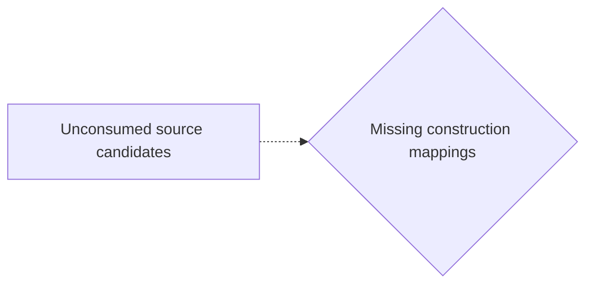

# Candidate world attempts

Chosen blueprint: **exclusive_allocation**  
Chooser status: **PARTIAL**

## 1. exclusive_allocation (selected; baseline)

Template status: **PARTIAL**  
Proposal status: **WITHHELD**  
Contract valid: **true**  
Missing slots: `second_transfer`, `quantity`, `second_recipient`, `exclusivity`, `first_outcome`, `first_hedge`, `second_outcome`, `second_hedge`, `first_implied_process`, `second_implied_process`, `second_branch_sentence`, `survival_chance`, `nonreceipt`

World withheld:

- Required slots remain unfilled: second_recipient

Source constructions retained outside the admitted world:

Parser proposals below preserve alternatives and local scope; they do not establish occurrence or a resolved interpretation.

Unconsumed parser candidates: **6**. These are visible mapping gaps, not admission failures.

- `c0`: Which construction should preserve this PREDICATION reading?
- `c1`: Which construction should preserve this MODALITY reading?
- `c2`: Which construction should preserve this MODALITY reading?
- `c3`: Which construction should preserve this PARTICIPANT reading?
- `c4`: Which construction should preserve this PARTICIPANT reading?
- `c5`: Which construction should preserve this PARTICIPANT reading?

## 2. omission_harm (alternative; baseline)

Template status: **PARTIAL**  
Proposal status: **WITHHELD**  
Contract valid: **true**  
Missing slots: `omitted`, `harm_done`, `harm_omitted`, `done_hedge`, `omitted_hedge`, `group_counts`, `instrument`

World withheld:

- Required slots remain unfilled: omitted, harm_done, harm_omitted

Source constructions retained outside the admitted world:

Parser proposals below preserve alternatives and local scope; they do not establish occurrence or a resolved interpretation.

Unconsumed parser candidates: **6**. These are visible mapping gaps, not admission failures.

- `c0`: Which construction should preserve this PREDICATION reading?
- `c1`: Which construction should preserve this MODALITY reading?
- `c2`: Which construction should preserve this MODALITY reading?
- `c3`: Which construction should preserve this PARTICIPANT reading?
- `c4`: Which construction should preserve this PARTICIPANT reading?
- `c5`: Which construction should preserve this PARTICIPANT reading?

## 3. conditional_outcome (alternative; baseline)

Template status: **PARTIAL**  
Proposal status: **WITHHELD**  
Contract valid: **true**  
Missing slots: `condition`, `second_condition`, `second_bearer`, `second_outcome`, `chance`

World withheld:

- Required slots remain unfilled: condition

Source constructions retained outside the admitted world:

Parser proposals below preserve alternatives and local scope; they do not establish occurrence or a resolved interpretation.

Unconsumed parser candidates: **6**. These are visible mapping gaps, not admission failures.

- `c0`: Which construction should preserve this PREDICATION reading?
- `c1`: Which construction should preserve this MODALITY reading?
- `c2`: Which construction should preserve this MODALITY reading?
- `c3`: Which construction should preserve this PARTICIPANT reading?
- `c4`: Which construction should preserve this PARTICIPANT reading?
- `c5`: Which construction should preserve this PARTICIPANT reading?

## 4. primitive_composition (alternative; composition)

Template status: **WITHHELD**  
Proposal status: **WITHHELD**  
Contract valid: **true**  
Missing slots: none

World withheld:

- No supported conditional branch was extracted.

Source constructions retained outside the admitted world:

Parser proposals below preserve alternatives and local scope; they do not establish occurrence or a resolved interpretation.

Unconsumed parser candidates: **6**. These are visible mapping gaps, not admission failures.

- `c0`: Which construction should preserve this PREDICATION reading?
- `c1`: Which construction should preserve this MODALITY reading?
- `c2`: Which construction should preserve this MODALITY reading?
- `c3`: Which construction should preserve this PARTICIPANT reading?
- `c4`: Which construction should preserve this PARTICIPANT reading?
- `c5`: Which construction should preserve this PARTICIPANT reading?
