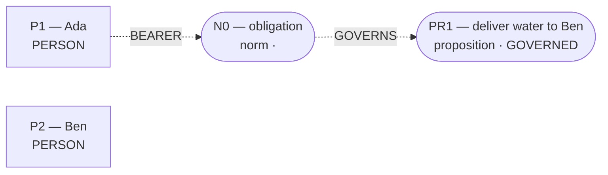

# Admitted world-state topology

Admission: **COMMITTED**  
Admitted effects: ``  
Conditions: **0**; Temporal links: **0**; Counterfactual links: **0**.

Discourse objects (not established effects):

- `PR1` (proposition): deliver water to Ben
- `N0` (norm): obligation
