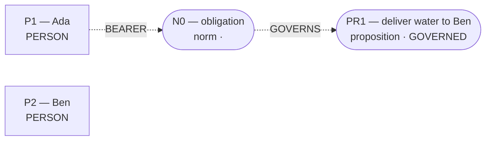
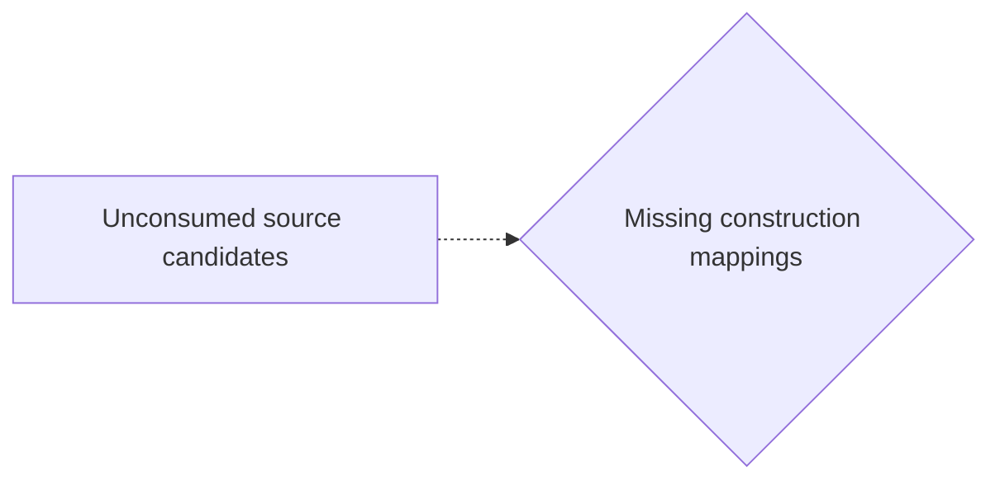

# Candidate world attempts

Chosen blueprint: **deontic_rule**  
Chooser status: **FILLED**

## 1. deontic_rule (selected; baseline)

Template status: **FILLED**  
Proposal status: **FILLED**  
Contract valid: **true**  
Missing slots: `authority`, `exception`, `sanction`

### deontic_rule candidate graph



Native admission:

```json
{
  "blueprint_id": "deontic_rule",
  "rank": 0,
  "variant": "baseline",
  "candidate_path": "/Users/benjaminkowal/Documents/Python/Python Coding/RL_Algorithms/diagnostics/discourse_visible_review/deontic_live/admission_attempts/00_deontic_rule/candidate.json",
  "overlay_path": "/Users/benjaminkowal/Documents/Python/Python Coding/RL_Algorithms/diagnostics/discourse_visible_review/deontic_live/admission_attempts/00_deontic_rule/hypothesis_overlay.json",
  "status": "ADMITTED",
  "admission": {
    "status": "COMMITTED",
    "world_model_status": "COMMITTED",
    "effects": 0,
    "causal_links": 0,
    "frozen_trace_valid": false,
    "discourse_committed": true,
    "relent_workspace": {
      "established": [],
      "not_established": [
        {
          "kind": "proposition",
          "proposition_id": "PR1",
          "predication": "deliver water to Ben",
          "status": "GOVERNED"
        },
        {
          "kind": "normative_proposition",
          "norm_id": "N0",
          "force": "obligation",
          "governed_proposition_id": "PR1",
          "status": "normative"
        }
      ],
      "duty_ledger_citations": [
        {
          "kind": "norm",
          "norm_id": "N0"
        }
      ],
      "ev_forbidden_proposition_ids": [
        "PR1"
      ],
      "factual_status_sources": [
        "occurrence_effects"
      ]
    },
    "fingerprint_sha256": null
  },
  "trace_path": "/Users/benjaminkowal/Documents/Python/Python Coding/RL_Algorithms/diagnostics/discourse_visible_review/deontic_live/admission_attempts/00_deontic_rule/frozen_world_trace.json"
}
```

Source constructions retained outside the admitted world:

Parser proposals below preserve alternatives and local scope; they do not establish occurrence or a resolved interpretation.

Unconsumed parser candidates: **6**. These are visible mapping gaps, not admission failures.



- `c0`: Which construction should preserve this PREDICATION reading?
- `c1`: Which construction should preserve this MODALITY reading?
- `c2`: Which construction should preserve this MODALITY reading?
- `c3`: Which construction should preserve this PARTICIPANT reading?
- `c4`: Which construction should preserve this PARTICIPANT reading?
- `c5`: Which construction should preserve this PARTICIPANT reading?

## 2. exclusive_allocation (alternative; baseline)

Template status: **PARTIAL**  
Proposal status: **WITHHELD**  
Contract valid: **true**  
Missing slots: `second_transfer`, `quantity`, `second_recipient`, `exclusivity`, `first_outcome`, `first_hedge`, `second_outcome`, `second_hedge`, `first_implied_process`, `second_implied_process`, `second_branch_sentence`, `survival_chance`, `nonreceipt`

World withheld:

- Required slots remain unfilled: second_recipient

Source constructions retained outside the admitted world:

Parser proposals below preserve alternatives and local scope; they do not establish occurrence or a resolved interpretation.

Unconsumed parser candidates: **6**. These are visible mapping gaps, not admission failures.


- `c0`: Which construction should preserve this PREDICATION reading?
- `c1`: Which construction should preserve this MODALITY reading?
- `c2`: Which construction should preserve this MODALITY reading?
- `c3`: Which construction should preserve this PARTICIPANT reading?
- `c4`: Which construction should preserve this PARTICIPANT reading?
- `c5`: Which construction should preserve this PARTICIPANT reading?

## 3. omission_harm (alternative; baseline)

Template status: **PARTIAL**  
Proposal status: **WITHHELD**  
Contract valid: **true**  
Missing slots: `omitted`, `harm_done`, `harm_omitted`, `done_hedge`, `omitted_hedge`, `group_counts`, `instrument`

World withheld:

- Required slots remain unfilled: omitted, harm_done, harm_omitted

Source constructions retained outside the admitted world:

Parser proposals below preserve alternatives and local scope; they do not establish occurrence or a resolved interpretation.

Unconsumed parser candidates: **6**. These are visible mapping gaps, not admission failures.


- `c0`: Which construction should preserve this PREDICATION reading?
- `c1`: Which construction should preserve this MODALITY reading?
- `c2`: Which construction should preserve this MODALITY reading?
- `c3`: Which construction should preserve this PARTICIPANT reading?
- `c4`: Which construction should preserve this PARTICIPANT reading?
- `c5`: Which construction should preserve this PARTICIPANT reading?

## 4. conditional_outcome (alternative; baseline)

Template status: **PARTIAL**  
Proposal status: **WITHHELD**  
Contract valid: **true**  
Missing slots: `condition`, `outcome`, `second_condition`, `second_bearer`, `second_outcome`, `chance`

World withheld:

- Required slots remain unfilled: condition, outcome

Source constructions retained outside the admitted world:

Parser proposals below preserve alternatives and local scope; they do not establish occurrence or a resolved interpretation.

Unconsumed parser candidates: **6**. These are visible mapping gaps, not admission failures.


- `c0`: Which construction should preserve this PREDICATION reading?
- `c1`: Which construction should preserve this MODALITY reading?
- `c2`: Which construction should preserve this MODALITY reading?
- `c3`: Which construction should preserve this PARTICIPANT reading?
- `c4`: Which construction should preserve this PARTICIPANT reading?
- `c5`: Which construction should preserve this PARTICIPANT reading?

## 5. primitive_composition (alternative; composition)

Template status: **WITHHELD**  
Proposal status: **WITHHELD**  
Contract valid: **true**  
Missing slots: none

World withheld:

- No supported conditional branch was extracted.

Source constructions retained outside the admitted world:

Parser proposals below preserve alternatives and local scope; they do not establish occurrence or a resolved interpretation.

Unconsumed parser candidates: **6**. These are visible mapping gaps, not admission failures.


- `c0`: Which construction should preserve this PREDICATION reading?
- `c1`: Which construction should preserve this MODALITY reading?
- `c2`: Which construction should preserve this MODALITY reading?
- `c3`: Which construction should preserve this PARTICIPANT reading?
- `c4`: Which construction should preserve this PARTICIPANT reading?
- `c5`: Which construction should preserve this PARTICIPANT reading?
