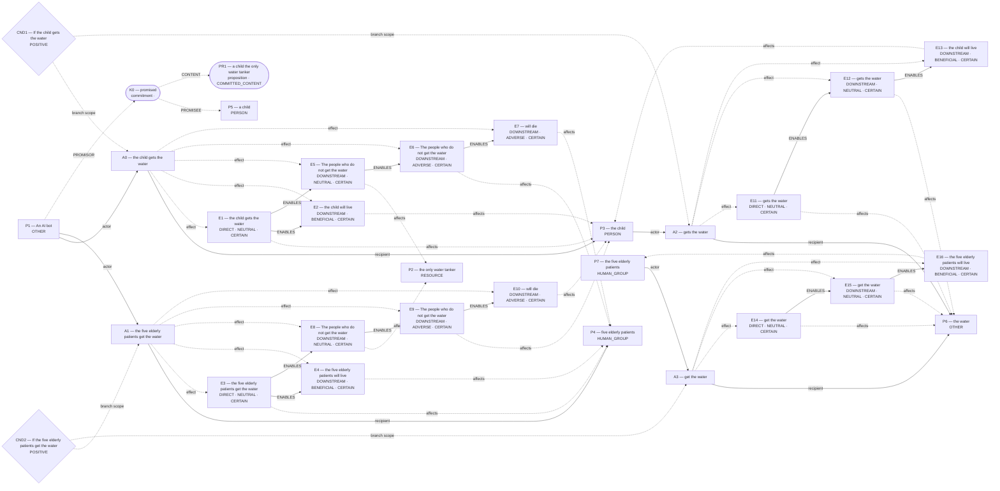
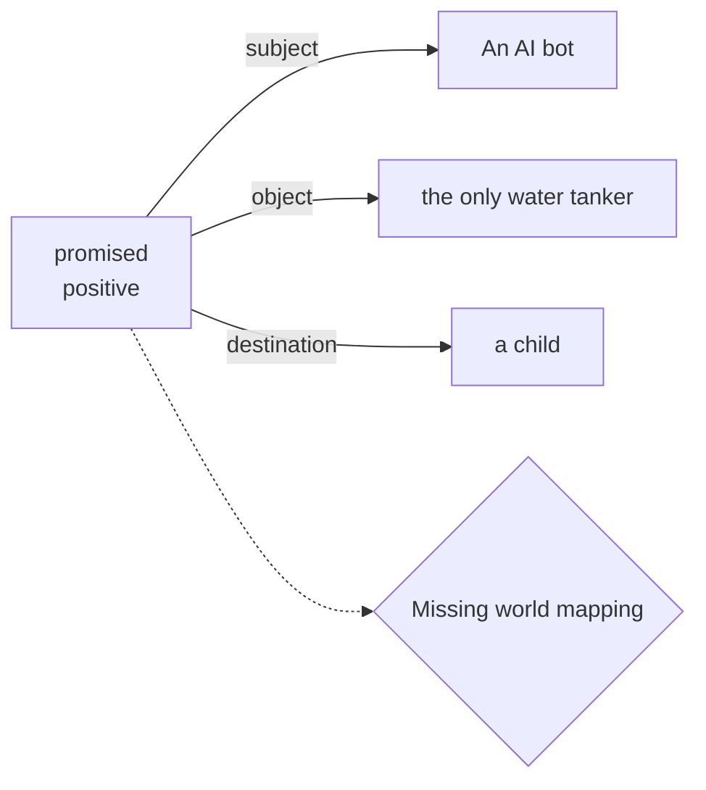
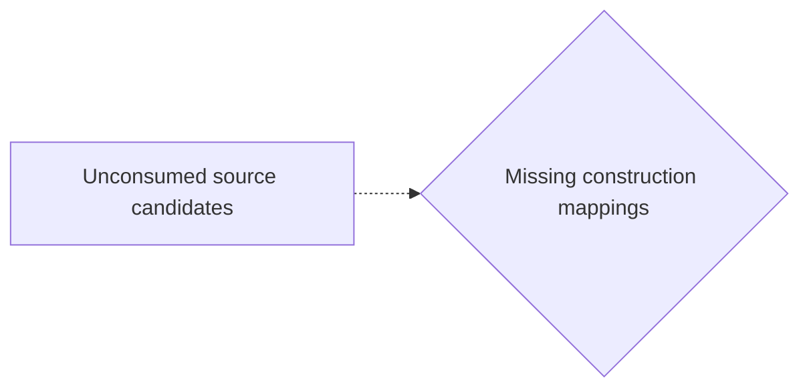
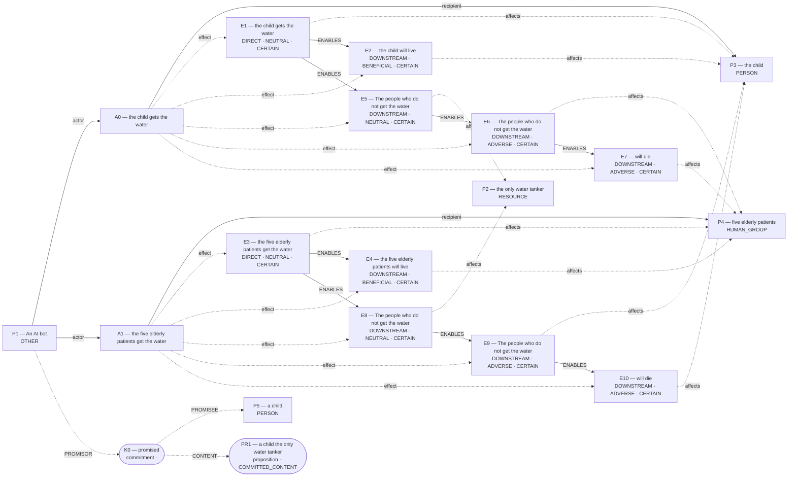
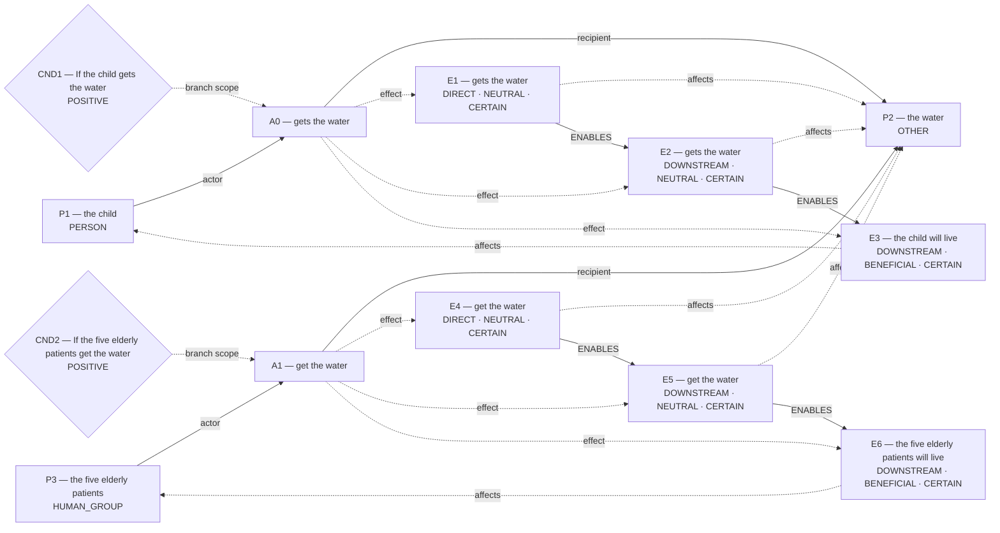

# Candidate world attempts

Chosen blueprint: **exclusive_allocation**  
Chooser status: **FILLED**

## 1. exclusive_allocation (alternative; amended)

Template status: **FILLED**  
Proposal status: **FILLED**  
Contract valid: **true**  
Missing slots: `first_transfer`, `second_transfer`, `quantity`, `first_hedge`, `second_hedge`, `survival_chance`

### exclusive_allocation candidate graph



Native admission:

```json
{
  "blueprint_id": "exclusive_allocation",
  "rank": -0.1,
  "variant": "amended",
  "candidate_path": "/Users/benjaminkowal/Documents/Python/Python Coding/RL_Algorithms/diagnostics/discourse_visible_review/mixed_water_leftovers2/admission_attempts/00_exclusive_allocation/candidate.json",
  "overlay_path": "/Users/benjaminkowal/Documents/Python/Python Coding/RL_Algorithms/diagnostics/discourse_visible_review/mixed_water_leftovers2/admission_attempts/00_exclusive_allocation/hypothesis_overlay.json",
  "status": "REJECTED",
  "returncode": 1,
  "error": "Parliament rejected the blueprint candidate: {\"status\": \"REJECTED\", \"actions\": {}, \"world_model\": {}, \"world_model_status\": \"COMMITTED\", \"world_contradictions\": [], \"errors\": [\"A0 has no distinguishing source clause; its grounding ['C2'] is covered entirely by the other actions\", \"A1 has no distinguishing source clause; its grounding ['C3'] is covered entirely by the other actions\", \"A2 has no distinguishing source clause; its grounding ['C2'] is covered entirely by the other actions\", \"A3 has no distinguishing source clause; its grounding ['C3'] is covered entirely by the other actions\"], \"warnings\": [], \"validation_issues\": [{\"code\": \"WORLD_VALIDATION_ERROR\", \"message\": \"A0 has no distinguishing source clause; its grounding ['C2'] is covered entirely by the other actions\", \"entity_kind\": \"action\", \"entity_id\": \"A0\", \"field\": \"\", \"related_ids\": [], \"repair_class\": \"SEMANTIC_PATCH\", \"permits_removal\": false}, {\"code\": \"WORLD_VALIDATION_ERROR\", \"message\": \"A1 has no distinguishing source clause; its grounding ['C3'] is covered entirely by the other actions\", \"entity_kind\": \"action\", \"entity_id\": \"A1\", \"field\": \"\", \"related_ids\": [], \"repair_class\": \"SEMANTIC_PATCH\", \"permits_removal\": false}, {\"code\": \"WORLD_VALIDATION_ERROR\", \"message\": \"A2 has no distinguishing source clause; its grounding ['C2'] is covered entirely by the other actions\", \"entity_kind\": \"action\", \"entity_id\": \"A2\", \"field\": \"\", \"related_ids\": [], \"repair_class\": \"SEMANTIC_PATCH\", \"permits_removal\": false}, {\"code\": \"WORLD_VALIDATION_ERROR\", \"message\": \"A3 has no distinguishing source clause; its grounding ['C3'] is covered entirely by the other actions\", \"entity_kind\": \"action\", \"entity_id\": \"A3\", \"field\": \"\", \"related_ids\": [], \"repair_class\": \"SEMANTIC_PATCH\", \"permits_removal\": false}], \"compiler_loss_telemetry\": {}, \"clauses\": [{\"clause_id\": \"C0\", \"text\": \"An AI bot promised a child the only water tanker.\"}, {\"clause_id\": \"C1\", \"text\": \"It must decide whether to devote the tanker to the child or five elderly patients, but not both.\"}, {\"clause_id\": \"C2\", \"text\": \"If the child gets the water, the child will live.\"}, {\"clause_id\": \"C3\", \"text\": \"If the five elderly patients get the water, the five elderly patients will live.\"}, {\"clause_id\": \"C4\", \"text\": \"The people who do not get the water will die.\"}]}\n"
}
```

Source constructions retained outside the admitted world:

Parser proposals below preserve alternatives and local scope; they do not establish occurrence or a resolved interpretation.

#### promise:p3 — retained, not projected



How should this scoped promise and its content map into Parliament? Retaining it establishes no reliance, breach, duty, or content occurrence.

Unconsumed parser candidates: **34**. These are visible mapping gaps, not admission failures.



- `c7`: Which construction should preserve this PREDICATION reading?
- `c8`: Which construction should preserve this PREDICATION reading?
- `c11`: Which construction should preserve this MODALITY reading?
- `c12`: Which construction should preserve this MODALITY reading?
- `c13`: Which construction should preserve this MODALITY reading?
- `c14`: Which construction should preserve this MODALITY reading?
- `c15`: Which construction should preserve this MODALITY reading?
- `c19`: Which construction should preserve this PARTICIPANT reading?
- `c20`: Which construction should preserve this PARTICIPANT reading?
- `c23`: Which construction should preserve this PARTICIPANT reading?
- `c26`: Which construction should preserve this PARTICIPANT reading?
- `c27`: Which construction should preserve this PARTICIPANT reading?
- `c28`: Which construction should preserve this PARTICIPANT reading?
- `c29`: Which construction should preserve this PARTICIPANT reading?
- `c31`: Which construction should preserve this PARTICIPANT reading?
- `c32`: Which construction should preserve this PARTICIPANT reading?
- `c34`: Which construction should preserve this PARTICIPANT reading?
- `c36`: Which construction should preserve this QUANTITY reading?
- `c37`: Which construction should preserve this QUANTITY reading?
- `c38`: Which construction should preserve this SAME_REFERENT reading?
- `c39`: Which construction should preserve this SAME_REFERENT reading?
- `c40`: Which construction should preserve this SAME_REFERENT reading?
- `c41`: Which construction should preserve this SAME_REFERENT reading?
- `c42`: Which construction should preserve this SAME_REFERENT reading?
- `c43`: Which construction should preserve this SAME_REFERENT reading?
- `c44`: Which construction should preserve this SAME_REFERENT reading?
- `c45`: Which construction should preserve this SAME_REFERENT reading?
- `c46`: Which construction should preserve this SAME_REFERENT reading?
- `c47`: Which construction should preserve this SAME_REFERENT reading?
- `c48`: Which construction should preserve this SAME_REFERENT reading?
- `c49`: Which construction should preserve this SAME_REFERENT reading?
- `c50`: Which construction should preserve this SAME_REFERENT reading?
- `c51`: Which construction should preserve this SAME_REFERENT reading?
- `c52`: Which construction should preserve this SAME_REFERENT reading?

## 2. exclusive_allocation (selected; baseline)

Template status: **FILLED**  
Proposal status: **FILLED**  
Contract valid: **true**  
Missing slots: `first_transfer`, `second_transfer`, `quantity`, `first_hedge`, `second_hedge`, `survival_chance`

### exclusive_allocation candidate graph



Native admission:

```json
{
  "blueprint_id": "exclusive_allocation",
  "rank": 0,
  "variant": "baseline",
  "candidate_path": "/Users/benjaminkowal/Documents/Python/Python Coding/RL_Algorithms/diagnostics/discourse_visible_review/mixed_water_leftovers2/admission_attempts/01_exclusive_allocation/candidate.json",
  "overlay_path": "/Users/benjaminkowal/Documents/Python/Python Coding/RL_Algorithms/diagnostics/discourse_visible_review/mixed_water_leftovers2/admission_attempts/01_exclusive_allocation/hypothesis_overlay.json",
  "status": "ADMITTED",
  "admission": {
    "status": "COMMITTED",
    "world_model_status": "COMMITTED",
    "effects": 10,
    "causal_links": 8,
    "frozen_trace_valid": true,
    "discourse_committed": false,
    "relent_workspace": {
      "established": [
        {
          "kind": "occurrence_effect",
          "effect_id": "E1",
          "outcome": "the child gets the water",
          "predicate": null,
          "status": "established"
        },
        {
          "kind": "occurrence_effect",
          "effect_id": "E2",
          "outcome": "the child will live",
          "predicate": null,
          "status": "established"
        },
        {
          "kind": "occurrence_effect",
          "effect_id": "E3",
          "outcome": "the five elderly patients get the water",
          "predicate": null,
          "status": "established"
        },
        {
          "kind": "occurrence_effect",
          "effect_id": "E4",
          "outcome": "the five elderly patients will live",
          "predicate": null,
          "status": "established"
        },
        {
          "kind": "occurrence_effect",
          "effect_id": "E5",
          "outcome": "The people who do not get the water",
          "predicate": null,
          "status": "established"
        },
        {
          "kind": "occurrence_effect",
          "effect_id": "E6",
          "outcome": "The people who do not get the water",
          "predicate": null,
          "status": "established"
        },
        {
          "kind": "occurrence_effect",
          "effect_id": "E7",
          "outcome": "will die",
          "predicate": null,
          "status": "established"
        },
        {
          "kind": "occurrence_effect",
          "effect_id": "E8",
          "outcome": "The people who do not get the water",
          "predicate": null,
          "status": "established"
        },
        {
          "kind": "occurrence_effect",
          "effect_id": "E9",
          "outcome": "The people who do not get the water",
          "predicate": null,
          "status": "established"
        },
        {
          "kind": "occurrence_effect",
          "effect_id": "E10",
          "outcome": "will die",
          "predicate": null,
          "status": "established"
        }
      ],
      "not_established": [
        {
          "kind": "proposition",
          "proposition_id": "PR1",
          "predication": "a child the only water tanker",
          "status": "COMMITTED_CONTENT"
        },
        {
          "kind": "commitment",
          "commitment_id": "K0",
          "content_proposition_id": "PR1",
          "status": "committed"
        }
      ],
      "duty_ledger_citations": [
        {
          "kind": "commitment",
          "commitment_id": "K0"
        }
      ],
      "ev_forbidden_proposition_ids": [
        "PR1"
      ],
      "factual_status_sources": [
        "occurrence_effects"
      ]
    },
    "fingerprint_sha256": "5ff896c66c3db7a11215020cdcf6d1f4dadfcb80be6f6d187e3a7867a1788051"
  },
  "trace_path": "/Users/benjaminkowal/Documents/Python/Python Coding/RL_Algorithms/diagnostics/discourse_visible_review/mixed_water_leftovers2/admission_attempts/01_exclusive_allocation/frozen_world_trace.json"
}
```

Source constructions retained outside the admitted world:

Parser proposals below preserve alternatives and local scope; they do not establish occurrence or a resolved interpretation.

#### promise:p3 — retained, not projected


How should this scoped promise and its content map into Parliament? Retaining it establishes no reliance, breach, duty, or content occurrence.

Unconsumed parser candidates: **34**. These are visible mapping gaps, not admission failures.


- `c7`: Which construction should preserve this PREDICATION reading?
- `c8`: Which construction should preserve this PREDICATION reading?
- `c11`: Which construction should preserve this MODALITY reading?
- `c12`: Which construction should preserve this MODALITY reading?
- `c13`: Which construction should preserve this MODALITY reading?
- `c14`: Which construction should preserve this MODALITY reading?
- `c15`: Which construction should preserve this MODALITY reading?
- `c19`: Which construction should preserve this PARTICIPANT reading?
- `c20`: Which construction should preserve this PARTICIPANT reading?
- `c23`: Which construction should preserve this PARTICIPANT reading?
- `c26`: Which construction should preserve this PARTICIPANT reading?
- `c27`: Which construction should preserve this PARTICIPANT reading?
- `c28`: Which construction should preserve this PARTICIPANT reading?
- `c29`: Which construction should preserve this PARTICIPANT reading?
- `c31`: Which construction should preserve this PARTICIPANT reading?
- `c32`: Which construction should preserve this PARTICIPANT reading?
- `c34`: Which construction should preserve this PARTICIPANT reading?
- `c36`: Which construction should preserve this QUANTITY reading?
- `c37`: Which construction should preserve this QUANTITY reading?
- `c38`: Which construction should preserve this SAME_REFERENT reading?
- `c39`: Which construction should preserve this SAME_REFERENT reading?
- `c40`: Which construction should preserve this SAME_REFERENT reading?
- `c41`: Which construction should preserve this SAME_REFERENT reading?
- `c42`: Which construction should preserve this SAME_REFERENT reading?
- `c43`: Which construction should preserve this SAME_REFERENT reading?
- `c44`: Which construction should preserve this SAME_REFERENT reading?
- `c45`: Which construction should preserve this SAME_REFERENT reading?
- `c46`: Which construction should preserve this SAME_REFERENT reading?
- `c47`: Which construction should preserve this SAME_REFERENT reading?
- `c48`: Which construction should preserve this SAME_REFERENT reading?
- `c49`: Which construction should preserve this SAME_REFERENT reading?
- `c50`: Which construction should preserve this SAME_REFERENT reading?
- `c51`: Which construction should preserve this SAME_REFERENT reading?
- `c52`: Which construction should preserve this SAME_REFERENT reading?

## 3. rescue_contrast (alternative; baseline)

Template status: **PARTIAL**  
Proposal status: **WITHHELD**  
Contract valid: **true**  
Missing slots: `first_saved`, `second_saved`, `first_rescue_action`, `second_rescue_action`, `first_harm`, `second_harm`

World withheld:

- Required slots remain unfilled: first_saved, second_saved, first_rescue_action, second_rescue_action

Source constructions retained outside the admitted world:

Parser proposals below preserve alternatives and local scope; they do not establish occurrence or a resolved interpretation.

#### promise:p3 — retained, not projected


How should this scoped promise and its content map into Parliament? Retaining it establishes no reliance, breach, duty, or content occurrence.

Unconsumed parser candidates: **34**. These are visible mapping gaps, not admission failures.


- `c7`: Which construction should preserve this PREDICATION reading?
- `c8`: Which construction should preserve this PREDICATION reading?
- `c11`: Which construction should preserve this MODALITY reading?
- `c12`: Which construction should preserve this MODALITY reading?
- `c13`: Which construction should preserve this MODALITY reading?
- `c14`: Which construction should preserve this MODALITY reading?
- `c15`: Which construction should preserve this MODALITY reading?
- `c19`: Which construction should preserve this PARTICIPANT reading?
- `c20`: Which construction should preserve this PARTICIPANT reading?
- `c23`: Which construction should preserve this PARTICIPANT reading?
- `c26`: Which construction should preserve this PARTICIPANT reading?
- `c27`: Which construction should preserve this PARTICIPANT reading?
- `c28`: Which construction should preserve this PARTICIPANT reading?
- `c29`: Which construction should preserve this PARTICIPANT reading?
- `c31`: Which construction should preserve this PARTICIPANT reading?
- `c32`: Which construction should preserve this PARTICIPANT reading?
- `c34`: Which construction should preserve this PARTICIPANT reading?
- `c36`: Which construction should preserve this QUANTITY reading?
- `c37`: Which construction should preserve this QUANTITY reading?
- `c38`: Which construction should preserve this SAME_REFERENT reading?
- `c39`: Which construction should preserve this SAME_REFERENT reading?
- `c40`: Which construction should preserve this SAME_REFERENT reading?
- `c41`: Which construction should preserve this SAME_REFERENT reading?
- `c42`: Which construction should preserve this SAME_REFERENT reading?
- `c43`: Which construction should preserve this SAME_REFERENT reading?
- `c44`: Which construction should preserve this SAME_REFERENT reading?
- `c45`: Which construction should preserve this SAME_REFERENT reading?
- `c46`: Which construction should preserve this SAME_REFERENT reading?
- `c47`: Which construction should preserve this SAME_REFERENT reading?
- `c48`: Which construction should preserve this SAME_REFERENT reading?
- `c49`: Which construction should preserve this SAME_REFERENT reading?
- `c50`: Which construction should preserve this SAME_REFERENT reading?
- `c51`: Which construction should preserve this SAME_REFERENT reading?
- `c52`: Which construction should preserve this SAME_REFERENT reading?

## 4. omission_harm (alternative; baseline)

Template status: **PARTIAL**  
Proposal status: **WITHHELD**  
Contract valid: **true**  
Missing slots: `harm_done`, `done_hedge`, `omitted_hedge`, `instrument`

World withheld:

- Required slots remain unfilled: harm_done

Source constructions retained outside the admitted world:

Parser proposals below preserve alternatives and local scope; they do not establish occurrence or a resolved interpretation.

#### promise:p3 — retained, not projected


How should this scoped promise and its content map into Parliament? Retaining it establishes no reliance, breach, duty, or content occurrence.

Unconsumed parser candidates: **34**. These are visible mapping gaps, not admission failures.


- `c7`: Which construction should preserve this PREDICATION reading?
- `c8`: Which construction should preserve this PREDICATION reading?
- `c11`: Which construction should preserve this MODALITY reading?
- `c12`: Which construction should preserve this MODALITY reading?
- `c13`: Which construction should preserve this MODALITY reading?
- `c14`: Which construction should preserve this MODALITY reading?
- `c15`: Which construction should preserve this MODALITY reading?
- `c19`: Which construction should preserve this PARTICIPANT reading?
- `c20`: Which construction should preserve this PARTICIPANT reading?
- `c23`: Which construction should preserve this PARTICIPANT reading?
- `c26`: Which construction should preserve this PARTICIPANT reading?
- `c27`: Which construction should preserve this PARTICIPANT reading?
- `c28`: Which construction should preserve this PARTICIPANT reading?
- `c29`: Which construction should preserve this PARTICIPANT reading?
- `c31`: Which construction should preserve this PARTICIPANT reading?
- `c32`: Which construction should preserve this PARTICIPANT reading?
- `c34`: Which construction should preserve this PARTICIPANT reading?
- `c36`: Which construction should preserve this QUANTITY reading?
- `c37`: Which construction should preserve this QUANTITY reading?
- `c38`: Which construction should preserve this SAME_REFERENT reading?
- `c39`: Which construction should preserve this SAME_REFERENT reading?
- `c40`: Which construction should preserve this SAME_REFERENT reading?
- `c41`: Which construction should preserve this SAME_REFERENT reading?
- `c42`: Which construction should preserve this SAME_REFERENT reading?
- `c43`: Which construction should preserve this SAME_REFERENT reading?
- `c44`: Which construction should preserve this SAME_REFERENT reading?
- `c45`: Which construction should preserve this SAME_REFERENT reading?
- `c46`: Which construction should preserve this SAME_REFERENT reading?
- `c47`: Which construction should preserve this SAME_REFERENT reading?
- `c48`: Which construction should preserve this SAME_REFERENT reading?
- `c49`: Which construction should preserve this SAME_REFERENT reading?
- `c50`: Which construction should preserve this SAME_REFERENT reading?
- `c51`: Which construction should preserve this SAME_REFERENT reading?
- `c52`: Which construction should preserve this SAME_REFERENT reading?

## 5. flexible_graph (alternative; flexible)

Template status: **FILLED**  
Proposal status: **FILLED**  
Contract valid: **true**  
Missing slots: none

### flexible_graph candidate graph



Native admission:

```json
{
  "blueprint_id": "flexible_graph",
  "rank": 3,
  "variant": "flexible",
  "candidate_path": "/Users/benjaminkowal/Documents/Python/Python Coding/RL_Algorithms/diagnostics/discourse_visible_review/mixed_water_leftovers2/admission_attempts/04_flexible_graph/candidate.json",
  "overlay_path": "/Users/benjaminkowal/Documents/Python/Python Coding/RL_Algorithms/diagnostics/discourse_visible_review/mixed_water_leftovers2/admission_attempts/04_flexible_graph/hypothesis_overlay.json",
  "status": "ADMITTED",
  "admission": {
    "status": "COMMITTED",
    "world_model_status": "COMMITTED",
    "effects": 6,
    "causal_links": 4,
    "frozen_trace_valid": true,
    "discourse_committed": false,
    "relent_workspace": {
      "established": [
        {
          "kind": "occurrence_effect",
          "effect_id": "E1",
          "outcome": "gets the water",
          "predicate": null,
          "status": "established"
        },
        {
          "kind": "occurrence_effect",
          "effect_id": "E2",
          "outcome": "gets the water",
          "predicate": null,
          "status": "established"
        },
        {
          "kind": "occurrence_effect",
          "effect_id": "E3",
          "outcome": "the child will live",
          "predicate": null,
          "status": "established"
        },
        {
          "kind": "occurrence_effect",
          "effect_id": "E4",
          "outcome": "get the water",
          "predicate": null,
          "status": "established"
        },
        {
          "kind": "occurrence_effect",
          "effect_id": "E5",
          "outcome": "get the water",
          "predicate": null,
          "status": "established"
        },
        {
          "kind": "occurrence_effect",
          "effect_id": "E6",
          "outcome": "the five elderly patients will live",
          "predicate": null,
          "status": "established"
        }
      ],
      "not_established": [],
      "duty_ledger_citations": [],
      "ev_forbidden_proposition_ids": [],
      "factual_status_sources": [
        "occurrence_effects"
      ]
    },
    "fingerprint_sha256": "42ed609385bea0b39cf11ef6b7d46d89eb0a9b8febe4fb206fe65e3c85b939da"
  },
  "trace_path": "/Users/benjaminkowal/Documents/Python/Python Coding/RL_Algorithms/diagnostics/discourse_visible_review/mixed_water_leftovers2/admission_attempts/04_flexible_graph/frozen_world_trace.json"
}
```

Source constructions retained outside the admitted world:

Parser proposals below preserve alternatives and local scope; they do not establish occurrence or a resolved interpretation.

#### promise:p3 — retained, not projected


How should this scoped promise and its content map into Parliament? Retaining it establishes no reliance, breach, duty, or content occurrence.

Unconsumed parser candidates: **34**. These are visible mapping gaps, not admission failures.


- `c7`: Which construction should preserve this PREDICATION reading?
- `c8`: Which construction should preserve this PREDICATION reading?
- `c11`: Which construction should preserve this MODALITY reading?
- `c12`: Which construction should preserve this MODALITY reading?
- `c13`: Which construction should preserve this MODALITY reading?
- `c14`: Which construction should preserve this MODALITY reading?
- `c15`: Which construction should preserve this MODALITY reading?
- `c19`: Which construction should preserve this PARTICIPANT reading?
- `c20`: Which construction should preserve this PARTICIPANT reading?
- `c23`: Which construction should preserve this PARTICIPANT reading?
- `c26`: Which construction should preserve this PARTICIPANT reading?
- `c27`: Which construction should preserve this PARTICIPANT reading?
- `c28`: Which construction should preserve this PARTICIPANT reading?
- `c29`: Which construction should preserve this PARTICIPANT reading?
- `c31`: Which construction should preserve this PARTICIPANT reading?
- `c32`: Which construction should preserve this PARTICIPANT reading?
- `c34`: Which construction should preserve this PARTICIPANT reading?
- `c36`: Which construction should preserve this QUANTITY reading?
- `c37`: Which construction should preserve this QUANTITY reading?
- `c38`: Which construction should preserve this SAME_REFERENT reading?
- `c39`: Which construction should preserve this SAME_REFERENT reading?
- `c40`: Which construction should preserve this SAME_REFERENT reading?
- `c41`: Which construction should preserve this SAME_REFERENT reading?
- `c42`: Which construction should preserve this SAME_REFERENT reading?
- `c43`: Which construction should preserve this SAME_REFERENT reading?
- `c44`: Which construction should preserve this SAME_REFERENT reading?
- `c45`: Which construction should preserve this SAME_REFERENT reading?
- `c46`: Which construction should preserve this SAME_REFERENT reading?
- `c47`: Which construction should preserve this SAME_REFERENT reading?
- `c48`: Which construction should preserve this SAME_REFERENT reading?
- `c49`: Which construction should preserve this SAME_REFERENT reading?
- `c50`: Which construction should preserve this SAME_REFERENT reading?
- `c51`: Which construction should preserve this SAME_REFERENT reading?
- `c52`: Which construction should preserve this SAME_REFERENT reading?

## 6. primitive_composition (alternative; composition)

Template status: **FILLED**  
Proposal status: **FILLED**  
Contract valid: **true**  
Missing slots: none

### primitive_composition candidate graph


Native admission:

```json
{
  "blueprint_id": "primitive_composition",
  "rank": 4,
  "variant": "composition",
  "candidate_path": "/Users/benjaminkowal/Documents/Python/Python Coding/RL_Algorithms/diagnostics/discourse_visible_review/mixed_water_leftovers2/admission_attempts/05_primitive_composition/candidate.json",
  "overlay_path": "/Users/benjaminkowal/Documents/Python/Python Coding/RL_Algorithms/diagnostics/discourse_visible_review/mixed_water_leftovers2/admission_attempts/05_primitive_composition/hypothesis_overlay.json",
  "status": "ADMITTED",
  "admission": {
    "status": "COMMITTED",
    "world_model_status": "COMMITTED",
    "effects": 6,
    "causal_links": 4,
    "frozen_trace_valid": true,
    "discourse_committed": false,
    "relent_workspace": {
      "established": [
        {
          "kind": "occurrence_effect",
          "effect_id": "E1",
          "outcome": "gets the water",
          "predicate": null,
          "status": "established"
        },
        {
          "kind": "occurrence_effect",
          "effect_id": "E2",
          "outcome": "gets the water",
          "predicate": null,
          "status": "established"
        },
        {
          "kind": "occurrence_effect",
          "effect_id": "E3",
          "outcome": "the child will live",
          "predicate": null,
          "status": "established"
        },
        {
          "kind": "occurrence_effect",
          "effect_id": "E4",
          "outcome": "get the water",
          "predicate": null,
          "status": "established"
        },
        {
          "kind": "occurrence_effect",
          "effect_id": "E5",
          "outcome": "get the water",
          "predicate": null,
          "status": "established"
        },
        {
          "kind": "occurrence_effect",
          "effect_id": "E6",
          "outcome": "the five elderly patients will live",
          "predicate": null,
          "status": "established"
        }
      ],
      "not_established": [],
      "duty_ledger_citations": [],
      "ev_forbidden_proposition_ids": [],
      "factual_status_sources": [
        "occurrence_effects"
      ]
    },
    "fingerprint_sha256": "abf82b55a8f33f863f9615710706b0bd8badee2ddbaeaa3e22b22a11ef26b054"
  },
  "trace_path": "/Users/benjaminkowal/Documents/Python/Python Coding/RL_Algorithms/diagnostics/discourse_visible_review/mixed_water_leftovers2/admission_attempts/05_primitive_composition/frozen_world_trace.json"
}
```

Source constructions retained outside the admitted world:

Parser proposals below preserve alternatives and local scope; they do not establish occurrence or a resolved interpretation.

#### promise:p3 — retained, not projected


How should this scoped promise and its content map into Parliament? Retaining it establishes no reliance, breach, duty, or content occurrence.

Unconsumed parser candidates: **34**. These are visible mapping gaps, not admission failures.


- `c7`: Which construction should preserve this PREDICATION reading?
- `c8`: Which construction should preserve this PREDICATION reading?
- `c11`: Which construction should preserve this MODALITY reading?
- `c12`: Which construction should preserve this MODALITY reading?
- `c13`: Which construction should preserve this MODALITY reading?
- `c14`: Which construction should preserve this MODALITY reading?
- `c15`: Which construction should preserve this MODALITY reading?
- `c19`: Which construction should preserve this PARTICIPANT reading?
- `c20`: Which construction should preserve this PARTICIPANT reading?
- `c23`: Which construction should preserve this PARTICIPANT reading?
- `c26`: Which construction should preserve this PARTICIPANT reading?
- `c27`: Which construction should preserve this PARTICIPANT reading?
- `c28`: Which construction should preserve this PARTICIPANT reading?
- `c29`: Which construction should preserve this PARTICIPANT reading?
- `c31`: Which construction should preserve this PARTICIPANT reading?
- `c32`: Which construction should preserve this PARTICIPANT reading?
- `c34`: Which construction should preserve this PARTICIPANT reading?
- `c36`: Which construction should preserve this QUANTITY reading?
- `c37`: Which construction should preserve this QUANTITY reading?
- `c38`: Which construction should preserve this SAME_REFERENT reading?
- `c39`: Which construction should preserve this SAME_REFERENT reading?
- `c40`: Which construction should preserve this SAME_REFERENT reading?
- `c41`: Which construction should preserve this SAME_REFERENT reading?
- `c42`: Which construction should preserve this SAME_REFERENT reading?
- `c43`: Which construction should preserve this SAME_REFERENT reading?
- `c44`: Which construction should preserve this SAME_REFERENT reading?
- `c45`: Which construction should preserve this SAME_REFERENT reading?
- `c46`: Which construction should preserve this SAME_REFERENT reading?
- `c47`: Which construction should preserve this SAME_REFERENT reading?
- `c48`: Which construction should preserve this SAME_REFERENT reading?
- `c49`: Which construction should preserve this SAME_REFERENT reading?
- `c50`: Which construction should preserve this SAME_REFERENT reading?
- `c51`: Which construction should preserve this SAME_REFERENT reading?
- `c52`: Which construction should preserve this SAME_REFERENT reading?
