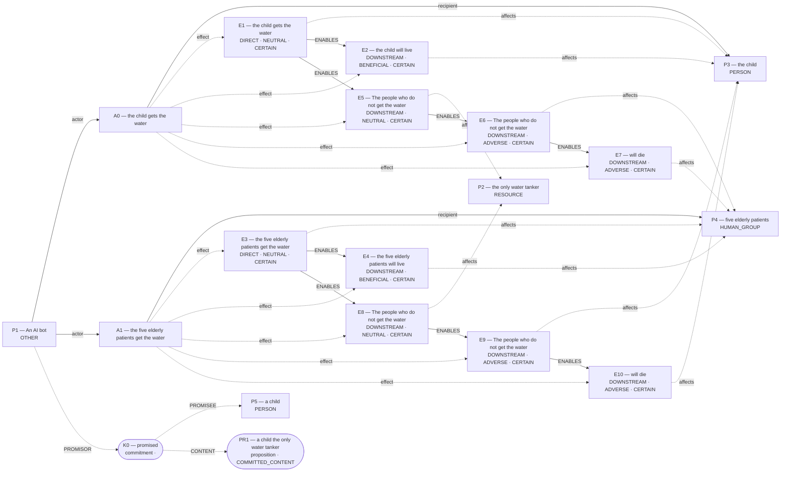

# Admitted world-state topology

Admission: **COMMITTED**  
Admitted effects: `E1, E2, E3, E4, E5, E6, E7, E8, E9, E10`  
Conditions: **0**; Temporal links: **0**; Counterfactual links: **0**.

Discourse objects (not established effects):

- `PR1` (proposition): a child the only water tanker
- `K0` (commitment): promised
