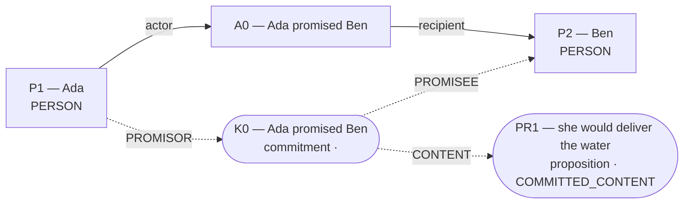
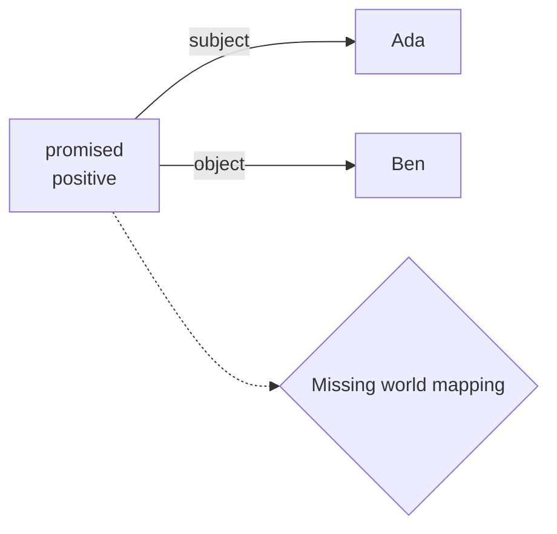
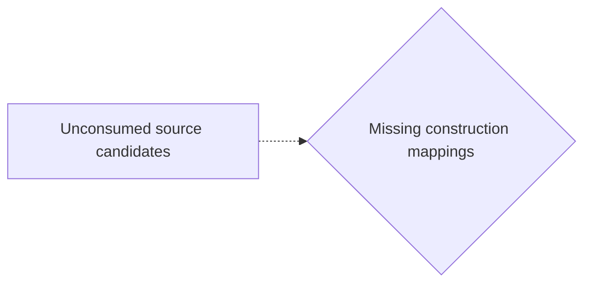

# Candidate world attempts

Chosen blueprint: **promise_reliance**  
Chooser status: **FILLED**

## 1. promise_reliance (selected; baseline)

Template status: **FILLED**  
Proposal status: **FILLED**  
Contract valid: **true**  
Missing slots: `reliance`, `breach`

### promise_reliance candidate graph



Native admission:

```json
{
  "blueprint_id": "promise_reliance",
  "rank": 0,
  "variant": "baseline",
  "candidate_path": "/Users/benjaminkowal/Documents/Python/Python Coding/RL_Algorithms/diagnostics/discourse_visible_review/promise/admission_attempts/00_promise_reliance/candidate.json",
  "overlay_path": "/Users/benjaminkowal/Documents/Python/Python Coding/RL_Algorithms/diagnostics/discourse_visible_review/promise/admission_attempts/00_promise_reliance/hypothesis_overlay.json",
  "status": "ADMITTED",
  "admission": {
    "status": "COMMITTED",
    "world_model_status": "COMMITTED",
    "effects": 0,
    "causal_links": 0,
    "frozen_trace_valid": false,
    "discourse_committed": true,
    "relent_workspace": {
      "established": [],
      "not_established": [
        {
          "kind": "proposition",
          "proposition_id": "PR1",
          "predication": "she would deliver the water",
          "status": "COMMITTED_CONTENT"
        },
        {
          "kind": "commitment",
          "commitment_id": "K0",
          "content_proposition_id": "PR1",
          "status": "committed"
        }
      ],
      "duty_ledger_citations": [
        {
          "kind": "commitment",
          "commitment_id": "K0"
        }
      ],
      "ev_forbidden_proposition_ids": [
        "PR1"
      ],
      "factual_status_sources": [
        "occurrence_effects"
      ]
    },
    "fingerprint_sha256": null
  },
  "trace_path": "/Users/benjaminkowal/Documents/Python/Python Coding/RL_Algorithms/diagnostics/discourse_visible_review/promise/admission_attempts/00_promise_reliance/frozen_world_trace.json"
}
```

Source constructions retained outside the admitted world:

Parser proposals below preserve alternatives and local scope; they do not establish occurrence or a resolved interpretation.

#### promise:p1 — retained, not projected



How should this scoped promise and its content map into Parliament? Retaining it establishes no reliance, breach, duty, or content occurrence.

Unconsumed parser candidates: **7**. These are visible mapping gaps, not admission failures.



- `c1`: Which construction should preserve this PREDICATION reading?
- `c2`: Which construction should preserve this MODALITY reading?
- `c3`: Which construction should preserve this MODALITY reading?
- `c6`: Which construction should preserve this PARTICIPANT reading?
- `c7`: Which construction should preserve this PARTICIPANT reading?
- `c8`: Which construction should preserve this SAME_REFERENT reading?
- `c9`: Which construction should preserve this SAME_REFERENT reading?

## 2. none (alternative; baseline)

Template status: **FILLED**  
Proposal status: **WITHHELD**  
Contract valid: **true**  
Missing slots: none

World withheld:

- No listed blueprint is supported by the scenario.

Source constructions retained outside the admitted world:

Parser proposals below preserve alternatives and local scope; they do not establish occurrence or a resolved interpretation.

#### promise:p1 — retained, not projected


How should this scoped promise and its content map into Parliament? Retaining it establishes no reliance, breach, duty, or content occurrence.

Unconsumed parser candidates: **7**. These are visible mapping gaps, not admission failures.


- `c1`: Which construction should preserve this PREDICATION reading?
- `c2`: Which construction should preserve this MODALITY reading?
- `c3`: Which construction should preserve this MODALITY reading?
- `c6`: Which construction should preserve this PARTICIPANT reading?
- `c7`: Which construction should preserve this PARTICIPANT reading?
- `c8`: Which construction should preserve this SAME_REFERENT reading?
- `c9`: Which construction should preserve this SAME_REFERENT reading?

## 3. exclusive_allocation (alternative; baseline)

Template status: **PARTIAL**  
Proposal status: **WITHHELD**  
Contract valid: **true**  
Missing slots: `second_transfer`, `quantity`, `second_recipient`, `exclusivity`, `first_outcome`, `first_hedge`, `second_outcome`, `second_hedge`, `first_implied_process`, `second_implied_process`, `second_branch_sentence`, `survival_chance`, `nonreceipt`

World withheld:

- Required slots remain unfilled: second_recipient

Source constructions retained outside the admitted world:

Parser proposals below preserve alternatives and local scope; they do not establish occurrence or a resolved interpretation.

#### promise:p1 — retained, not projected


How should this scoped promise and its content map into Parliament? Retaining it establishes no reliance, breach, duty, or content occurrence.

Unconsumed parser candidates: **7**. These are visible mapping gaps, not admission failures.


- `c1`: Which construction should preserve this PREDICATION reading?
- `c2`: Which construction should preserve this MODALITY reading?
- `c3`: Which construction should preserve this MODALITY reading?
- `c6`: Which construction should preserve this PARTICIPANT reading?
- `c7`: Which construction should preserve this PARTICIPANT reading?
- `c8`: Which construction should preserve this SAME_REFERENT reading?
- `c9`: Which construction should preserve this SAME_REFERENT reading?

## 4. primitive_composition (alternative; composition)

Template status: **WITHHELD**  
Proposal status: **WITHHELD**  
Contract valid: **true**  
Missing slots: none

World withheld:

- No supported conditional branch was extracted.

Source constructions retained outside the admitted world:

Parser proposals below preserve alternatives and local scope; they do not establish occurrence or a resolved interpretation.

#### promise:p1 — retained, not projected


How should this scoped promise and its content map into Parliament? Retaining it establishes no reliance, breach, duty, or content occurrence.

Unconsumed parser candidates: **7**. These are visible mapping gaps, not admission failures.


- `c1`: Which construction should preserve this PREDICATION reading?
- `c2`: Which construction should preserve this MODALITY reading?
- `c3`: Which construction should preserve this MODALITY reading?
- `c6`: Which construction should preserve this PARTICIPANT reading?
- `c7`: Which construction should preserve this PARTICIPANT reading?
- `c8`: Which construction should preserve this SAME_REFERENT reading?
- `c9`: Which construction should preserve this SAME_REFERENT reading?
