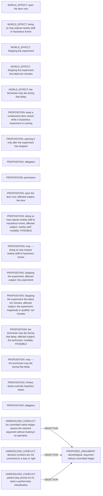

# Logic_Puzzles claim/conflict projection

Read-only projection. Native records remain attributed; evidence links do not establish whole-record correctness.

Proposed review queue (at most two issues):

- No committed native ledger; assess the retained argument without treating it as operative.
- decisive numbers are not connected to a duty or right
