# Logic_Puzzles claim/conflict projection

Read-only projection. Native records remain attributed; evidence links do not establish whole-record correctness.

```mermaid
flowchart LR
    n0["WORLD_EFFECT: If Ada gives the medicine to Ben,"]
    n1["WORLD_EFFECT: Ben has a 95% chance of survival"]
    n2["WORLD_EFFECT: If Ada gives the medicine to Cara,"]
    n3["WORLD_EFFECT: Cara has a 5% chance of survival"]
    n4["WORLD_EFFECT: does not receive one dose of medicine"]
    n5["WORLD_EFFECT: does not receive one dose of medicine"]
    n6["WORLD_EFFECT: will die"]
    n7["WORLD_EFFECT: will die"]
    n8["PROPOSITION: If Ada gives the medicine to Ben,; affected subject: Ben"]
    n9["PROPOSITION: Ben has a 95% chance of survival; affected subject: Ben; modality: PROBABILISTIC"]
    n10["PROPOSITION: 95% chance — Ben has a 95% chance of survival"]
    n11["PROPOSITION: If Ada gives the medicine to Cara,; affected subject: Cara"]
    n12["PROPOSITION: Cara has a 5% chance of survival; affected subject: Cara; modality: PROBABILISTIC"]
    n13["PROPOSITION: 5% chance — Cara has a 5% chance of survival"]
    n14["PROPOSITION: does not receive one dose of medicine; affected subject: Cara; magnitude or qualifier: one"]
    n15["PROPOSITION: does not receive one dose of medicine; affected subject: Ben; magnitude or qualifier: one"]
    n16["PROPOSITION: will die; affected subject: Cara"]
    n17["PROPOSITION: will die; affected subject: Ben"]
    n18["PROPOSITION: A clinic has one dose of medicine."]
    n19["PROPOSITION: Ada can give the medicine to Ben or Cara, but not both."]
    n20["PROPOSITION: The patient who does not get the medicine will die."]
    n21["PROPOSITION: If Ada gives the medicine to Ben, Ben has a 95% chance of survival."]
    n22["PROPOSITION: If Ada gives the medicine to Cara, Cara has a 5% chance of survival."]
    n23["PROPOSITION: Ben has a 95% chance of survival; affected subject: Ben; modality: PROBABILISTIC"]
    n24["PROPOSITION: Cara has a 5% chance of survival; affected subject: Cara; modality: PROBABILISTIC"]
    n25["PROPOSITION: Ada can give the medicine to Ben or Cara, but not both."]
```

Proposed review queue (at most two issues):

