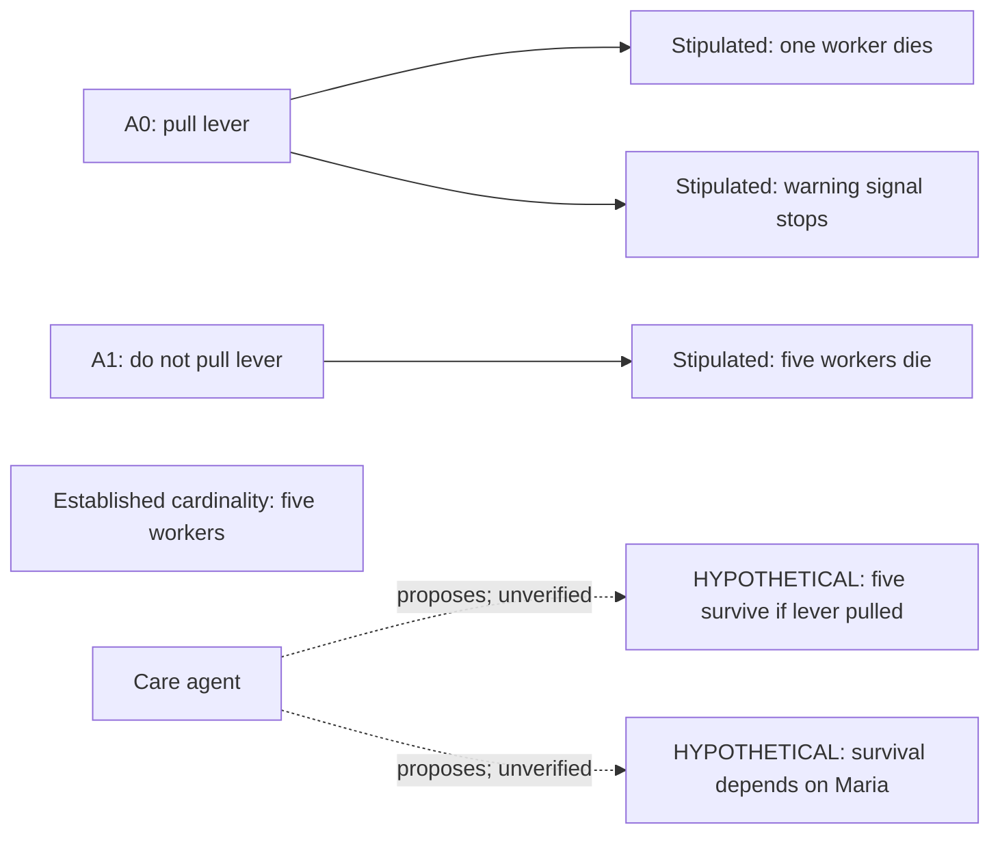

# Bounded live containment probe and quantity binding fix

Two cycles of o3 with Care and Deontology consumed the existing frozen, admitted
lever composition. The world remained COMMITTED and exactly equal to the frozen
input; there were zero world-generation calls. Judgment remained UNRESOLVED.
Care generated DEPENDENCY rather than ENTRUSTED, so this live run does not verify
live entrustment extraction or cross-agent adoption.

The audit found an unsupported survival outcome in both cycles and an unsupported
causal dependency in cycle two. Although the audit requested NEW_HYPOTHESIS,
the binder mapped them to the established "five workers" quantity atom. Its
semantic matcher borrowed action context from the effect that seeded that atom.
This was a general binding error, not a wrong E-number patched for this scenario.

The fix prevents party-cardinality atoms from licensing outcome or relationship
claims. It applies to semantic resolution, aliases/component resolution, and
explicit quantity IDs supplied by an audit. Canonical quantity copies and valid
world-effect bindings still work. Other proposition matching is unchanged.
This does not introduce a world-admission restriction or remove an agent's view.

The saved model audit findings were replayed after the fix. Survival and dependency
are now HYPOTHETICAL records with Care as origin. The repeated survival finding
reuses its hypothesis ID without promotion. Canonical quantity records, their
aliases and evidence, admitted world records, and the semantic graph remain intact.
See audit_replay.json. This is a deterministic verification of actual model output,
not a second live run and not evidence that every unsupported premise is detected.

Workspace regressions: 84 tests, 79 passed and 5 skipped. Native ledger/binding
regressions: 34 passed; one existing transparent-conjunction binding test failed.
The same failure reproduced with this increment removed: a multi-effect conjunction
is bound as ESTABLISHED instead of DERIVED. It remains a separate known issue.
The integration patch applies cleanly to the pinned Parliament HEAD.

## Hypothesis separation after replay

The hypothesis nodes belong to the deliberative proposition ledger; they are not
added to the admitted world. This diagram summarizes relevant effects, rather
than displaying the entire seven-effect world graph. The live trace retains the
pre-fix bindings unchanged for inspection.
